# Compose performance

Latest: `4175feb44092ca8c9fbd3a648e51c219956d0974` on 2026-11-07T000703Z, measured on the CI Ubuntu runner by the paired performance shards.
Each value is the median of the candidate arm's samples; p95 is shown beside it. Change compares the previous main commit.

| Benchmark | Median | p95 | Change |
| --- | --- | --- | --- |
| animate-many/compose | 6.85 ms | 6.99 ms | +77.0% |
| animate-many/memory/mounted | 2208 KiB | 2208 KiB | +0.7% |
| animate-many/memory/teardown | 1 KiB | 1 KiB | +0.0% |
| animate-many/plain | 1.64 ms | 1.72 ms | +39.4% |
| animated-navigation.extreme/compose/burst | 8.05 ms | 8.51 ms | +13.8% |
| animated-navigation.extreme/compose/cold | 11.61 ms | 15.78 ms | +10.2% |
| animated-navigation.extreme/compose/counts | 84.39 ms | 84.39 ms | +28.3% |
| animated-navigation.extreme/compose/settle | 1.1 µs | 1.6 µs | -23.4% |
| animated-navigation.extreme/compose/steady | 33.17 ms | 35.38 ms | +45.7% |
| animated-navigation.extreme/compose/teardown | 2.90 ms | 3.94 ms | +22.4% |
| animated-navigation.extreme/memory/mounted | 6871 KiB | 6871 KiB | -0.1% |
| animated-navigation.extreme/memory/teardown | 1 KiB | 1 KiB | +0.0% |
| animated-navigation.extreme/plain/burst | 1.44 ms | 1.56 ms | +43.7% |
| animated-navigation.extreme/plain/cold | 5.11 ms | 9.11 ms | +22.1% |
| animated-navigation.extreme/plain/settle | 1.1 µs | 1.7 µs | +59.5% |
| animated-navigation.extreme/plain/steady | 19.30 ms | 19.66 ms | +43.8% |
| animated-navigation.extreme/plain/teardown | 3.78 ms | 5.04 ms | +4.1% |
| animated-navigation.large/compose/burst | 1.85 ms | 1.99 ms | -44.1% |
| animated-navigation.large/compose/cold | 4.15 ms | 5.50 ms | -28.2% |
| animated-navigation.large/compose/counts | 28.96 ms | 28.96 ms | -41.2% |
| animated-navigation.large/compose/settle | 0.8 µs | 1.0 µs | -53.5% |
| animated-navigation.large/compose/steady | 12.10 ms | 12.72 ms | -45.3% |
| animated-navigation.large/compose/teardown | 640.8 µs | 1.34 ms | -58.1% |
| animated-navigation.large/memory/mounted | 3451 KiB | 3451 KiB | +0.0% |
| animated-navigation.large/memory/teardown | 0 KiB | 0 KiB | -100.0% |
| animated-navigation.large/plain/burst | 335.8 µs | 369.8 µs | -31.4% |
| animated-navigation.large/plain/cold | 1.34 ms | 3.12 ms | -51.1% |
| animated-navigation.large/plain/settle | 0.3 µs | 7.4 µs | -68.9% |
| animated-navigation.large/plain/steady | 4.52 ms | 4.61 ms | -28.4% |
| animated-navigation.large/plain/teardown | 727.7 µs | 902.5 µs | -43.0% |
| animated-navigation.medium/compose/burst | 1.32 ms | 1.45 ms | +127.7% |
| animated-navigation.medium/compose/cold | 1.65 ms | 3.26 ms | +131.7% |
| animated-navigation.medium/compose/counts | 22.48 ms | 22.48 ms | +114.1% |
| animated-navigation.medium/compose/settle | 0.7 µs | 1.9 µs | +103.4% |
| animated-navigation.medium/compose/steady | 10.45 ms | 10.82 ms | +127.2% |
| animated-navigation.medium/compose/teardown | 395.0 µs | 609.8 µs | +133.0% |
| animated-navigation.medium/memory/mounted | 1167 KiB | 1167 KiB | +0.7% |
| animated-navigation.medium/memory/teardown | 9 KiB | 9 KiB | +0.0% |
| animated-navigation.medium/plain/burst | 228.0 µs | 309.8 µs | +87.6% |
| animated-navigation.medium/plain/cold | 686.7 µs | 1.62 ms | +35.1% |
| animated-navigation.medium/plain/settle | 0.5 µs | 0.8 µs | +80.5% |
| animated-navigation.medium/plain/steady | 2.62 ms | 2.73 ms | +67.6% |
| animated-navigation.medium/plain/teardown | 211.7 µs | 402.0 µs | +83.2% |
| branch-swap/compose | 4.17 ms | 6.23 ms | -5.0% |
| branch-swap/memory/mounted | 23 KiB | 23 KiB | +53.3% |
| branch-swap/memory/teardown | 0 KiB | 0 KiB | — |
| branch-swap/plain | 3.00 ms | 4.25 ms | -3.2% |
| cold-mount-100/compose | 718.7 µs | 797.9 µs | -4.7% |
| cold-mount-100/memory/mounted | 2244 KiB | 2244 KiB | -0.4% |
| cold-mount-100/memory/teardown | 0 KiB | 0 KiB | — |
| cold-mount-100/plain | 698.5 µs | 1.13 ms | -10.1% |
| cold-mount-1000/compose | 3.46 ms | 5.00 ms | -24.1% |
| cold-mount-1000/memory/mounted | 22086 KiB | 22086 KiB | +0.0% |
| cold-mount-1000/memory/teardown | 8 KiB | 8 KiB | — |
| cold-mount-1000/plain | 3.49 ms | 6.17 ms | -22.8% |
| cold-mount-10000/compose | 63.21 ms | 107.63 ms | -23.2% |
| cold-mount-10000/memory/mounted | 222924 KiB | 222924 KiB | -0.0% |
| cold-mount-10000/memory/teardown | 1 KiB | 1 KiB | +0.0% |
| cold-mount-10000/plain | 84.35 ms | 93.06 ms | +23.0% |
| data-grid.extreme/compose/burst | 895.26 ms | 920.64 ms | +99.1% |
| data-grid.extreme/compose/cold | 531.50 ms | 573.20 ms | +86.9% |
| data-grid.extreme/compose/counts | 1377.68 ms | 1377.68 ms | +75.4% |
| data-grid.extreme/compose/settle | 2.2 µs | 2.8 µs | -1.7% |
| data-grid.extreme/compose/steady | 22.36 ms | 27.36 ms | +100.5% |
| data-grid.extreme/compose/teardown | 1.22 ms | 1.75 ms | +46.6% |
| data-grid.extreme/memory/mounted | 29244 KiB | 29244 KiB | +0.0% |
| data-grid.extreme/memory/teardown | 8 KiB | 8 KiB | +0.0% |
| data-grid.extreme/plain/burst | 774.13 ms | 833.03 ms | +92.7% |
| data-grid.extreme/plain/cold | 500.62 ms | 538.36 ms | +90.8% |
| data-grid.extreme/plain/settle | 2.3 µs | 2.8 µs | +2.7% |
| data-grid.extreme/plain/steady | 19.56 ms | 22.72 ms | +86.6% |
| data-grid.extreme/plain/teardown | 529.8 µs | 730.8 µs | +58.3% |
| data-grid.large/compose/burst | 81.41 ms | 114.98 ms | -33.2% |
| data-grid.large/compose/cold | 44.97 ms | 56.50 ms | -34.6% |
| data-grid.large/compose/counts | 150.55 ms | 150.55 ms | -29.7% |
| data-grid.large/compose/settle | 1.9 µs | 2.6 µs | -30.5% |
| data-grid.large/compose/steady | 8.35 ms | 13.30 ms | -35.3% |
| data-grid.large/compose/teardown | 361.1 µs | 995.6 µs | -30.4% |
| data-grid.large/memory/mounted | 6837 KiB | 6837 KiB | +0.0% |
| data-grid.large/memory/teardown | 1 KiB | 1 KiB | +0.0% |
| data-grid.large/plain/burst | 68.85 ms | 75.91 ms | -32.2% |
| data-grid.large/plain/cold | 41.33 ms | 50.34 ms | -33.6% |
| data-grid.large/plain/settle | 1.9 µs | 2.8 µs | -32.6% |
| data-grid.large/plain/steady | 6.20 ms | 8.35 ms | -33.7% |
| data-grid.large/plain/teardown | 156.1 µs | 331.0 µs | -19.5% |
| data-grid.medium/compose/burst | 65.76 ms | 68.24 ms | +19.7% |
| data-grid.medium/compose/cold | 37.33 ms | 41.77 ms | +24.0% |
| data-grid.medium/compose/counts | 130.84 ms | 130.84 ms | +18.7% |
| data-grid.medium/compose/settle | 1.9 µs | 6.6 µs | -9.5% |
| data-grid.medium/compose/steady | 14.78 ms | 20.55 ms | +31.2% |
| data-grid.medium/compose/teardown | 313.2 µs | 332.8 µs | +14.9% |
| data-grid.medium/memory/mounted | 3563 KiB | 3563 KiB | +0.0% |
| data-grid.medium/memory/teardown | 0 KiB | 0 KiB | — |
| data-grid.medium/plain/burst | 54.15 ms | 55.78 ms | +21.8% |
| data-grid.medium/plain/cold | 34.31 ms | 35.05 ms | +19.5% |
| data-grid.medium/plain/settle | 2.3 µs | 2.7 µs | +26.8% |
| data-grid.medium/plain/steady | 7.53 ms | 9.54 ms | +15.4% |
| data-grid.medium/plain/teardown | 100.7 µs | 143.8 µs | -21.1% |
| dense-dashboard.extreme/compose/burst | 14.41 ms | 23.65 ms | +57.5% |
| dense-dashboard.extreme/compose/cold | 528.9 µs | 910.0 µs | +60.4% |
| dense-dashboard.extreme/compose/counts | 40.27 ms | 40.27 ms | +192.6% |
| dense-dashboard.extreme/compose/settle | 1.0 µs | 1.8 µs | -5.6% |
| dense-dashboard.extreme/compose/steady | 868.8 µs | 1.03 ms | +78.3% |
| dense-dashboard.extreme/compose/teardown | 537.9 µs | 602.9 µs | +58.9% |
| dense-dashboard.extreme/memory/mounted | 1278 KiB | 1278 KiB | +0.0% |
| dense-dashboard.extreme/memory/teardown | 0 KiB | 0 KiB | — |
| dense-dashboard.extreme/plain/burst | 6.80 ms | 8.98 ms | +48.8% |
| dense-dashboard.extreme/plain/cold | 244.0 µs | 415.4 µs | +67.2% |
| dense-dashboard.extreme/plain/settle | 0.8 µs | 1.2 µs | -22.4% |
| dense-dashboard.extreme/plain/steady | 136.3 µs | 140.3 µs | +68.9% |
| dense-dashboard.extreme/plain/teardown | 211.3 µs | 288.1 µs | +19.6% |
| dense-dashboard.large/compose/burst | 4.72 ms | 6.31 ms | -37.5% |
| dense-dashboard.large/compose/cold | 182.8 µs | 791.1 µs | -44.8% |
| dense-dashboard.large/compose/counts | 8.83 ms | 8.83 ms | -32.9% |
| dense-dashboard.large/compose/settle | 0.6 µs | 0.7 µs | -59.2% |
| dense-dashboard.large/compose/steady | 432.8 µs | 457.1 µs | -39.1% |
| dense-dashboard.large/compose/teardown | 146.7 µs | 282.4 µs | -46.0% |
| dense-dashboard.large/memory/mounted | 668 KiB | 668 KiB | -1.2% |
| dense-dashboard.large/memory/teardown | 0 KiB | 0 KiB | — |
| dense-dashboard.large/plain/burst | 1.97 ms | 3.23 ms | -37.8% |
| dense-dashboard.large/plain/cold | 80.5 µs | 323.9 µs | -42.7% |
| dense-dashboard.large/plain/settle | 0.5 µs | 0.7 µs | -42.6% |
| dense-dashboard.large/plain/steady | 70.8 µs | 93.7 µs | -44.1% |
| dense-dashboard.large/plain/teardown | 70.1 µs | 120.4 µs | -29.4% |
| dense-dashboard.medium/compose/burst | 2.95 ms | 5.07 ms | +107.0% |
| dense-dashboard.medium/compose/cold | 215.2 µs | 666.8 µs | +123.0% |
| dense-dashboard.medium/compose/counts | 6.21 ms | 6.21 ms | +154.1% |
| dense-dashboard.medium/compose/settle | 0.7 µs | 0.9 µs | +58.2% |
| dense-dashboard.medium/compose/steady | 847.9 µs | 877.2 µs | +92.7% |
| dense-dashboard.medium/compose/teardown | 120.6 µs | 169.9 µs | +98.7% |
| dense-dashboard.medium/memory/mounted | 323 KiB | 323 KiB | +0.0% |
| dense-dashboard.medium/memory/teardown | 0 KiB | 0 KiB | -100.0% |
| dense-dashboard.medium/plain/burst | 1.15 ms | 2.76 ms | +69.5% |
| dense-dashboard.medium/plain/cold | 93.4 µs | 310.4 µs | +96.1% |
| dense-dashboard.medium/plain/settle | 0.6 µs | 13.5 µs | +64.4% |
| dense-dashboard.medium/plain/steady | 130.2 µs | 156.9 µs | +81.7% |
| dense-dashboard.medium/plain/teardown | 51.4 µs | 75.2 µs | +101.4% |
| entities-identity-churn-10.extreme/compose/burst | 42.72 ms | 53.77 ms | +6.6% |
| entities-identity-churn-10.extreme/compose/cold | 27.74 ms | 38.69 ms | -2.1% |
| entities-identity-churn-10.extreme/compose/counts | 169.97 ms | 169.97 ms | -1.1% |
| entities-identity-churn-10.extreme/compose/settle | 2.8 µs | 3.6 µs | +85.2% |
| entities-identity-churn-10.extreme/compose/steady | 49.40 ms | 62.17 ms | +7.4% |
| entities-identity-churn-10.extreme/compose/teardown | 1.43 ms | 1.69 ms | +34.0% |
| entities-identity-churn-10.extreme/memory/mounted | 4223 KiB | 4223 KiB | -0.4% |
| entities-identity-churn-10.extreme/memory/teardown | 0 KiB | 0 KiB | -100.0% |
| entities-identity-churn-10.extreme/plain/burst | 17.42 ms | 22.60 ms | +14.8% |
| entities-identity-churn-10.extreme/plain/cold | 6.65 ms | 14.30 ms | -4.8% |
| entities-identity-churn-10.extreme/plain/settle | 2.8 µs | 3.5 µs | +143.7% |
| entities-identity-churn-10.extreme/plain/steady | 22.63 ms | 27.68 ms | -23.2% |
| entities-identity-churn-10.extreme/plain/teardown | 359.1 µs | 1.03 ms | +1.0% |
| entities-identity-churn-10.large/compose/burst | 14.36 ms | 21.92 ms | +10.5% |
| entities-identity-churn-10.large/compose/cold | 12.69 ms | 20.93 ms | +47.3% |
| entities-identity-churn-10.large/compose/counts | 70.14 ms | 70.14 ms | +21.6% |
| entities-identity-churn-10.large/compose/settle | 2.1 µs | 2.6 µs | +6.8% |
| entities-identity-churn-10.large/compose/steady | 19.05 ms | 27.35 ms | +17.0% |
| entities-identity-churn-10.large/compose/teardown | 426.3 µs | 477.7 µs | +17.5% |
| entities-identity-churn-10.large/memory/mounted | 1685 KiB | 1685 KiB | +0.0% |
| entities-identity-churn-10.large/memory/teardown | 0 KiB | 0 KiB | — |
| entities-identity-churn-10.large/plain/burst | 5.89 ms | 7.79 ms | +32.1% |
| entities-identity-churn-10.large/plain/cold | 3.55 ms | 6.06 ms | +0.6% |
| entities-identity-churn-10.large/plain/settle | 1.5 µs | 2.2 µs | +7.7% |
| entities-identity-churn-10.large/plain/steady | 11.26 ms | 13.45 ms | +24.8% |
| entities-identity-churn-10.large/plain/teardown | 120.0 µs | 289.3 µs | -1.3% |
| entities-identity-churn-10.medium/compose/burst | 8.47 ms | 10.66 ms | +157.5% |
| entities-identity-churn-10.medium/compose/cold | 5.43 ms | 9.95 ms | +125.4% |
| entities-identity-churn-10.medium/compose/counts | 33.71 ms | 33.71 ms | +108.9% |
| entities-identity-churn-10.medium/compose/settle | 1.2 µs | 2.3 µs | +137.9% |
| entities-identity-churn-10.medium/compose/steady | 8.59 ms | 11.64 ms | +131.7% |
| entities-identity-churn-10.medium/compose/teardown | 229.5 µs | 285.5 µs | +128.3% |
| entities-identity-churn-10.medium/memory/mounted | 870 KiB | 870 KiB | +0.0% |
| entities-identity-churn-10.medium/memory/teardown | 0 KiB | 0 KiB | — |
| entities-identity-churn-10.medium/plain/burst | 2.71 ms | 4.08 ms | +92.7% |
| entities-identity-churn-10.medium/plain/cold | 2.19 ms | 6.09 ms | +244.2% |
| entities-identity-churn-10.medium/plain/settle | 1.6 µs | 2.1 µs | +242.5% |
| entities-identity-churn-10.medium/plain/steady | 6.02 ms | 6.38 ms | +144.0% |
| entities-identity-churn-10.medium/plain/teardown | 76.4 µs | 123.6 µs | +113.8% |
| entities-identity-churn-50.extreme/compose/burst | 49.93 ms | 74.37 ms | +31.7% |
| entities-identity-churn-50.extreme/compose/cold | 34.97 ms | 63.95 ms | +22.5% |
| entities-identity-churn-50.extreme/compose/counts | 321.51 ms | 321.51 ms | +8.8% |
| entities-identity-churn-50.extreme/compose/settle | 2.3 µs | 3.0 µs | -11.6% |
| entities-identity-churn-50.extreme/compose/steady | 153.49 ms | 193.28 ms | -3.7% |
| entities-identity-churn-50.extreme/compose/teardown | 1.15 ms | 1.50 ms | +3.1% |
| entities-identity-churn-50.extreme/memory/mounted | 4179 KiB | 4179 KiB | +0.0% |
| entities-identity-churn-50.extreme/memory/teardown | 1 KiB | 1 KiB | +0.0% |
| entities-identity-churn-50.extreme/plain/burst | 17.99 ms | 21.24 ms | -0.2% |
| entities-identity-churn-50.extreme/plain/cold | 8.99 ms | 25.35 ms | +24.3% |
| entities-identity-churn-50.extreme/plain/settle | 2.0 µs | 2.6 µs | -19.0% |
| entities-identity-churn-50.extreme/plain/steady | 60.56 ms | 84.32 ms | -16.9% |
| entities-identity-churn-50.extreme/plain/teardown | 390.7 µs | 464.6 µs | -5.2% |
| entities-identity-churn-50.large/compose/burst | 11.69 ms | 19.23 ms | -23.8% |
| entities-identity-churn-50.large/compose/cold | 8.07 ms | 14.33 ms | -26.1% |
| entities-identity-churn-50.large/compose/counts | 90.34 ms | 90.34 ms | -12.7% |
| entities-identity-churn-50.large/compose/settle | 2.4 µs | 3.3 µs | +65.7% |
| entities-identity-churn-50.large/compose/steady | 42.90 ms | 52.17 ms | -6.8% |
| entities-identity-churn-50.large/compose/teardown | 321.9 µs | 398.5 µs | -13.4% |
| entities-identity-churn-50.large/memory/mounted | 1730 KiB | 1730 KiB | +0.0% |
| entities-identity-churn-50.large/memory/teardown | 0 KiB | 0 KiB | — |
| entities-identity-churn-50.large/plain/burst | 6.26 ms | 7.63 ms | +34.7% |
| entities-identity-churn-50.large/plain/cold | 2.36 ms | 7.17 ms | -38.5% |
| entities-identity-churn-50.large/plain/settle | 2.3 µs | 3.8 µs | +138.0% |
| entities-identity-churn-50.large/plain/steady | 17.60 ms | 25.63 ms | -14.7% |
| entities-identity-churn-50.large/plain/teardown | 120.2 µs | 398.8 µs | -1.2% |
| entities-identity-churn-50.medium/compose/burst | 5.34 ms | 9.98 ms | -26.2% |
| entities-identity-churn-50.medium/compose/cold | 3.42 ms | 5.55 ms | -24.4% |
| entities-identity-churn-50.medium/compose/counts | 40.33 ms | 40.33 ms | -34.8% |
| entities-identity-churn-50.medium/compose/settle | 1.6 µs | 2.8 µs | -27.4% |
| entities-identity-churn-50.medium/compose/steady | 16.17 ms | 19.76 ms | -25.3% |
| entities-identity-churn-50.medium/compose/teardown | 165.7 µs | 317.8 µs | -29.3% |
| entities-identity-churn-50.medium/memory/mounted | 953 KiB | 953 KiB | +0.0% |
| entities-identity-churn-50.medium/memory/teardown | 0 KiB | 0 KiB | -100.0% |
| entities-identity-churn-50.medium/plain/burst | 2.25 ms | 6.80 ms | -15.9% |
| entities-identity-churn-50.medium/plain/cold | 925.3 µs | 3.31 ms | -30.9% |
| entities-identity-churn-50.medium/plain/settle | 1.8 µs | 2.0 µs | +18.9% |
| entities-identity-churn-50.medium/plain/steady | 5.90 ms | 9.31 ms | -41.1% |
| entities-identity-churn-50.medium/plain/teardown | 56.7 µs | 93.8 µs | -21.6% |
| entities-identity-churn.extreme/compose/burst | 40.17 ms | 47.56 ms | -24.0% |
| entities-identity-churn.extreme/compose/cold | 28.80 ms | 36.26 ms | +6.6% |
| entities-identity-churn.extreme/compose/counts | 188.22 ms | 188.22 ms | -27.7% |
| entities-identity-churn.extreme/compose/settle | 2.4 µs | 3.0 µs | -4.7% |
| entities-identity-churn.extreme/compose/steady | 73.29 ms | 99.21 ms | -34.8% |
| entities-identity-churn.extreme/compose/teardown | 1.10 ms | 1.52 ms | -20.4% |
| entities-identity-churn.extreme/memory/mounted | 4557 KiB | 4557 KiB | +0.7% |
| entities-identity-churn.extreme/memory/teardown | 1 KiB | 1 KiB | — |
| entities-identity-churn.extreme/plain/burst | 14.50 ms | 24.07 ms | -26.3% |
| entities-identity-churn.extreme/plain/cold | 5.87 ms | 20.37 ms | -55.2% |
| entities-identity-churn.extreme/plain/settle | 2.3 µs | 2.7 µs | -22.4% |
| entities-identity-churn.extreme/plain/steady | 31.25 ms | 37.65 ms | -25.9% |
| entities-identity-churn.extreme/plain/teardown | 338.7 µs | 845.1 µs | -24.7% |
| entities-identity-churn.large/compose/burst | 14.73 ms | 17.73 ms | +75.7% |
| entities-identity-churn.large/compose/cold | 12.62 ms | 16.99 ms | +110.9% |
| entities-identity-churn.large/compose/counts | 93.15 ms | 93.15 ms | +79.4% |
| entities-identity-churn.large/compose/settle | 1.5 µs | 2.0 µs | +34.0% |
| entities-identity-churn.large/compose/steady | 30.63 ms | 35.48 ms | +99.8% |
| entities-identity-churn.large/compose/teardown | 367.8 µs | 569.4 µs | +85.1% |
| entities-identity-churn.large/memory/mounted | 1648 KiB | 1648 KiB | +0.0% |
| entities-identity-churn.large/memory/teardown | 1 KiB | 1 KiB | — |
| entities-identity-churn.large/plain/burst | 4.68 ms | 7.88 ms | +32.6% |
| entities-identity-churn.large/plain/cold | 3.78 ms | 4.68 ms | +136.1% |
| entities-identity-churn.large/plain/settle | 1.0 µs | 1.5 µs | +59.1% |
| entities-identity-churn.large/plain/steady | 15.60 ms | 21.79 ms | +89.5% |
| entities-identity-churn.large/plain/teardown | 110.8 µs | 232.3 µs | +68.5% |
| entities-identity-churn.medium/compose/burst | 8.64 ms | 13.19 ms | +32.4% |
| entities-identity-churn.medium/compose/cold | 4.99 ms | 7.66 ms | +7.3% |
| entities-identity-churn.medium/compose/counts | 40.73 ms | 40.73 ms | +15.1% |
| entities-identity-churn.medium/compose/settle | 1.1 µs | 1.5 µs | -19.0% |
| entities-identity-churn.medium/compose/steady | 13.83 ms | 18.81 ms | +7.5% |
| entities-identity-churn.medium/compose/teardown | 206.3 µs | 249.6 µs | +7.8% |
| entities-identity-churn.medium/memory/mounted | 917 KiB | 917 KiB | +0.0% |
| entities-identity-churn.medium/memory/teardown | 1 KiB | 1 KiB | +0.0% |
| entities-identity-churn.medium/plain/burst | 2.68 ms | 4.17 ms | +4.1% |
| entities-identity-churn.medium/plain/cold | 1.31 ms | 2.51 ms | +12.1% |
| entities-identity-churn.medium/plain/settle | 0.9 µs | 1.2 µs | -22.1% |
| entities-identity-churn.medium/plain/steady | 7.85 ms | 9.29 ms | +33.9% |
| entities-identity-churn.medium/plain/teardown | 65.0 µs | 86.7 µs | +4.2% |
| entities-integrated.extreme/compose/burst | 9.63 ms | 14.44 ms | -20.5% |
| entities-integrated.extreme/compose/cold | 67.50 ms | 89.42 ms | -12.2% |
| entities-integrated.extreme/compose/counts | 204.16 ms | 204.16 ms | -24.2% |
| entities-integrated.extreme/compose/settle | 1.6 µs | 1.7 µs | -19.4% |
| entities-integrated.extreme/compose/steady | 55.13 ms | 57.22 ms | -25.1% |
| entities-integrated.extreme/compose/teardown | 36.58 ms | 44.87 ms | -23.9% |
| entities-integrated.extreme/memory/mounted | 40530 KiB | 40530 KiB | +0.0% |
| entities-integrated.extreme/memory/teardown | 25 KiB | 25 KiB | — |
| entities-integrated.extreme/plain/burst | 3.52 ms | 6.30 ms | -8.7% |
| entities-integrated.extreme/plain/cold | 23.36 ms | 38.28 ms | +1.3% |
| entities-integrated.extreme/plain/settle | 1.4 µs | 2.1 µs | -24.5% |
| entities-integrated.extreme/plain/steady | 17.03 ms | 29.22 ms | -20.6% |
| entities-integrated.extreme/plain/teardown | 17.54 ms | 23.89 ms | -24.3% |
| entities-integrated.large/compose/burst | 5.43 ms | 9.42 ms | -40.6% |
| entities-integrated.large/compose/cold | 28.35 ms | 41.82 ms | -24.3% |
| entities-integrated.large/compose/counts | 92.77 ms | 92.77 ms | -36.3% |
| entities-integrated.large/compose/settle | 2.0 µs | 3.4 µs | -9.4% |
| entities-integrated.large/compose/steady | 34.02 ms | 42.66 ms | -31.8% |
| entities-integrated.large/compose/teardown | 12.47 ms | 15.86 ms | -31.4% |
| entities-integrated.large/memory/mounted | 16653 KiB | 16653 KiB | +0.0% |
| entities-integrated.large/memory/teardown | 0 KiB | 0 KiB | -100.0% |
| entities-integrated.large/plain/burst | 1.77 ms | 4.11 ms | -32.2% |
| entities-integrated.large/plain/cold | 9.77 ms | 13.92 ms | -19.8% |
| entities-integrated.large/plain/settle | 1.4 µs | 2.3 µs | -16.3% |
| entities-integrated.large/plain/steady | 8.34 ms | 14.59 ms | -28.7% |
| entities-integrated.large/plain/teardown | 5.24 ms | 6.67 ms | -20.1% |
| entities-integrated.medium/compose/burst | 7.03 ms | 8.46 ms | +95.1% |
| entities-integrated.medium/compose/cold | 21.05 ms | 34.78 ms | +59.4% |
| entities-integrated.medium/compose/counts | 91.21 ms | 91.21 ms | +98.0% |
| entities-integrated.medium/compose/settle | 1.6 µs | 2.0 µs | +65.6% |
| entities-integrated.medium/compose/steady | 34.42 ms | 45.10 ms | +104.1% |
| entities-integrated.medium/compose/teardown | 6.54 ms | 7.99 ms | +85.8% |
| entities-integrated.medium/memory/mounted | 9030 KiB | 9030 KiB | +0.1% |
| entities-integrated.medium/memory/teardown | 8 KiB | 8 KiB | — |
| entities-integrated.medium/plain/burst | 2.27 ms | 3.12 ms | +95.1% |
| entities-integrated.medium/plain/cold | 6.49 ms | 8.88 ms | +65.9% |
| entities-integrated.medium/plain/settle | 1.1 µs | 1.4 µs | +93.1% |
| entities-integrated.medium/plain/steady | 10.53 ms | 16.23 ms | +98.0% |
| entities-integrated.medium/plain/teardown | 2.50 ms | 2.97 ms | +99.0% |
| entities-relevance-saturated.extreme/compose/burst | 82.53 ms | 99.57 ms | +10.3% |
| entities-relevance-saturated.extreme/compose/cold | 26.86 ms | 38.50 ms | +11.0% |
| entities-relevance-saturated.extreme/compose/counts | 231.46 ms | 231.46 ms | +9.4% |
| entities-relevance-saturated.extreme/compose/settle | 2.2 µs | 2.5 µs | -12.5% |
| entities-relevance-saturated.extreme/compose/steady | 46.60 ms | 78.37 ms | -7.2% |
| entities-relevance-saturated.extreme/compose/teardown | 12.35 ms | 14.65 ms | -11.6% |
| entities-relevance-saturated.extreme/memory/mounted | 12150 KiB | 12150 KiB | -0.1% |
| entities-relevance-saturated.extreme/memory/teardown | 0 KiB | 0 KiB | -100.0% |
| entities-relevance-saturated.extreme/plain/burst | 19.85 ms | 32.75 ms | +11.3% |
| entities-relevance-saturated.extreme/plain/cold | 9.53 ms | 16.59 ms | -7.8% |
| entities-relevance-saturated.extreme/plain/settle | 2.2 µs | 2.7 µs | -15.0% |
| entities-relevance-saturated.extreme/plain/steady | 99.79 ms | 107.68 ms | -1.1% |
| entities-relevance-saturated.extreme/plain/teardown | 3.40 ms | 4.80 ms | +14.8% |
| entities-relevance-saturated.large/compose/burst | 26.74 ms | 38.42 ms | +12.7% |
| entities-relevance-saturated.large/compose/cold | 10.99 ms | 26.31 ms | +6.6% |
| entities-relevance-saturated.large/compose/counts | 81.63 ms | 81.63 ms | +21.2% |
| entities-relevance-saturated.large/compose/settle | 1.9 µs | 2.6 µs | +2.6% |
| entities-relevance-saturated.large/compose/steady | 19.33 ms | 28.20 ms | +14.6% |
| entities-relevance-saturated.large/compose/teardown | 3.24 ms | 3.62 ms | +5.3% |
| entities-relevance-saturated.large/memory/mounted | 4880 KiB | 4880 KiB | -0.2% |
| entities-relevance-saturated.large/memory/teardown | 0 KiB | 0 KiB | -100.0% |
| entities-relevance-saturated.large/plain/burst | 6.99 ms | 12.90 ms | +18.2% |
| entities-relevance-saturated.large/plain/cold | 4.90 ms | 9.88 ms | +58.8% |
| entities-relevance-saturated.large/plain/settle | 1.9 µs | 2.2 µs | -13.1% |
| entities-relevance-saturated.large/plain/steady | 37.58 ms | 44.83 ms | +27.3% |
| entities-relevance-saturated.large/plain/teardown | 1.35 ms | 1.55 ms | +35.5% |
| entities-relevance-saturated.medium/compose/burst | 7.49 ms | 12.48 ms | -34.0% |
| entities-relevance-saturated.medium/compose/cold | 3.73 ms | 9.41 ms | -38.7% |
| entities-relevance-saturated.medium/compose/counts | 21.86 ms | 21.86 ms | -39.1% |
| entities-relevance-saturated.medium/compose/settle | 1.4 µs | 2.1 µs | +52.6% |
| entities-relevance-saturated.medium/compose/steady | 5.13 ms | 10.42 ms | -30.3% |
| entities-relevance-saturated.medium/compose/teardown | 908.9 µs | 1.12 ms | -12.1% |
| entities-relevance-saturated.medium/memory/mounted | 2443 KiB | 2443 KiB | -0.3% |
| entities-relevance-saturated.medium/memory/teardown | 0 KiB | 0 KiB | — |
| entities-relevance-saturated.medium/plain/burst | 2.03 ms | 4.18 ms | -22.8% |
| entities-relevance-saturated.medium/plain/cold | 1.22 ms | 4.31 ms | -41.6% |
| entities-relevance-saturated.medium/plain/settle | 1.6 µs | 2.0 µs | +98.5% |
| entities-relevance-saturated.medium/plain/steady | 9.66 ms | 13.13 ms | -42.4% |
| entities-relevance-saturated.medium/plain/teardown | 625.2 µs | 734.9 µs | +103.0% |
| entities-relevance-sweep.extreme/compose/burst | 116.40 ms | 132.29 ms | +3.6% |
| entities-relevance-sweep.extreme/compose/cold | 28.10 ms | 39.51 ms | +5.5% |
| entities-relevance-sweep.extreme/compose/counts | 325.18 ms | 325.18 ms | +0.9% |
| entities-relevance-sweep.extreme/compose/settle | 3.2 µs | 50.0 µs | +73.6% |
| entities-relevance-sweep.extreme/compose/steady | 117.04 ms | 136.33 ms | +7.2% |
| entities-relevance-sweep.extreme/compose/teardown | 14.14 ms | 22.73 ms | +14.2% |
| entities-relevance-sweep.extreme/memory/mounted | 12170 KiB | 12170 KiB | +0.1% |
| entities-relevance-sweep.extreme/memory/teardown | 16 KiB | 16 KiB | — |
| entities-relevance-sweep.extreme/plain/burst | 37.49 ms | 57.01 ms | +15.9% |
| entities-relevance-sweep.extreme/plain/cold | 9.74 ms | 19.83 ms | +1.0% |
| entities-relevance-sweep.extreme/plain/settle | 3.7 µs | 10.9 µs | +94.1% |
| entities-relevance-sweep.extreme/plain/steady | 35.58 ms | 49.06 ms | +30.4% |
| entities-relevance-sweep.extreme/plain/teardown | 4.04 ms | 5.72 ms | +21.4% |
| entities-relevance-sweep.large/compose/burst | 44.98 ms | 55.74 ms | -0.6% |
| entities-relevance-sweep.large/compose/cold | 11.52 ms | 25.42 ms | +15.9% |
| entities-relevance-sweep.large/compose/counts | 132.62 ms | 132.62 ms | +10.0% |
| entities-relevance-sweep.large/compose/settle | 1.8 µs | 2.4 µs | -28.7% |
| entities-relevance-sweep.large/compose/steady | 39.29 ms | 56.16 ms | -5.6% |
| entities-relevance-sweep.large/compose/teardown | 3.37 ms | 4.39 ms | -6.1% |
| entities-relevance-sweep.large/memory/mounted | 4889 KiB | 4889 KiB | +0.0% |
| entities-relevance-sweep.large/memory/teardown | 0 KiB | 0 KiB | — |
| entities-relevance-sweep.large/plain/burst | 10.24 ms | 15.93 ms | -21.0% |
| entities-relevance-sweep.large/plain/cold | 3.78 ms | 10.54 ms | +17.7% |
| entities-relevance-sweep.large/plain/settle | 1.4 µs | 2.7 µs | -20.9% |
| entities-relevance-sweep.large/plain/steady | 10.87 ms | 20.02 ms | -1.7% |
| entities-relevance-sweep.large/plain/teardown | 1.21 ms | 1.73 ms | +10.8% |
| entities-relevance-sweep.medium/compose/burst | 10.54 ms | 15.30 ms | -23.0% |
| entities-relevance-sweep.medium/compose/cold | 4.33 ms | 8.33 ms | +15.6% |
| entities-relevance-sweep.medium/compose/counts | 37.23 ms | 37.23 ms | -16.9% |
| entities-relevance-sweep.medium/compose/settle | 0.8 µs | 1.2 µs | -54.8% |
| entities-relevance-sweep.medium/compose/steady | 9.57 ms | 14.42 ms | -20.5% |
| entities-relevance-sweep.medium/compose/teardown | 703.5 µs | 859.3 µs | -37.4% |
| entities-relevance-sweep.medium/memory/mounted | 2452 KiB | 2452 KiB | +0.3% |
| entities-relevance-sweep.medium/memory/teardown | 1 KiB | 1 KiB | +0.0% |
| entities-relevance-sweep.medium/plain/burst | 3.86 ms | 5.98 ms | -26.1% |
| entities-relevance-sweep.medium/plain/cold | 1.25 ms | 2.73 ms | -44.5% |
| entities-relevance-sweep.medium/plain/settle | 0.6 µs | 1.0 µs | -34.8% |
| entities-relevance-sweep.medium/plain/steady | 3.20 ms | 5.46 ms | -34.0% |
| entities-relevance-sweep.medium/plain/teardown | 228.8 µs | 343.4 µs | -64.1% |
| entity-labels-sparse.extreme/compose/burst | 19.05 ms | 22.22 ms | -56.1% |
| entity-labels-sparse.extreme/compose/cold | 15.19 ms | 23.55 ms | -39.5% |
| entity-labels-sparse.extreme/compose/counts | 73.20 ms | 73.20 ms | -31.7% |
| entity-labels-sparse.extreme/compose/settle | 1.7 µs | 2.6 µs | -41.4% |
| entity-labels-sparse.extreme/compose/steady | 2.72 ms | 3.43 ms | -45.4% |
| entity-labels-sparse.extreme/compose/teardown | 8.96 ms | 9.96 ms | -41.1% |
| entity-labels-sparse.extreme/memory/mounted | 12355 KiB | 12355 KiB | +0.1% |
| entity-labels-sparse.extreme/memory/teardown | 9 KiB | 9 KiB | — |
| entity-labels-sparse.extreme/plain/burst | 6.35 ms | 12.82 ms | -21.5% |
| entity-labels-sparse.extreme/plain/cold | 6.85 ms | 14.21 ms | -45.9% |
| entity-labels-sparse.extreme/plain/settle | 0.9 µs | 1.5 µs | -60.9% |
| entity-labels-sparse.extreme/plain/steady | 564.4 µs | 961.6 µs | -45.5% |
| entity-labels-sparse.extreme/plain/teardown | 4.57 ms | 5.50 ms | -33.9% |
| entity-labels-sparse.large/compose/burst | 7.34 ms | 9.47 ms | -44.3% |
| entity-labels-sparse.large/compose/cold | 6.01 ms | 12.08 ms | -55.6% |
| entity-labels-sparse.large/compose/counts | 22.65 ms | 22.65 ms | -48.1% |
| entity-labels-sparse.large/compose/settle | 1.0 µs | 1.3 µs | -56.9% |
| entity-labels-sparse.large/compose/steady | 1.17 ms | 1.59 ms | -47.8% |
| entity-labels-sparse.large/compose/teardown | 2.56 ms | 3.52 ms | -46.4% |
| entity-labels-sparse.large/memory/mounted | 6421 KiB | 6421 KiB | +0.1% |
| entity-labels-sparse.large/memory/teardown | 9 KiB | 9 KiB | +800.0% |
| entity-labels-sparse.large/plain/burst | 2.42 ms | 3.58 ms | -38.1% |
| entity-labels-sparse.large/plain/cold | 3.13 ms | 4.61 ms | -46.2% |
| entity-labels-sparse.large/plain/settle | 0.6 µs | 0.9 µs | -61.7% |
| entity-labels-sparse.large/plain/steady | 271.9 µs | 308.7 µs | -39.5% |
| entity-labels-sparse.large/plain/teardown | 1.18 ms | 1.45 ms | -48.4% |
| entity-labels-sparse.medium/compose/burst | 5.23 ms | 6.98 ms | +50.9% |
| entity-labels-sparse.medium/compose/cold | 3.96 ms | 6.80 ms | +26.4% |
| entity-labels-sparse.medium/compose/counts | 20.71 ms | 20.71 ms | +57.2% |
| entity-labels-sparse.medium/compose/settle | 0.9 µs | 1.3 µs | -16.8% |
| entity-labels-sparse.medium/compose/steady | 847.0 µs | 1.06 ms | +53.8% |
| entity-labels-sparse.medium/compose/teardown | 1.22 ms | 1.59 ms | +39.7% |
| entity-labels-sparse.medium/memory/mounted | 2831 KiB | 2831 KiB | -0.3% |
| entity-labels-sparse.medium/memory/teardown | 0 KiB | 0 KiB | -100.0% |
| entity-labels-sparse.medium/plain/burst | 1.42 ms | 2.49 ms | +43.2% |
| entity-labels-sparse.medium/plain/cold | 2.00 ms | 2.92 ms | +134.1% |
| entity-labels-sparse.medium/plain/settle | 0.6 µs | 0.9 µs | -26.1% |
| entity-labels-sparse.medium/plain/steady | 206.9 µs | 272.7 µs | +60.2% |
| entity-labels-sparse.medium/plain/teardown | 475.4 µs | 529.2 µs | +17.5% |
| entity-labels.extreme/compose/burst | 18.16 ms | 21.62 ms | +2.4% |
| entity-labels.extreme/compose/cold | 15.58 ms | 24.38 ms | -5.6% |
| entity-labels.extreme/compose/counts | 71.99 ms | 71.99 ms | -11.9% |
| entity-labels.extreme/compose/settle | 1.3 µs | 2.4 µs | -35.9% |
| entity-labels.extreme/compose/steady | 13.68 ms | 20.70 ms | -10.2% |
| entity-labels.extreme/compose/teardown | 8.06 ms | 10.27 ms | -14.7% |
| entity-labels.extreme/memory/mounted | 12816 KiB | 12816 KiB | +0.0% |
| entity-labels.extreme/memory/teardown | 1 KiB | 1 KiB | +0.0% |
| entity-labels.extreme/plain/burst | 5.18 ms | 9.26 ms | -35.7% |
| entity-labels.extreme/plain/cold | 5.91 ms | 7.55 ms | -13.0% |
| entity-labels.extreme/plain/settle | 0.6 µs | 0.7 µs | -55.4% |
| entity-labels.extreme/plain/steady | 484.4 µs | 560.9 µs | -16.0% |
| entity-labels.extreme/plain/teardown | 3.99 ms | 4.48 ms | -19.6% |
| entity-labels.large/compose/burst | 7.53 ms | 10.60 ms | -49.1% |
| entity-labels.large/compose/cold | 8.83 ms | 12.10 ms | -32.2% |
| entity-labels.large/compose/counts | 37.57 ms | 37.57 ms | -40.6% |
| entity-labels.large/compose/settle | 1.1 µs | 1.7 µs | -53.6% |
| entity-labels.large/compose/steady | 6.30 ms | 7.03 ms | -51.4% |
| entity-labels.large/compose/teardown | 2.95 ms | 3.19 ms | -38.9% |
| entity-labels.large/memory/mounted | 6657 KiB | 6657 KiB | -0.0% |
| entity-labels.large/memory/teardown | 1 KiB | 1 KiB | +0.0% |
| entity-labels.large/plain/burst | 2.39 ms | 4.39 ms | -39.5% |
| entity-labels.large/plain/cold | 3.18 ms | 5.10 ms | -34.3% |
| entity-labels.large/plain/settle | 0.7 µs | 1.1 µs | -63.4% |
| entity-labels.large/plain/steady | 281.9 µs | 323.9 µs | -43.4% |
| entity-labels.large/plain/teardown | 1.31 ms | 1.55 ms | -39.8% |
| entity-labels.medium/compose/burst | 2.51 ms | 3.16 ms | -18.4% |
| entity-labels.medium/compose/cold | 2.30 ms | 3.22 ms | -20.2% |
| entity-labels.medium/compose/counts | 11.59 ms | 11.59 ms | -8.5% |
| entity-labels.medium/compose/settle | 0.5 µs | 0.8 µs | -40.3% |
| entity-labels.medium/compose/steady | 2.37 ms | 2.72 ms | -19.3% |
| entity-labels.medium/compose/teardown | 700.5 µs | 755.0 µs | -26.2% |
| entity-labels.medium/memory/mounted | 2967 KiB | 2967 KiB | +0.5% |
| entity-labels.medium/memory/teardown | 8 KiB | 8 KiB | — |
| entity-labels.medium/plain/burst | 918.3 µs | 1.46 ms | +6.1% |
| entity-labels.medium/plain/cold | 1.06 ms | 2.37 ms | -30.6% |
| entity-labels.medium/plain/settle | 0.4 µs | 0.7 µs | -28.8% |
| entity-labels.medium/plain/steady | 116.8 µs | 132.0 µs | -1.3% |
| entity-labels.medium/plain/teardown | 315.7 µs | 480.0 µs | -4.2% |
| events/compose | 13.24 ms | 16.91 ms | +4.0% |
| events/memory/mounted | 0 KiB | 0 KiB | -100.0% |
| events/memory/teardown | 0 KiB | 0 KiB | — |
| events/plain | 10.71 ms | 12.52 ms | +6.3% |
| inspector.extreme/compose/burst | 9.01 ms | 14.93 ms | +18.6% |
| inspector.extreme/compose/cold | 22.29 ms | 25.04 ms | +20.8% |
| inspector.extreme/compose/counts | 36.84 ms | 36.84 ms | +9.4% |
| inspector.extreme/compose/settle | 1.8 µs | 2.2 µs | +7.4% |
| inspector.extreme/compose/steady | 307.4 µs | 497.8 µs | +29.8% |
| inspector.extreme/compose/teardown | 3.05 ms | 4.53 ms | +17.1% |
| inspector.extreme/memory/mounted | 17431 KiB | 17431 KiB | +0.0% |
| inspector.extreme/memory/teardown | 1 KiB | 1 KiB | +0.0% |
| inspector.extreme/plain/burst | 1.83 ms | 1.95 ms | +21.8% |
| inspector.extreme/plain/cold | 7.48 ms | 10.54 ms | -3.0% |
| inspector.extreme/plain/settle | 0.7 µs | 0.9 µs | -33.2% |
| inspector.extreme/plain/steady | 71.8 µs | 102.1 µs | -9.8% |
| inspector.extreme/plain/teardown | 5.31 ms | 5.69 ms | -11.2% |
| inspector.large/compose/burst | 2.23 ms | 2.80 ms | -46.7% |
| inspector.large/compose/cold | 5.17 ms | 8.66 ms | -22.8% |
| inspector.large/compose/counts | 13.49 ms | 13.49 ms | -23.3% |
| inspector.large/compose/settle | 0.5 µs | 1.1 µs | -28.9% |
| inspector.large/compose/steady | 141.4 µs | 219.3 µs | -39.7% |
| inspector.large/compose/teardown | 752.4 µs | 940.2 µs | -30.8% |
| inspector.large/memory/mounted | 6229 KiB | 6229 KiB | +0.0% |
| inspector.large/memory/teardown | 1 KiB | 1 KiB | +0.0% |
| inspector.large/plain/burst | 403.5 µs | 542.9 µs | -52.2% |
| inspector.large/plain/cold | 2.41 ms | 3.91 ms | -16.1% |
| inspector.large/plain/settle | 0.4 µs | 0.4 µs | -37.0% |
| inspector.large/plain/steady | 39.4 µs | 54.1 µs | -37.5% |
| inspector.large/plain/teardown | 1.18 ms | 1.38 ms | -25.1% |
| inspector.medium/compose/burst | 1.50 ms | 1.64 ms | +64.2% |
| inspector.medium/compose/cold | 2.13 ms | 3.85 ms | +48.9% |
| inspector.medium/compose/counts | 4.66 ms | 4.66 ms | +46.9% |
| inspector.medium/compose/settle | 0.6 µs | 1.4 µs | -13.1% |
| inspector.medium/compose/steady | 210.0 µs | 251.8 µs | +32.4% |
| inspector.medium/compose/teardown | 385.2 µs | 460.2 µs | +16.8% |
| inspector.medium/memory/mounted | 1807 KiB | 1807 KiB | +0.4% |
| inspector.medium/memory/teardown | 9 KiB | 9 KiB | — |
| inspector.medium/plain/burst | 260.8 µs | 302.4 µs | +47.5% |
| inspector.medium/plain/cold | 1.16 ms | 2.31 ms | +66.3% |
| inspector.medium/plain/settle | 0.5 µs | 5.3 µs | +16.8% |
| inspector.medium/plain/steady | 57.9 µs | 65.1 µs | +34.9% |
| inspector.medium/plain/teardown | 333.1 µs | 433.1 µs | +18.7% |
| keyed-append/compose | 582.5 µs | 892.4 µs | -36.1% |
| keyed-append/memory/mounted | 2286 KiB | 2286 KiB | +0.0% |
| keyed-append/memory/teardown | 1 KiB | 1 KiB | +0.0% |
| keyed-append/plain | 717.8 µs | 935.6 µs | -31.1% |
| keyed-insert/compose | 2.82 ms | 3.83 ms | +119.9% |
| keyed-insert/memory/mounted | 2289 KiB | 2289 KiB | -0.3% |
| keyed-insert/memory/teardown | 1 KiB | 1 KiB | -88.9% |
| keyed-insert/plain | 1.50 ms | 2.22 ms | +99.3% |
| keyed-prepend/compose | 4.22 ms | 4.58 ms | +45.8% |
| keyed-prepend/memory/mounted | 2302 KiB | 2302 KiB | +0.0% |
| keyed-prepend/memory/teardown | 1 KiB | 1 KiB | +0.0% |
| keyed-prepend/plain | 1.77 ms | 2.35 ms | +11.7% |
| keyed-remove/compose | 1.29 ms | 1.75 ms | -49.7% |
| keyed-remove/memory/mounted | 2285 KiB | 2285 KiB | +0.0% |
| keyed-remove/memory/teardown | 1 KiB | 1 KiB | +0.0% |
| keyed-remove/plain | 781.1 µs | 928.9 µs | -48.2% |
| keyed-replace/compose | 37.00 ms | 43.57 ms | -26.4% |
| keyed-replace/memory/mounted | 2313 KiB | 2313 KiB | -0.3% |
| keyed-replace/memory/teardown | 9 KiB | 9 KiB | +0.0% |
| keyed-replace/plain | 21.57 ms | 22.61 ms | -40.8% |
| keyed-reverse/compose | 2.96 ms | 3.26 ms | +130.7% |
| keyed-reverse/memory/mounted | 2297 KiB | 2297 KiB | +0.3% |
| keyed-reverse/memory/teardown | 9 KiB | 9 KiB | — |
| keyed-reverse/plain | 1.24 ms | 1.31 ms | +96.5% |
| keyed-rotate/compose | 1.35 ms | 1.51 ms | -43.1% |
| keyed-rotate/memory/mounted | 2289 KiB | 2289 KiB | -0.3% |
| keyed-rotate/memory/teardown | 1 KiB | 1 KiB | — |
| keyed-rotate/plain | 594.8 µs | 625.3 µs | -36.0% |
| keyed-shuffle/compose | 3.01 ms | 3.09 ms | +100.1% |
| keyed-shuffle/memory/mounted | 2297 KiB | 2297 KiB | +0.0% |
| keyed-shuffle/memory/teardown | 0 KiB | 0 KiB | -100.0% |
| keyed-shuffle/plain | 1.31 ms | 1.36 ms | +55.6% |
| mount-cycles/compose | 17.25 ms | 22.04 ms | -32.6% |
| mount-cycles/memory/mounted | 0 KiB | 0 KiB | -100.0% |
| mount-cycles/memory/teardown | 0 KiB | 0 KiB | — |
| mount-cycles/plain | 12.67 ms | 15.87 ms | -31.2% |
| mount-dispose/compose | 6.42 ms | 7.24 ms | -12.3% |
| mount-dispose/memory/mounted | 0 KiB | 0 KiB | -100.0% |
| mount-dispose/memory/teardown | 0 KiB | 0 KiB | — |
| mount-dispose/plain | 6.32 ms | 6.91 ms | -16.4% |
| ordered-window-scroll/compose | 283.6 µs | 294.7 µs | -43.0% |
| ordered-window-scroll/memory/mounted | 1131 KiB | 1131 KiB | +0.7% |
| ordered-window-scroll/memory/teardown | 9 KiB | 9 KiB | — |
| projection-keyed-append-500/compose | 13.43 ms | 14.80 ms | +118.4% |
| projection-keyed-append-500/memory/mounted | 3225 KiB | 3225 KiB | +0.0% |
| projection-keyed-append-500/memory/teardown | 1 KiB | 1 KiB | +0.0% |
| projection-keyed-append-500/plain | 2.20 ms | 3.20 ms | +9.2% |
| projection-observe-100/compose | 1.01 ms | 1.23 ms | -34.3% |
| projection-observe-100/memory/mounted | 66 KiB | 66 KiB | +0.0% |
| projection-observe-100/memory/teardown | 0 KiB | 0 KiB | — |
| projection-selection-500/compose | 676.6 µs | 724.8 µs | -6.0% |
| projection-selection-500/memory/mounted | 4100 KiB | 4100 KiB | +0.0% |
| projection-selection-500/memory/teardown | 0 KiB | 0 KiB | — |
| projection-selection-500/plain | 115.7 µs | 131.7 µs | +3.4% |
| scene-2d.extreme/compose/burst | 16.55 ms | 33.98 ms | -20.2% |
| scene-2d.extreme/compose/cold | 6.22 ms | 12.83 ms | -10.2% |
| scene-2d.extreme/compose/counts | 98.14 ms | 98.14 ms | -21.6% |
| scene-2d.extreme/compose/settle | 1.3 µs | 4.9 µs | -36.8% |
| scene-2d.extreme/compose/steady | 45.17 ms | 65.52 ms | -4.4% |
| scene-2d.extreme/compose/teardown | 664.8 µs | 1.27 ms | -22.4% |
| scene-2d.extreme/memory/mounted | 9696 KiB | 9696 KiB | -0.2% |
| scene-2d.extreme/memory/teardown | 0 KiB | 0 KiB | -100.0% |
| scene-2d.extreme/plain/burst | 5.53 ms | 10.19 ms | -9.6% |
| scene-2d.extreme/plain/cold | 1.09 ms | 1.80 ms | +4.6% |
| scene-2d.extreme/plain/settle | 0.7 µs | 1.1 µs | -68.1% |
| scene-2d.extreme/plain/steady | 26.63 ms | 30.11 ms | -3.7% |
| scene-2d.extreme/plain/teardown | 319.4 µs | 467.4 µs | -40.4% |
| scene-2d.large/compose/burst | 19.15 ms | 28.54 ms | -16.2% |
| scene-2d.large/compose/cold | 3.96 ms | 8.08 ms | -36.5% |
| scene-2d.large/compose/counts | 118.45 ms | 118.45 ms | -35.0% |
| scene-2d.large/compose/settle | 2.1 µs | 3.0 µs | +96.1% |
| scene-2d.large/compose/steady | 50.54 ms | 52.84 ms | -42.3% |
| scene-2d.large/compose/teardown | 1.02 ms | 1.60 ms | +4.7% |
| scene-2d.large/memory/mounted | 4079 KiB | 4079 KiB | +0.0% |
| scene-2d.large/memory/teardown | 1 KiB | 1 KiB | +0.0% |
| scene-2d.large/plain/burst | 6.73 ms | 10.54 ms | -14.8% |
| scene-2d.large/plain/cold | 1.06 ms | 2.70 ms | -44.4% |
| scene-2d.large/plain/settle | 1.7 µs | 2.5 µs | +117.6% |
| scene-2d.large/plain/steady | 28.82 ms | 33.22 ms | -40.9% |
| scene-2d.large/plain/teardown | 517.6 µs | 684.5 µs | +12.7% |
| scene-2d.medium/compose/burst | 12.03 ms | 12.69 ms | -10.3% |
| scene-2d.medium/compose/cold | 1.95 ms | 3.06 ms | -35.6% |
| scene-2d.medium/compose/counts | 71.18 ms | 71.18 ms | -11.9% |
| scene-2d.medium/compose/settle | 0.8 µs | 1.0 µs | -59.1% |
| scene-2d.medium/compose/steady | 32.60 ms | 34.84 ms | -10.0% |
| scene-2d.medium/compose/teardown | 442.3 µs | 543.3 µs | -38.3% |
| scene-2d.medium/memory/mounted | 2282 KiB | 2282 KiB | +0.0% |
| scene-2d.medium/memory/teardown | 0 KiB | 0 KiB | — |
| scene-2d.medium/plain/burst | 3.16 ms | 5.75 ms | -16.0% |
| scene-2d.medium/plain/cold | 1.22 ms | 2.52 ms | -35.3% |
| scene-2d.medium/plain/settle | 0.5 µs | 0.7 µs | -67.9% |
| scene-2d.medium/plain/steady | 19.51 ms | 20.70 ms | -11.1% |
| scene-2d.medium/plain/teardown | 251.0 µs | 348.7 µs | -43.2% |
| scene-3d/compose | 3.35 ms | 4.69 ms | -19.3% |
| scene-3d/memory/mounted | 1302 KiB | 1302 KiB | +0.0% |
| scene-3d/memory/teardown | 8 KiB | 8 KiB | — |
| scene-3d/plain | 1.72 ms | 2.14 ms | -3.3% |
| session-cycle.extreme/compose/burst | 97.73 ms | 125.06 ms | -2.3% |
| session-cycle.extreme/compose/cold | 4.1 µs | 6.7 µs | -4.4% |
| session-cycle.extreme/compose/counts | 246.44 ms | 246.44 ms | -0.3% |
| session-cycle.extreme/compose/settle | 2.3 µs | 2.7 µs | -7.9% |
| session-cycle.extreme/compose/steady | 126.78 ms | 200.61 ms | -17.5% |
| session-cycle.extreme/compose/teardown | 2.2 µs | 3.4 µs | -30.1% |
| session-cycle.extreme/memory/mounted | 2 KiB | 2 KiB | -80.0% |
| session-cycle.extreme/memory/teardown | 8 KiB | 8 KiB | +0.0% |
| session-cycle.extreme/plain/burst | 99.25 ms | 135.08 ms | -12.8% |
| session-cycle.extreme/plain/cold | 4.8 µs | 7.4 µs | -0.4% |
| session-cycle.extreme/plain/settle | 2.5 µs | 3.0 µs | -10.9% |
| session-cycle.extreme/plain/steady | 157.17 ms | 267.47 ms | +6.4% |
| session-cycle.extreme/plain/teardown | 2.5 µs | 3.3 µs | -9.8% |
| session-cycle.large/compose/burst | 33.94 ms | 50.43 ms | -23.1% |
| session-cycle.large/compose/cold | 3.8 µs | 4.6 µs | -0.3% |
| session-cycle.large/compose/counts | 84.98 ms | 84.98 ms | +11.4% |
| session-cycle.large/compose/settle | 1.8 µs | 2.2 µs | -13.1% |
| session-cycle.large/compose/steady | 48.39 ms | 75.35 ms | +1.0% |
| session-cycle.large/compose/teardown | 1.9 µs | 2.1 µs | -17.7% |
| session-cycle.large/memory/mounted | 1 KiB | 1 KiB | +0.0% |
| session-cycle.large/memory/teardown | 0 KiB | 0 KiB | — |
| session-cycle.large/plain/burst | 42.06 ms | 53.77 ms | +41.5% |
| session-cycle.large/plain/cold | 3.7 µs | 5.6 µs | -20.1% |
| session-cycle.large/plain/settle | 2.0 µs | 2.6 µs | -15.8% |
| session-cycle.large/plain/steady | 40.13 ms | 84.59 ms | -24.7% |
| session-cycle.large/plain/teardown | 1.8 µs | 2.3 µs | -8.7% |
| session-cycle.medium/compose/burst | 10.82 ms | 16.41 ms | -0.5% |
| session-cycle.medium/compose/cold | 4.0 µs | 6.3 µs | +35.1% |
| session-cycle.medium/compose/counts | 36.69 ms | 36.69 ms | +2.1% |
| session-cycle.medium/compose/settle | 1.8 µs | 2.4 µs | +80.3% |
| session-cycle.medium/compose/steady | 18.03 ms | 25.75 ms | -14.6% |
| session-cycle.medium/compose/teardown | 2.0 µs | 2.7 µs | +113.2% |
| session-cycle.medium/memory/mounted | 0 KiB | 0 KiB | -100.0% |
| session-cycle.medium/memory/teardown | 8 KiB | 8 KiB | +0.0% |
| session-cycle.medium/plain/burst | 7.10 ms | 14.90 ms | -25.5% |
| session-cycle.medium/plain/cold | 4.3 µs | 5.7 µs | +42.2% |
| session-cycle.medium/plain/settle | 2.0 µs | 2.6 µs | +86.6% |
| session-cycle.medium/plain/steady | 14.81 ms | 19.65 ms | -11.6% |
| session-cycle.medium/plain/teardown | 2.0 µs | 2.5 µs | +119.4% |
| spatial-scene.extreme/compose/burst | 90.81 ms | 160.09 ms | -32.2% |
| spatial-scene.extreme/compose/cold | 7.97 ms | 17.56 ms | -22.6% |
| spatial-scene.extreme/compose/counts | 168.51 ms | 168.51 ms | -30.4% |
| spatial-scene.extreme/compose/settle | 2.1 µs | 3.2 µs | -9.8% |
| spatial-scene.extreme/compose/steady | 33.24 ms | 44.30 ms | -17.0% |
| spatial-scene.extreme/compose/teardown | 3.03 ms | 10.80 ms | -29.7% |
| spatial-scene.extreme/memory/mounted | 4829 KiB | 4829 KiB | -0.2% |
| spatial-scene.extreme/memory/teardown | 0 KiB | 0 KiB | — |
| spatial-scene.extreme/plain/burst | 40.06 ms | 53.66 ms | -32.1% |
| spatial-scene.extreme/plain/cold | 2.86 ms | 8.29 ms | -44.1% |
| spatial-scene.extreme/plain/settle | 2.2 µs | 3.2 µs | -33.0% |
| spatial-scene.extreme/plain/steady | 42.30 ms | 50.86 ms | -26.8% |
| spatial-scene.extreme/plain/teardown | 1.03 ms | 3.12 ms | -46.6% |
| spatial-scene.large/compose/burst | 27.39 ms | 32.39 ms | -11.8% |
| spatial-scene.large/compose/cold | 3.07 ms | 4.69 ms | -2.8% |
| spatial-scene.large/compose/counts | 47.00 ms | 47.00 ms | -29.3% |
| spatial-scene.large/compose/settle | 2.5 µs | 3.0 µs | +146.6% |
| spatial-scene.large/compose/steady | 11.26 ms | 12.32 ms | -38.2% |
| spatial-scene.large/compose/teardown | 704.6 µs | 925.3 µs | -7.7% |
| spatial-scene.large/memory/mounted | 1774 KiB | 1774 KiB | +0.0% |
| spatial-scene.large/memory/teardown | 0 KiB | 0 KiB | -100.0% |
| spatial-scene.large/plain/burst | 10.54 ms | 12.87 ms | -7.2% |
| spatial-scene.large/plain/cold | 1.37 ms | 1.99 ms | +34.2% |
| spatial-scene.large/plain/settle | 1.9 µs | 3.0 µs | +117.3% |
| spatial-scene.large/plain/steady | 13.70 ms | 14.47 ms | -39.3% |
| spatial-scene.large/plain/teardown | 206.7 µs | 311.7 µs | -29.1% |
| spatial-scene.medium/compose/burst | 13.23 ms | 15.56 ms | +141.1% |
| spatial-scene.medium/compose/cold | 1.40 ms | 2.90 ms | +161.7% |
| spatial-scene.medium/compose/counts | 32.05 ms | 32.05 ms | +156.1% |
| spatial-scene.medium/compose/settle | 1.1 µs | 1.7 µs | +106.3% |
| spatial-scene.medium/compose/steady | 9.26 ms | 10.34 ms | +121.1% |
| spatial-scene.medium/compose/teardown | 328.6 µs | 429.5 µs | +145.9% |
| spatial-scene.medium/memory/mounted | 694 KiB | 694 KiB | -1.1% |
| spatial-scene.medium/memory/teardown | 0 KiB | 0 KiB | — |
| spatial-scene.medium/plain/burst | 5.31 ms | 6.65 ms | +147.5% |
| spatial-scene.medium/plain/cold | 428.7 µs | 805.1 µs | +52.2% |
| spatial-scene.medium/plain/settle | 0.8 µs | 1.0 µs | +74.3% |
| spatial-scene.medium/plain/steady | 8.69 ms | 9.05 ms | +85.8% |
| spatial-scene.medium/plain/teardown | 106.8 µs | 161.8 µs | +100.9% |
| status-panel/compose | 289.9 µs | 308.7 µs | -34.1% |
| status-panel/memory/mounted | 43 KiB | 43 KiB | +0.0% |
| status-panel/memory/teardown | 0 KiB | 0 KiB | — |
| status-panel/plain | 51.1 µs | 88.7 µs | -43.9% |
| unwind/compose | 3.60 ms | 5.25 ms | +47.9% |
| unwind/memory/mounted | 0 KiB | 0 KiB | -100.0% |
| unwind/memory/teardown | 0 KiB | 0 KiB | — |
| unwind/plain | 2.10 ms | 2.95 ms | -21.2% |
| update-batched/compose | 1.26 ms | 1.36 ms | -4.9% |
| update-batched/memory/mounted | 1892 KiB | 1892 KiB | -0.4% |
| update-batched/memory/teardown | 0 KiB | 0 KiB | — |
| update-batched/plain | 469.1 µs | 485.7 µs | -3.9% |
| update-fanout/compose | 1.62 ms | 1.73 ms | +94.6% |
| update-fanout/memory/mounted | 1844 KiB | 1844 KiB | +0.0% |
| update-fanout/memory/teardown | 0 KiB | 0 KiB | — |
| update-fanout/plain | 1.13 ms | 1.56 ms | +109.4% |
| update-leaf/compose | 41.1 µs | 61.2 µs | +11.8% |
| update-leaf/memory/mounted | 2780 KiB | 2780 KiB | -0.3% |
| update-leaf/memory/teardown | 1 KiB | 1 KiB | -88.9% |
| update-leaf/plain | 15.8 µs | 17.5 µs | -9.2% |
| update-repeated/compose | 152.2 µs | 174.8 µs | +2.7% |
| update-repeated/memory/mounted | 9 KiB | 9 KiB | -47.1% |
| update-repeated/memory/teardown | 0 KiB | 0 KiB | — |
| update-repeated/plain | 20.5 µs | 21.6 µs | +1.2% |
| virtual-filtered-list.extreme/compose/burst | 770.37 ms | 817.17 ms | +53.3% |
| virtual-filtered-list.extreme/compose/cold | 479.24 ms | 505.00 ms | +51.8% |
| virtual-filtered-list.extreme/compose/counts | 1285.36 ms | 1285.36 ms | +56.5% |
| virtual-filtered-list.extreme/compose/settle | 2.1 µs | 2.6 µs | -12.8% |
| virtual-filtered-list.extreme/compose/steady | 16.27 ms | 21.67 ms | +69.0% |
| virtual-filtered-list.extreme/compose/teardown | 512.5 µs | 679.8 µs | +2.1% |
| virtual-filtered-list.extreme/memory/mounted | 27931 KiB | 27931 KiB | -0.0% |
| virtual-filtered-list.extreme/memory/teardown | 9 KiB | 9 KiB | +0.0% |
| virtual-filtered-list.extreme/plain/burst | 728.24 ms | 775.80 ms | +57.3% |
| virtual-filtered-list.extreme/plain/cold | 469.07 ms | 513.07 ms | +58.6% |
| virtual-filtered-list.extreme/plain/settle | 2.2 µs | 2.8 µs | -12.3% |
| virtual-filtered-list.extreme/plain/steady | 10.30 ms | 12.60 ms | +51.0% |
| virtual-filtered-list.extreme/plain/teardown | 190.7 µs | 321.4 µs | +24.4% |
| virtual-filtered-list.large/compose/burst | 127.75 ms | 137.23 ms | +14.6% |
| virtual-filtered-list.large/compose/cold | 79.53 ms | 88.69 ms | +17.6% |
| virtual-filtered-list.large/compose/counts | 232.16 ms | 232.16 ms | +17.5% |
| virtual-filtered-list.large/compose/settle | 2.2 µs | 3.6 µs | -17.2% |
| virtual-filtered-list.large/compose/steady | 13.98 ms | 21.10 ms | +16.3% |
| virtual-filtered-list.large/compose/teardown | 323.6 µs | 746.3 µs | +18.5% |
| virtual-filtered-list.large/memory/mounted | 6298 KiB | 6298 KiB | +0.0% |
| virtual-filtered-list.large/memory/teardown | 0 KiB | 0 KiB | -100.0% |
| virtual-filtered-list.large/plain/burst | 115.90 ms | 118.52 ms | +18.2% |
| virtual-filtered-list.large/plain/cold | 73.21 ms | 75.16 ms | +15.5% |
| virtual-filtered-list.large/plain/settle | 2.0 µs | 3.0 µs | -16.6% |
| virtual-filtered-list.large/plain/steady | 7.81 ms | 10.16 ms | +15.0% |
| virtual-filtered-list.large/plain/teardown | 103.0 µs | 133.0 µs | +5.9% |
| virtual-filtered-list.medium/compose/burst | 16.55 ms | 24.88 ms | -28.5% |
| virtual-filtered-list.medium/compose/cold | 8.56 ms | 10.82 ms | -30.3% |
| virtual-filtered-list.medium/compose/counts | 41.36 ms | 41.36 ms | -23.9% |
| virtual-filtered-list.medium/compose/settle | 2.5 µs | 3.0 µs | +196.6% |
| virtual-filtered-list.medium/compose/steady | 8.64 ms | 10.89 ms | -22.9% |
| virtual-filtered-list.medium/compose/teardown | 135.6 µs | 340.0 µs | -24.8% |
| virtual-filtered-list.medium/memory/mounted | 1620 KiB | 1620 KiB | +0.6% |
| virtual-filtered-list.medium/memory/teardown | 1 KiB | 1 KiB | — |
| virtual-filtered-list.medium/plain/burst | 12.27 ms | 14.13 ms | -33.6% |
| virtual-filtered-list.medium/plain/cold | 7.20 ms | 8.44 ms | -38.4% |
| virtual-filtered-list.medium/plain/settle | 2.4 µs | 2.9 µs | +216.9% |
| virtual-filtered-list.medium/plain/steady | 3.63 ms | 6.02 ms | -30.1% |
| virtual-filtered-list.medium/plain/teardown | 42.1 µs | 158.5 µs | -30.1% |

## Trends over the last 8 main commits

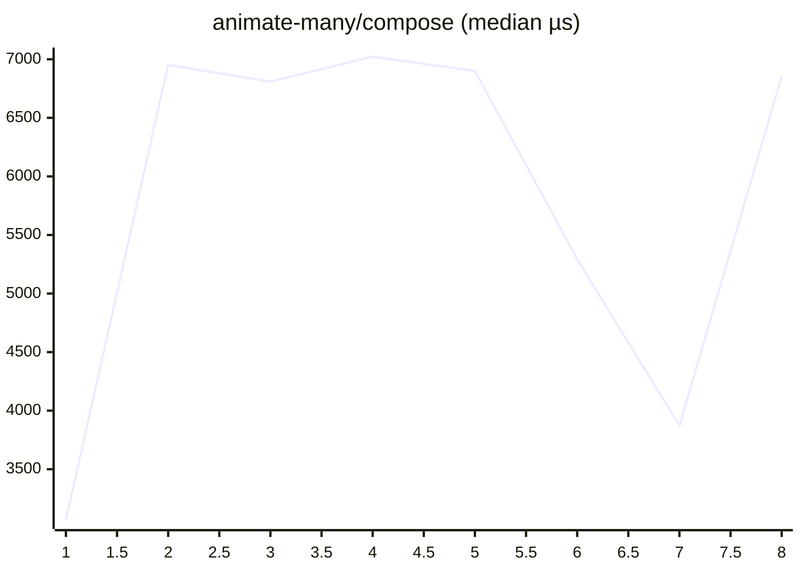

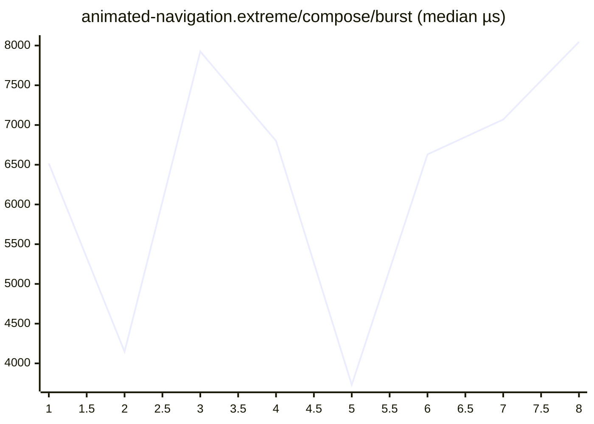


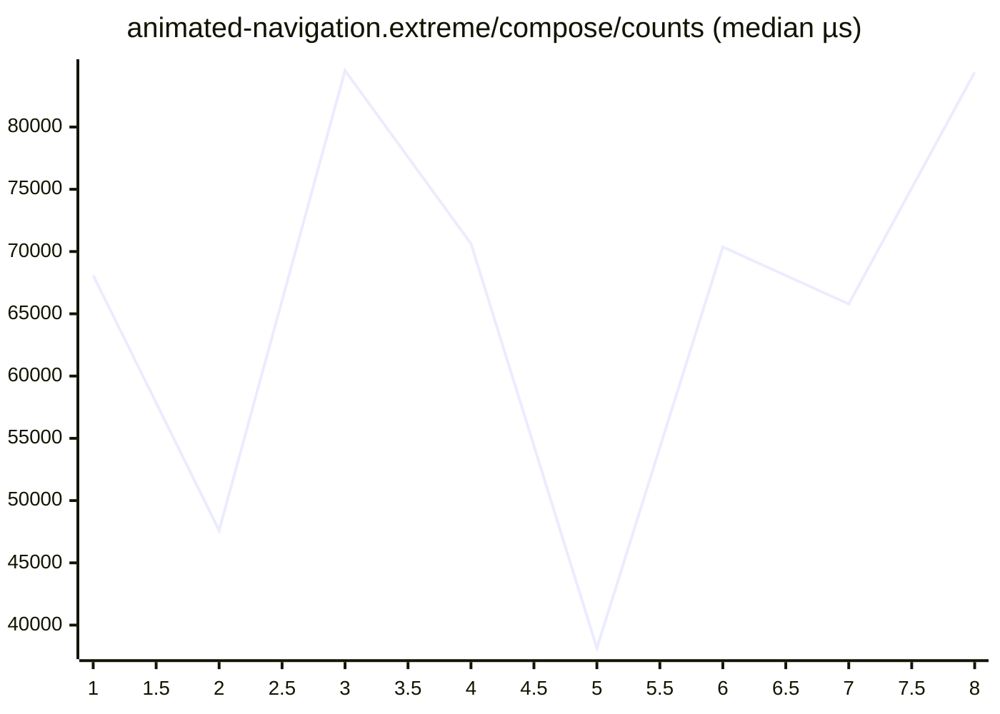

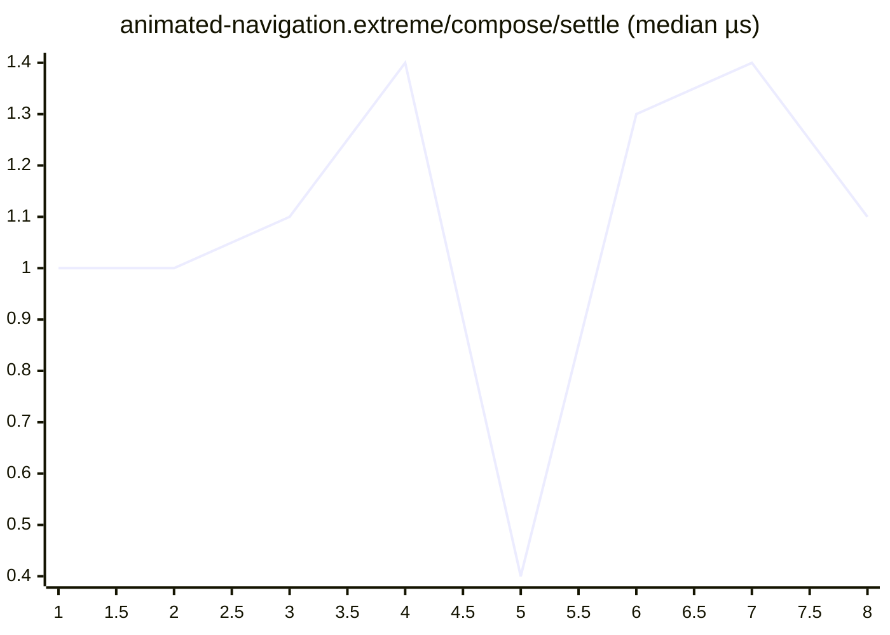


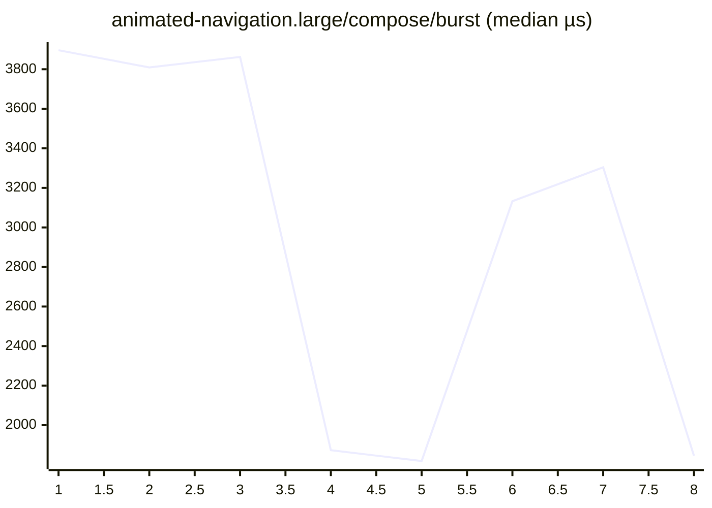


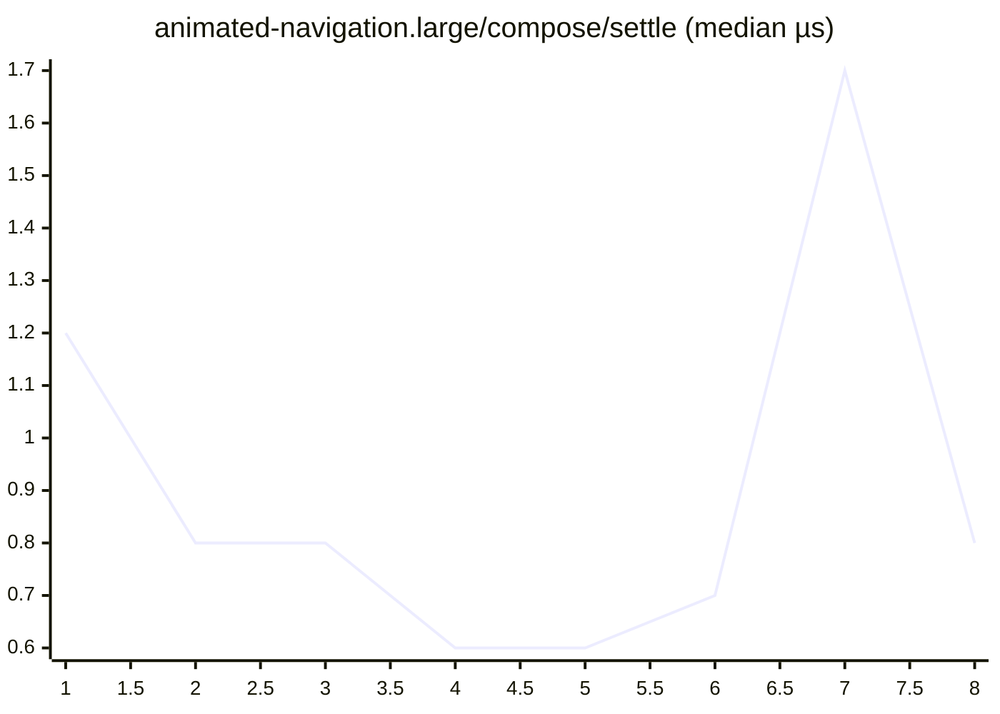

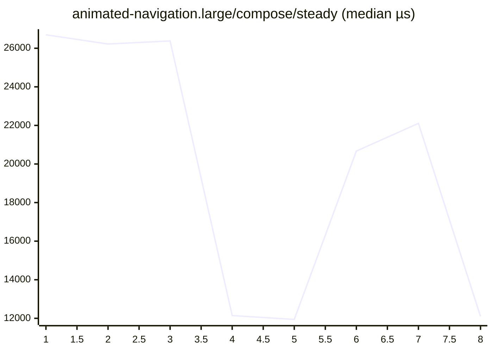

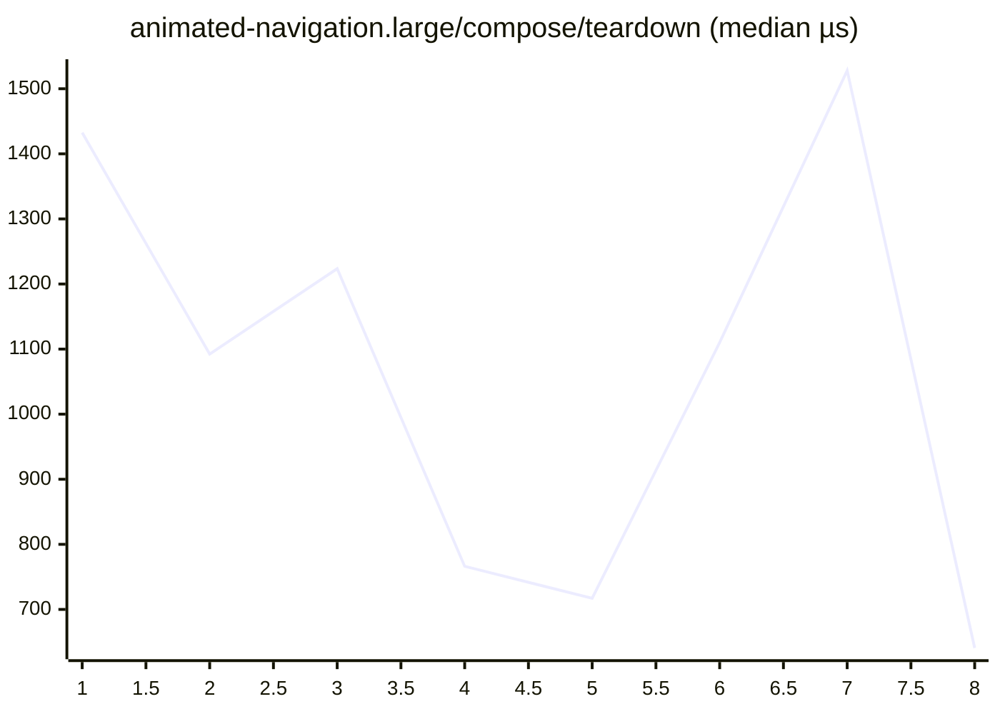

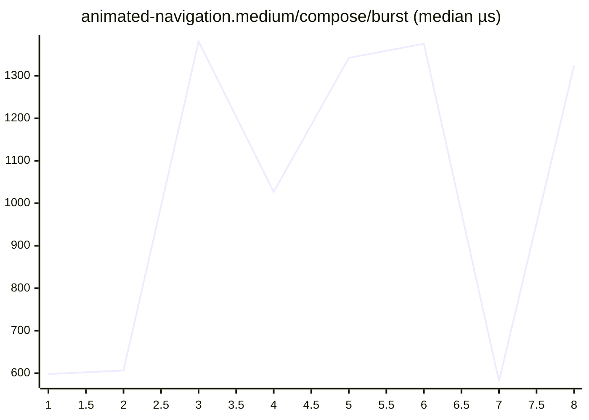


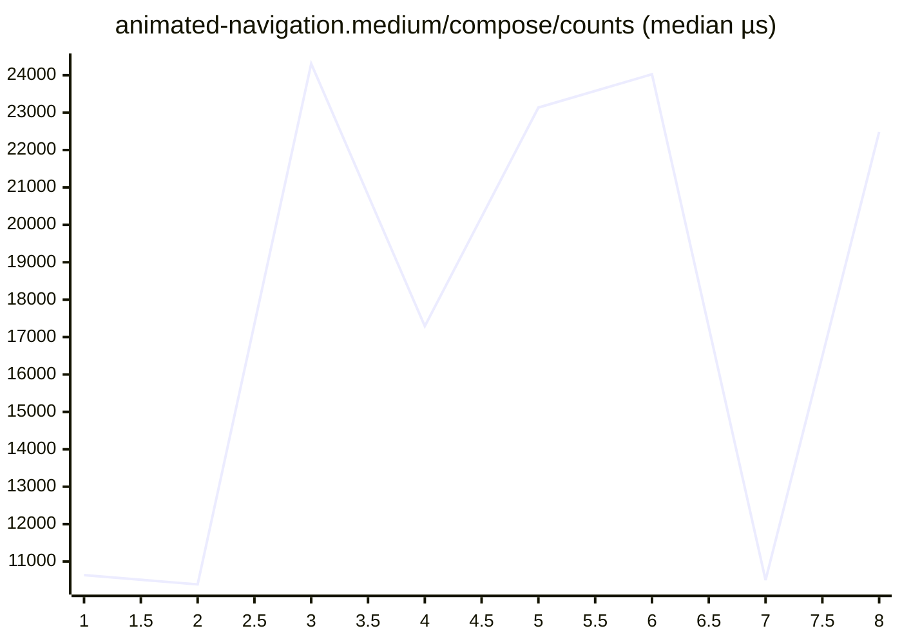

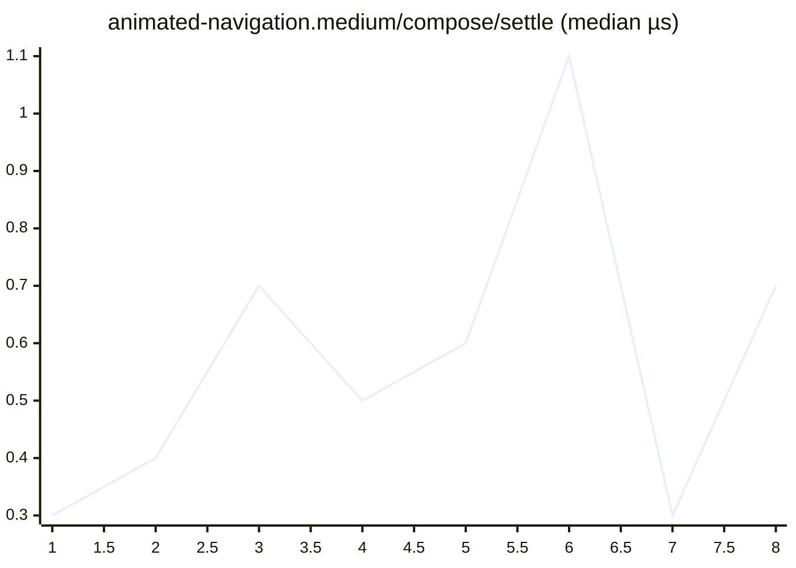

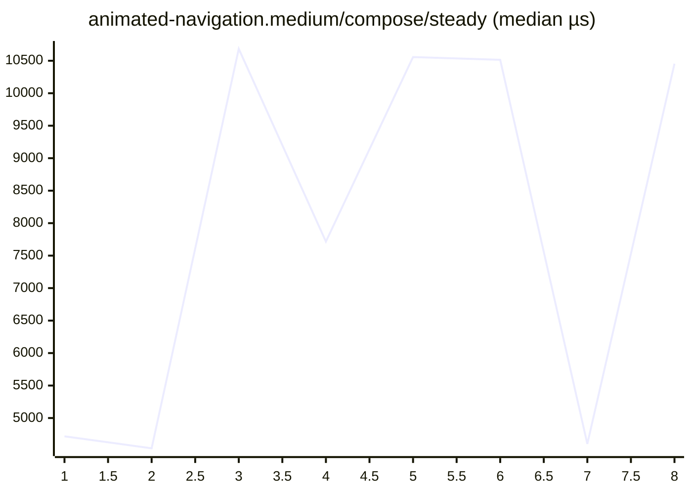

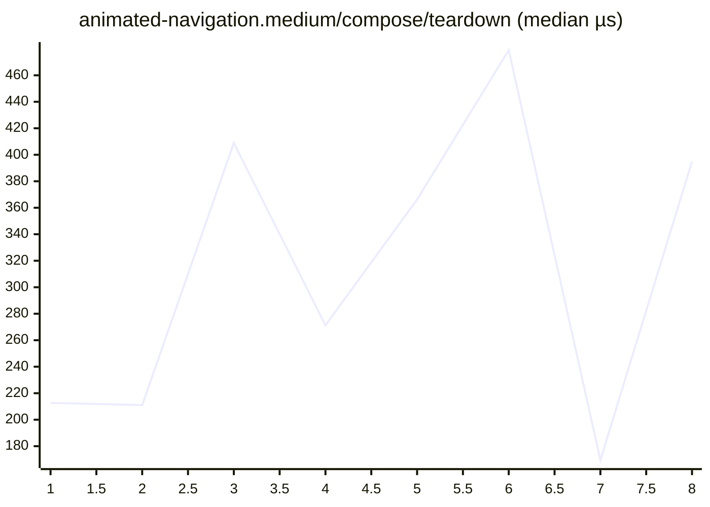

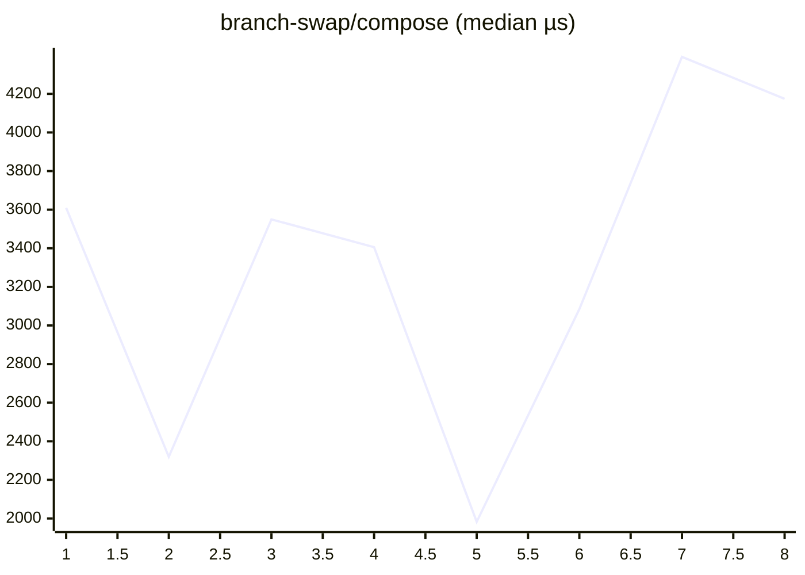

```mermaid
xychart-beta
    title "cold-mount-100/compose (median µs)"
    x-axis 1 --> 8
    line [592.6, 519.9, 885.4, 445.1, 390.3, 654.2, 754.1, 718.7]
```

```mermaid
xychart-beta
    title "cold-mount-1000/compose (median µs)"
    x-axis 1 --> 8
    line [8085.8, 5389.9, 8549.6, 6933.2, 5008.1, 8021.9, 4561.7, 3463.8]
```

```mermaid
xychart-beta
    title "cold-mount-10000/compose (median µs)"
    x-axis 1 --> 8
    line [73945.7, 98256.1, 94238.7, 59096.4, 91513.5, 96319.1, 82259.3, 63209.5]
```

```mermaid
xychart-beta
    title "data-grid.extreme/compose/burst (median µs)"
    x-axis 1 --> 8
    line [572777.3, 535083.2, 832744.6, 637093.8, 901025.5, 925169.9, 449606.0, 895257.3]
```

```mermaid
xychart-beta
    title "data-grid.extreme/compose/cold (median µs)"
    x-axis 1 --> 8
    line [350893.5, 328646.9, 515839.7, 377498.6, 538166.5, 557904.7, 284386.4, 531496.5]
```

```mermaid
xychart-beta
    title "data-grid.extreme/compose/counts (median µs)"
    x-axis 1 --> 8
    line [961903.0, 895177.9, 1510853.2, 1085251.1, 1502399.1, 1611360.1, 785389.3, 1377677.2]
```

```mermaid
xychart-beta
    title "data-grid.extreme/compose/settle (median µs)"
    x-axis 1 --> 8
    line [2.8, 2.4, 2.2, 2.6, 2.1, 2.4, 2.2, 2.2]
```

```mermaid
xychart-beta
    title "data-grid.extreme/compose/steady (median µs)"
    x-axis 1 --> 8
    line [12594.0, 11681.8, 22844.9, 17958.7, 23673.8, 23322.2, 11155.7, 22361.8]
```

```mermaid
xychart-beta
    title "data-grid.extreme/compose/teardown (median µs)"
    x-axis 1 --> 8
    line [1086.6, 1137.9, 1208.9, 1019.3, 1268.8, 1343.4, 835.2, 1224.3]
```

```mermaid
xychart-beta
    title "data-grid.large/compose/burst (median µs)"
    x-axis 1 --> 8
    line [140083.3, 135962.2, 137048.1, 79047.3, 75260.8, 109163.6, 121880.1, 81408.7]
```

```mermaid
xychart-beta
    title "data-grid.large/compose/cold (median µs)"
    x-axis 1 --> 8
    line [80791.9, 79866.7, 78358.1, 46545.2, 43756.7, 58099.4, 68778.5, 44967.9]
```

```mermaid
xychart-beta
    title "data-grid.large/compose/counts (median µs)"
    x-axis 1 --> 8
    line [269572.2, 259528.8, 247425.1, 134287.8, 131710.6, 188468.8, 214177.9, 150547.4]
```

```mermaid
xychart-beta
    title "data-grid.large/compose/settle (median µs)"
    x-axis 1 --> 8
    line [2.0, 2.0, 1.8, 1.2, 2.0, 1.9, 2.7, 1.9]
```

```mermaid
xychart-beta
    title "data-grid.large/compose/steady (median µs)"
    x-axis 1 --> 8
    line [17382.0, 15842.8, 15303.1, 9007.1, 8005.9, 11625.0, 12919.6, 8353.8]
```

```mermaid
xychart-beta
    title "data-grid.large/compose/teardown (median µs)"
    x-axis 1 --> 8
    line [517.4, 507.1, 530.1, 308.6, 332.9, 426.4, 518.6, 361.1]
```

```mermaid
xychart-beta
    title "data-grid.medium/compose/burst (median µs)"
    x-axis 1 --> 8
    line [49689.5, 40264.0, 63124.3, 54341.9, 32137.1, 50132.9, 54919.9, 65755.5]
```

```mermaid
xychart-beta
    title "data-grid.medium/compose/cold (median µs)"
    x-axis 1 --> 8
    line [28216.2, 22726.8, 35966.3, 30152.5, 18330.7, 26916.9, 30108.2, 37334.5]
```

```mermaid
xychart-beta
    title "data-grid.medium/compose/counts (median µs)"
    x-axis 1 --> 8
    line [101676.4, 85010.8, 128707.0, 106187.2, 62031.4, 100197.9, 110205.4, 130840.7]
```

```mermaid
xychart-beta
    title "data-grid.medium/compose/settle (median µs)"
    x-axis 1 --> 8
    line [2.2, 2.3, 1.8, 2.4, 0.6, 1.9, 2.1, 1.9]
```

```mermaid
xychart-beta
    title "data-grid.medium/compose/steady (median µs)"
    x-axis 1 --> 8
    line [12139.2, 8725.2, 12812.2, 11984.4, 6457.6, 10768.7, 11263.0, 14779.4]
```

```mermaid
xychart-beta
    title "data-grid.medium/compose/teardown (median µs)"
    x-axis 1 --> 8
    line [242.3, 222.0, 291.3, 267.8, 145.7, 280.3, 272.6, 313.2]
```

```mermaid
xychart-beta
    title "dense-dashboard.extreme/compose/burst (median µs)"
    x-axis 1 --> 8
    line [8748.3, 13808.9, 14242.7, 14836.6, 15612.8, 11708.1, 9145.2, 14405.4]
```

```mermaid
xychart-beta
    title "dense-dashboard.extreme/compose/cold (median µs)"
    x-axis 1 --> 8
    line [306.9, 503.4, 495.3, 587.1, 524.3, 393.3, 329.8, 528.9]
```

```mermaid
xychart-beta
    title "dense-dashboard.extreme/compose/counts (median µs)"
    x-axis 1 --> 8
    line [12107.6, 25337.6, 22769.2, 21520.0, 21897.1, 18320.5, 13760.6, 40266.5]
```

```mermaid
xychart-beta
    title "dense-dashboard.extreme/compose/settle (median µs)"
    x-axis 1 --> 8
    line [0.6, 1.1, 1.0, 0.8, 0.9, 0.8, 1.1, 1.0]
```

```mermaid
xychart-beta
    title "dense-dashboard.extreme/compose/steady (median µs)"
    x-axis 1 --> 8
    line [461.4, 853.9, 896.4, 863.9, 868.1, 685.9, 487.3, 868.8]
```

```mermaid
xychart-beta
    title "dense-dashboard.extreme/compose/teardown (median µs)"
    x-axis 1 --> 8
    line [300.0, 528.8, 524.0, 500.2, 563.4, 420.3, 338.6, 537.9]
```

```mermaid
xychart-beta
    title "dense-dashboard.large/compose/burst (median µs)"
    x-axis 1 --> 8
    line [7315.2, 6455.4, 7861.5, 5932.0, 3664.7, 4865.3, 7559.3, 4721.2]
```

```mermaid
xychart-beta
    title "dense-dashboard.large/compose/cold (median µs)"
    x-axis 1 --> 8
    line [321.9, 311.0, 312.5, 196.1, 172.6, 252.5, 330.9, 182.8]
```

```mermaid
xychart-beta
    title "dense-dashboard.large/compose/counts (median µs)"
    x-axis 1 --> 8
    line [15457.3, 15616.4, 15030.0, 9619.3, 9006.3, 13093.5, 13144.9, 8826.0]
```

```mermaid
xychart-beta
    title "dense-dashboard.large/compose/settle (median µs)"
    x-axis 1 --> 8
    line [0.9, 0.8, 0.8, 0.7, 0.5, 0.6, 1.5, 0.6]
```

```mermaid
xychart-beta
    title "dense-dashboard.large/compose/steady (median µs)"
    x-axis 1 --> 8
    line [871.8, 849.7, 860.9, 434.1, 430.1, 673.3, 710.2, 432.8]
```

```mermaid
xychart-beta
    title "dense-dashboard.large/compose/teardown (median µs)"
    x-axis 1 --> 8
    line [255.7, 242.4, 250.0, 139.2, 128.8, 202.4, 271.9, 146.7]
```

```mermaid
xychart-beta
    title "dense-dashboard.medium/compose/burst (median µs)"
    x-axis 1 --> 8
    line [1884.9, 1716.2, 3396.7, 2022.7, 3071.6, 3206.4, 1423.0, 2945.6]
```

```mermaid
xychart-beta
    title "dense-dashboard.medium/compose/cold (median µs)"
    x-axis 1 --> 8
    line [150.8, 125.0, 199.3, 164.2, 201.4, 241.3, 96.5, 215.2]
```

```mermaid
xychart-beta
    title "dense-dashboard.medium/compose/counts (median µs)"
    x-axis 1 --> 8
    line [4488.4, 3035.8, 6218.8, 3927.1, 6262.4, 5300.8, 2445.0, 6213.6]
```

```mermaid
xychart-beta
    title "dense-dashboard.medium/compose/settle (median µs)"
    x-axis 1 --> 8
    line [0.6, 0.4, 0.7, 0.5, 0.7, 0.7, 0.4, 0.7]
```

```mermaid
xychart-beta
    title "dense-dashboard.medium/compose/steady (median µs)"
    x-axis 1 --> 8
    line [451.5, 440.8, 842.9, 675.3, 830.4, 863.8, 440.0, 847.9]
```

```mermaid
xychart-beta
    title "dense-dashboard.medium/compose/teardown (median µs)"
    x-axis 1 --> 8
    line [71.1, 68.2, 109.1, 88.9, 111.5, 129.0, 60.7, 120.6]
```

```mermaid
xychart-beta
    title "entities-identity-churn-10.extreme/compose/burst (median µs)"
    x-axis 1 --> 8
    line [36450.3, 44418.2, 46637.6, 27103.8, 44981.1, 29543.4, 40066.6, 42717.5]
```

```mermaid
xychart-beta
    title "entities-identity-churn-10.extreme/compose/cold (median µs)"
    x-axis 1 --> 8
    line [22317.0, 30608.9, 30755.4, 23786.9, 40570.4, 19153.7, 28343.7, 27744.4]
```

```mermaid
xychart-beta
    title "entities-identity-churn-10.extreme/compose/counts (median µs)"
    x-axis 1 --> 8
    line [157183.8, 226408.0, 207640.3, 143081.0, 226763.2, 128206.5, 171885.4, 169973.5]
```

```mermaid
xychart-beta
    title "entities-identity-churn-10.extreme/compose/settle (median µs)"
    x-axis 1 --> 8
    line [1.5, 2.2, 2.0, 1.5, 2.5, 2.0, 1.5, 2.8]
```

```mermaid
xychart-beta
    title "entities-identity-churn-10.extreme/compose/steady (median µs)"
    x-axis 1 --> 8
    line [38679.7, 58936.7, 52064.1, 26669.0, 61811.9, 29113.4, 45991.2, 49404.1]
```

```mermaid
xychart-beta
    title "entities-identity-churn-10.extreme/compose/teardown (median µs)"
    x-axis 1 --> 8
    line [870.1, 1178.4, 1115.4, 774.0, 1244.2, 740.3, 1065.2, 1427.6]
```

```mermaid
xychart-beta
    title "entities-identity-churn-10.large/compose/burst (median µs)"
    x-axis 1 --> 8
    line [13822.3, 12671.8, 13643.0, 12953.8, 6143.0, 14759.8, 12995.7, 14364.3]
```

```mermaid
xychart-beta
    title "entities-identity-churn-10.large/compose/cold (median µs)"
    x-axis 1 --> 8
    line [8768.9, 8903.6, 12727.0, 12419.1, 6935.5, 10733.2, 8614.4, 12686.5]
```

```mermaid
xychart-beta
    title "entities-identity-churn-10.large/compose/counts (median µs)"
    x-axis 1 --> 8
    line [56991.3, 49197.8, 64112.9, 60677.1, 28433.4, 57838.2, 57671.1, 70144.7]
```

```mermaid
xychart-beta
    title "entities-identity-churn-10.large/compose/settle (median µs)"
    x-axis 1 --> 8
    line [2.0, 2.2, 1.6, 1.9, 0.7, 1.8, 2.0, 2.1]
```

```mermaid
xychart-beta
    title "entities-identity-churn-10.large/compose/steady (median µs)"
    x-axis 1 --> 8
    line [16083.5, 12191.6, 17784.2, 14312.6, 8120.2, 16453.6, 16282.2, 19046.9]
```

```mermaid
xychart-beta
    title "entities-identity-churn-10.large/compose/teardown (median µs)"
    x-axis 1 --> 8
    line [346.1, 297.1, 375.4, 338.9, 182.0, 354.6, 362.7, 426.3]
```

```mermaid
xychart-beta
    title "entities-identity-churn-10.medium/compose/burst (median µs)"
    x-axis 1 --> 8
    line [4810.6, 5385.1, 7593.1, 5112.8, 6878.8, 6650.5, 3288.9, 8470.5]
```

```mermaid
xychart-beta
    title "entities-identity-churn-10.medium/compose/cold (median µs)"
    x-axis 1 --> 8
    line [3510.0, 3688.3, 5372.0, 3383.4, 4891.2, 5151.2, 2409.5, 5430.8]
```

```mermaid
xychart-beta
    title "entities-identity-churn-10.medium/compose/counts (median µs)"
    x-axis 1 --> 8
    line [22176.2, 21779.2, 33203.4, 22936.2, 34013.7, 31437.1, 16138.3, 33707.6]
```

```mermaid
xychart-beta
    title "entities-identity-churn-10.medium/compose/settle (median µs)"
    x-axis 1 --> 8
    line [0.9, 1.3, 1.1, 0.9, 1.2, 1.1, 0.5, 1.2]
```

```mermaid
xychart-beta
    title "entities-identity-churn-10.medium/compose/steady (median µs)"
    x-axis 1 --> 8
    line [5091.1, 4800.2, 8300.0, 5909.2, 8141.7, 8237.8, 3705.4, 8586.3]
```

```mermaid
xychart-beta
    title "entities-identity-churn-10.medium/compose/teardown (median µs)"
    x-axis 1 --> 8
    line [138.2, 141.4, 189.4, 143.6, 208.6, 209.6, 100.5, 229.5]
```

```mermaid
xychart-beta
    title "entities-identity-churn-50.extreme/compose/burst (median µs)"
    x-axis 1 --> 8
    line [37375.3, 42100.8, 41076.4, 43172.5, 28018.8, 41299.1, 37898.2, 49926.6]
```

```mermaid
xychart-beta
    title "entities-identity-churn-50.extreme/compose/cold (median µs)"
    x-axis 1 --> 8
    line [28909.8, 26506.8, 29632.4, 23700.6, 16677.6, 22767.7, 28551.6, 34974.5]
```

```mermaid
xychart-beta
    title "entities-identity-churn-50.extreme/compose/counts (median µs)"
    x-axis 1 --> 8
    line [312089.2, 264728.7, 287119.4, 313931.9, 170730.7, 360065.4, 295547.6, 321512.6]
```

```mermaid
xychart-beta
    title "entities-identity-churn-50.extreme/compose/settle (median µs)"
    x-axis 1 --> 8
    line [2.6, 2.4, 1.9, 2.3, 2.1, 2.0, 2.6, 2.3]
```

```mermaid
xychart-beta
    title "entities-identity-churn-50.extreme/compose/steady (median µs)"
    x-axis 1 --> 8
    line [144362.2, 138910.8, 151388.1, 146004.0, 82765.7, 135865.1, 159344.1, 153493.1]
```

```mermaid
xychart-beta
    title "entities-identity-churn-50.extreme/compose/teardown (median µs)"
    x-axis 1 --> 8
    line [1011.3, 1046.8, 1153.3, 1158.5, 635.9, 966.8, 1114.4, 1149.1]
```

```mermaid
xychart-beta
    title "entities-identity-churn-50.large/compose/burst (median µs)"
    x-axis 1 --> 8
    line [11392.1, 16006.5, 14237.9, 8830.8, 17379.2, 12261.9, 15344.8, 11689.2]
```

```mermaid
xychart-beta
    title "entities-identity-churn-50.large/compose/cold (median µs)"
    x-axis 1 --> 8
    line [10645.8, 12312.2, 10388.0, 8077.7, 10611.2, 7955.1, 10922.4, 8068.7]
```

```mermaid
xychart-beta
    title "entities-identity-churn-50.large/compose/counts (median µs)"
    x-axis 1 --> 8
    line [86389.6, 118638.8, 108507.3, 60853.6, 129304.7, 73934.5, 103471.9, 90339.3]
```

```mermaid
xychart-beta
    title "entities-identity-churn-50.large/compose/settle (median µs)"
    x-axis 1 --> 8
    line [1.5, 2.3, 1.6, 1.2, 1.9, 1.8, 1.4, 2.4]
```

```mermaid
xychart-beta
    title "entities-identity-churn-50.large/compose/steady (median µs)"
    x-axis 1 --> 8
    line [40309.4, 56606.6, 50910.5, 29130.8, 63002.5, 34672.3, 46041.0, 42900.9]
```

```mermaid
xychart-beta
    title "entities-identity-churn-50.large/compose/teardown (median µs)"
    x-axis 1 --> 8
    line [312.8, 448.9, 398.2, 225.9, 469.2, 278.4, 371.5, 321.9]
```

```mermaid
xychart-beta
    title "entities-identity-churn-50.medium/compose/burst (median µs)"
    x-axis 1 --> 8
    line [8485.7, 8733.8, 7811.5, 5053.3, 3913.2, 6868.0, 7233.3, 5340.6]
```

```mermaid
xychart-beta
    title "entities-identity-churn-50.medium/compose/cold (median µs)"
    x-axis 1 --> 8
    line [5123.1, 5090.8, 6479.6, 3545.3, 2939.0, 4644.6, 4523.8, 3418.2]
```

```mermaid
xychart-beta
    title "entities-identity-churn-50.medium/compose/counts (median µs)"
    x-axis 1 --> 8
    line [60621.5, 66177.5, 62123.7, 40694.0, 32773.8, 53100.7, 61894.0, 40328.5]
```

```mermaid
xychart-beta
    title "entities-identity-churn-50.medium/compose/settle (median µs)"
    x-axis 1 --> 8
    line [1.3, 1.6, 1.6, 1.3, 0.7, 1.6, 2.2, 1.6]
```

```mermaid
xychart-beta
    title "entities-identity-churn-50.medium/compose/steady (median µs)"
    x-axis 1 --> 8
    line [22448.9, 25049.9, 23583.9, 14477.3, 11837.6, 20245.0, 21639.9, 16174.8]
```

```mermaid
xychart-beta
    title "entities-identity-churn-50.medium/compose/teardown (median µs)"
    x-axis 1 --> 8
    line [239.6, 252.1, 242.6, 155.2, 117.2, 204.8, 234.3, 165.7]
```

```mermaid
xychart-beta
    title "entities-identity-churn.extreme/compose/burst (median µs)"
    x-axis 1 --> 8
    line [51119.4, 42743.7, 45181.7, 38370.3, 33338.8, 36817.5, 52885.4, 40171.8]
```

```mermaid
xychart-beta
    title "entities-identity-churn.extreme/compose/cold (median µs)"
    x-axis 1 --> 8
    line [31173.0, 29216.5, 29632.0, 19346.5, 15753.8, 25514.4, 27023.7, 28801.0]
```

```mermaid
xychart-beta
    title "entities-identity-churn.extreme/compose/counts (median µs)"
    x-axis 1 --> 8
    line [276895.4, 231546.3, 239558.4, 151482.1, 126042.6, 202144.3, 260291.3, 188217.0]
```

```mermaid
xychart-beta
    title "entities-identity-churn.extreme/compose/settle (median µs)"
    x-axis 1 --> 8
    line [2.3, 2.0, 2.1, 2.3, 1.7, 2.3, 2.5, 2.4]
```

```mermaid
xychart-beta
    title "entities-identity-churn.extreme/compose/steady (median µs)"
    x-axis 1 --> 8
    line [103496.4, 98719.9, 87903.0, 60700.8, 49561.0, 86888.2, 112427.9, 73292.0]
```

```mermaid
xychart-beta
    title "entities-identity-churn.extreme/compose/teardown (median µs)"
    x-axis 1 --> 8
    line [1459.8, 1163.1, 1253.7, 814.1, 700.5, 1030.1, 1378.4, 1097.2]
```

```mermaid
xychart-beta
    title "entities-identity-churn.large/compose/burst (median µs)"
    x-axis 1 --> 8
    line [9662.4, 8486.1, 12526.7, 11002.8, 13446.7, 15085.5, 8379.8, 14725.8]
```

```mermaid
xychart-beta
    title "entities-identity-churn.large/compose/cold (median µs)"
    x-axis 1 --> 8
    line [7331.9, 8413.6, 11406.1, 12037.1, 13160.2, 12731.3, 5986.0, 12621.4]
```

```mermaid
xychart-beta
    title "entities-identity-churn.large/compose/counts (median µs)"
    x-axis 1 --> 8
    line [62489.1, 65083.5, 93016.9, 76013.1, 98085.9, 98527.4, 51915.0, 93148.1]
```

```mermaid
xychart-beta
    title "entities-identity-churn.large/compose/settle (median µs)"
    x-axis 1 --> 8
    line [1.6, 1.6, 1.7, 1.3, 2.0, 1.7, 1.1, 1.5]
```

```mermaid
xychart-beta
    title "entities-identity-churn.large/compose/steady (median µs)"
    x-axis 1 --> 8
    line [17762.3, 18587.4, 28783.0, 23340.3, 29455.6, 33017.1, 15327.8, 30626.8]
```

```mermaid
xychart-beta
    title "entities-identity-churn.large/compose/teardown (median µs)"
    x-axis 1 --> 8
    line [221.0, 244.4, 350.0, 314.6, 386.7, 384.2, 198.7, 367.8]
```

```mermaid
xychart-beta
    title "entities-identity-churn.medium/compose/burst (median µs)"
    x-axis 1 --> 8
    line [5597.4, 5043.1, 7507.7, 7112.6, 3457.9, 6040.7, 6526.1, 8643.7]
```

```mermaid
xychart-beta
    title "entities-identity-churn.medium/compose/cold (median µs)"
    x-axis 1 --> 8
    line [4098.3, 3677.5, 4917.8, 4309.4, 3034.9, 4284.9, 4653.8, 4991.2]
```

```mermaid
xychart-beta
    title "entities-identity-churn.medium/compose/counts (median µs)"
    x-axis 1 --> 8
    line [31911.5, 26270.5, 38265.0, 35758.5, 17029.0, 34046.6, 35379.4, 40732.1]
```

```mermaid
xychart-beta
    title "entities-identity-churn.medium/compose/settle (median µs)"
    x-axis 1 --> 8
    line [1.0, 1.7, 1.0, 1.9, 0.6, 1.6, 1.4, 1.1]
```

```mermaid
xychart-beta
    title "entities-identity-churn.medium/compose/steady (median µs)"
    x-axis 1 --> 8
    line [10781.6, 9751.3, 14145.6, 11476.1, 7059.7, 11350.6, 12871.8, 13831.7]
```

```mermaid
xychart-beta
    title "entities-identity-churn.medium/compose/teardown (median µs)"
    x-axis 1 --> 8
    line [163.7, 158.3, 209.3, 186.8, 106.1, 185.4, 191.4, 206.3]
```

```mermaid
xychart-beta
    title "entities-integrated.extreme/compose/burst (median µs)"
    x-axis 1 --> 8
    line [18098.0, 16855.7, 18205.9, 16320.2, 17509.3, 20570.2, 12111.1, 9626.9]
```

```mermaid
xychart-beta
    title "entities-integrated.extreme/compose/cold (median µs)"
    x-axis 1 --> 8
    line [102015.1, 100238.6, 110792.2, 98791.5, 86043.8, 111031.3, 76896.5, 67500.7]
```

```mermaid
xychart-beta
    title "entities-integrated.extreme/compose/counts (median µs)"
    x-axis 1 --> 8
    line [358907.4, 324615.1, 382570.8, 305419.8, 287951.5, 321960.0, 269473.8, 204158.1]
```

```mermaid
xychart-beta
    title "entities-integrated.extreme/compose/settle (median µs)"
    x-axis 1 --> 8
    line [1.8, 1.9, 2.1, 1.7, 1.7, 1.9, 2.0, 1.6]
```

```mermaid
xychart-beta
    title "entities-integrated.extreme/compose/steady (median µs)"
    x-axis 1 --> 8
    line [90630.1, 81412.5, 95946.8, 80410.1, 73987.2, 97008.8, 73582.9, 55127.3]
```

```mermaid
xychart-beta
    title "entities-integrated.extreme/compose/teardown (median µs)"
    x-axis 1 --> 8
    line [52871.1, 45496.4, 55490.6, 46463.3, 40502.6, 51955.2, 48082.4, 36583.8]
```

```mermaid
xychart-beta
    title "entities-integrated.large/compose/burst (median µs)"
    x-axis 1 --> 8
    line [9879.6, 9266.1, 9580.3, 5350.4, 5000.3, 7911.5, 9138.6, 5431.2]
```

```mermaid
xychart-beta
    title "entities-integrated.large/compose/cold (median µs)"
    x-axis 1 --> 8
    line [42924.1, 40697.9, 38453.5, 27622.0, 23282.1, 34452.0, 37474.1, 28353.5]
```

```mermaid
xychart-beta
    title "entities-integrated.large/compose/counts (median µs)"
    x-axis 1 --> 8
    line [159260.0, 136585.0, 136418.7, 92540.6, 75726.6, 116205.8, 145691.2, 92771.0]
```

```mermaid
xychart-beta
    title "entities-integrated.large/compose/settle (median µs)"
    x-axis 1 --> 8
    line [2.1, 1.5, 1.6, 1.6, 1.2, 1.6, 2.2, 2.0]
```

```mermaid
xychart-beta
    title "entities-integrated.large/compose/steady (median µs)"
    x-axis 1 --> 8
    line [56879.3, 47700.5, 50360.1, 29499.8, 25632.1, 39134.3, 49897.4, 34021.1]
```

```mermaid
xychart-beta
    title "entities-integrated.large/compose/teardown (median µs)"
    x-axis 1 --> 8
    line [16802.1, 13908.2, 14198.2, 10974.4, 8656.6, 14230.7, 18168.2, 12469.9]
```

```mermaid
xychart-beta
    title "entities-integrated.medium/compose/burst (median µs)"
    x-axis 1 --> 8
    line [4273.0, 4064.7, 6941.6, 5470.1, 7091.9, 7241.2, 3606.4, 7034.6]
```

```mermaid
xychart-beta
    title "entities-integrated.medium/compose/cold (median µs)"
    x-axis 1 --> 8
    line [14214.0, 12986.0, 18998.1, 20759.9, 20252.4, 22768.0, 13202.3, 21049.2]
```

```mermaid
xychart-beta
    title "entities-integrated.medium/compose/counts (median µs)"
    x-axis 1 --> 8
    line [60159.0, 56773.8, 91261.8, 68607.4, 94840.7, 109979.7, 46066.0, 91208.7]
```

```mermaid
xychart-beta
    title "entities-integrated.medium/compose/settle (median µs)"
    x-axis 1 --> 8
    line [1.9, 1.7, 1.6, 1.2, 1.4, 1.7, 1.0, 1.6]
```

```mermaid
xychart-beta
    title "entities-integrated.medium/compose/steady (median µs)"
    x-axis 1 --> 8
    line [20781.1, 19484.3, 34314.8, 25155.4, 35931.8, 41195.2, 16863.5, 34416.2]
```

```mermaid
xychart-beta
    title "entities-integrated.medium/compose/teardown (median µs)"
    x-axis 1 --> 8
    line [5912.5, 5137.9, 6370.7, 5086.2, 6899.6, 7628.9, 3519.9, 6540.0]
```

```mermaid
xychart-beta
    title "entities-relevance-saturated.extreme/compose/burst (median µs)"
    x-axis 1 --> 8
    line [82088.2, 67803.4, 81772.9, 78539.9, 42827.9, 75203.6, 74827.0, 82527.1]
```

```mermaid
xychart-beta
    title "entities-relevance-saturated.extreme/compose/cold (median µs)"
    x-axis 1 --> 8
    line [23851.0, 19385.3, 27237.7, 29579.2, 16205.6, 25539.7, 24187.8, 26855.5]
```

```mermaid
xychart-beta
    title "entities-relevance-saturated.extreme/compose/counts (median µs)"
    x-axis 1 --> 8
    line [215972.6, 170155.4, 218067.6, 205395.8, 129067.0, 218719.0, 211515.3, 231455.2]
```

```mermaid
xychart-beta
    title "entities-relevance-saturated.extreme/compose/settle (median µs)"
    x-axis 1 --> 8
    line [2.5, 2.9, 2.1, 2.6, 1.9, 2.5, 2.5, 2.2]
```

```mermaid
xychart-beta
    title "entities-relevance-saturated.extreme/compose/steady (median µs)"
    x-axis 1 --> 8
    line [46499.2, 63403.0, 50693.5, 50493.5, 26077.2, 49900.4, 50230.3, 46598.9]
```

```mermaid
xychart-beta
    title "entities-relevance-saturated.extreme/compose/teardown (median µs)"
    x-axis 1 --> 8
    line [13254.3, 13259.6, 13403.6, 14674.6, 8911.1, 13251.9, 13962.6, 12345.3]
```

```mermaid
xychart-beta
    title "entities-relevance-saturated.large/compose/burst (median µs)"
    x-axis 1 --> 8
    line [23829.2, 21410.5, 26910.9, 27013.4, 14236.6, 24208.8, 23728.7, 26738.0]
```

```mermaid
xychart-beta
    title "entities-relevance-saturated.large/compose/cold (median µs)"
    x-axis 1 --> 8
    line [9046.6, 8698.0, 11112.7, 11237.4, 6143.2, 9343.6, 10313.4, 10994.3]
```

```mermaid
xychart-beta
    title "entities-relevance-saturated.large/compose/counts (median µs)"
    x-axis 1 --> 8
    line [66263.4, 60081.6, 78201.5, 74218.9, 39404.5, 69251.9, 67363.7, 81625.4]
```

```mermaid
xychart-beta
    title "entities-relevance-saturated.large/compose/settle (median µs)"
    x-axis 1 --> 8
    line [2.2, 2.3, 1.7, 2.3, 1.1, 2.0, 1.9, 1.9]
```

```mermaid
xychart-beta
    title "entities-relevance-saturated.large/compose/steady (median µs)"
    x-axis 1 --> 8
    line [15970.8, 12947.8, 17610.3, 17826.6, 11242.1, 15433.1, 16862.1, 19331.5]
```

```mermaid
xychart-beta
    title "entities-relevance-saturated.large/compose/teardown (median µs)"
    x-axis 1 --> 8
    line [3313.5, 2966.7, 2967.8, 3445.2, 1914.9, 3360.7, 3073.0, 3235.1]
```

```mermaid
xychart-beta
    title "entities-relevance-saturated.medium/compose/burst (median µs)"
    x-axis 1 --> 8
    line [10053.5, 13258.0, 10542.4, 6875.4, 13588.9, 8448.7, 11354.4, 7488.6]
```

```mermaid
xychart-beta
    title "entities-relevance-saturated.medium/compose/cold (median µs)"
    x-axis 1 --> 8
    line [4425.1, 5999.0, 4925.5, 3251.8, 5590.3, 3641.1, 6085.1, 3730.8]
```

```mermaid
xychart-beta
    title "entities-relevance-saturated.medium/compose/counts (median µs)"
    x-axis 1 --> 8
    line [26589.7, 40004.4, 35054.4, 23518.5, 43107.2, 20771.7, 35914.6, 21858.7]
```

```mermaid
xychart-beta
    title "entities-relevance-saturated.medium/compose/settle (median µs)"
    x-axis 1 --> 8
    line [1.0, 1.5, 1.0, 0.9, 2.0, 1.7, 0.9, 1.4]
```

```mermaid
xychart-beta
    title "entities-relevance-saturated.medium/compose/steady (median µs)"
    x-axis 1 --> 8
    line [6593.9, 10265.5, 7799.1, 4375.5, 8267.5, 5658.1, 7360.6, 5130.7]
```

```mermaid
xychart-beta
    title "entities-relevance-saturated.medium/compose/teardown (median µs)"
    x-axis 1 --> 8
    line [909.1, 1375.7, 1014.9, 866.7, 1424.9, 998.3, 1033.6, 908.9]
```

```mermaid
xychart-beta
    title "entities-relevance-sweep.extreme/compose/burst (median µs)"
    x-axis 1 --> 8
    line [83025.5, 131890.1, 139155.5, 102900.1, 157933.2, 128808.8, 112296.6, 116395.3]
```

```mermaid
xychart-beta
    title "entities-relevance-sweep.extreme/compose/cold (median µs)"
    x-axis 1 --> 8
    line [27112.7, 32898.9, 35114.3, 19901.5, 33750.6, 20001.5, 26640.6, 28100.9]
```

```mermaid
xychart-beta
    title "entities-relevance-sweep.extreme/compose/counts (median µs)"
    x-axis 1 --> 8
    line [297306.3, 392730.6, 375325.7, 279449.1, 480733.4, 287660.1, 322358.3, 325178.3]
```

```mermaid
xychart-beta
    title "entities-relevance-sweep.extreme/compose/settle (median µs)"
    x-axis 1 --> 8
    line [1.9, 2.5, 2.5, 2.5, 2.8, 2.8, 1.9, 3.2]
```

```mermaid
xychart-beta
    title "entities-relevance-sweep.extreme/compose/steady (median µs)"
    x-axis 1 --> 8
    line [104435.7, 129482.8, 118556.7, 87490.4, 162273.4, 97620.2, 109193.4, 117043.1]
```

```mermaid
xychart-beta
    title "entities-relevance-sweep.extreme/compose/teardown (median µs)"
    x-axis 1 --> 8
    line [11409.1, 14374.0, 14539.1, 12187.9, 16437.6, 13724.4, 12383.5, 14144.5]
```

```mermaid
xychart-beta
    title "entities-relevance-sweep.large/compose/burst (median µs)"
    x-axis 1 --> 8
    line [37687.9, 36619.3, 41760.4, 43897.0, 20442.0, 38915.7, 45255.8, 44982.1]
```

```mermaid
xychart-beta
    title "entities-relevance-sweep.large/compose/cold (median µs)"
    x-axis 1 --> 8
    line [9427.2, 7416.6, 10731.1, 9936.2, 7900.6, 9398.3, 9938.4, 11517.2]
```

```mermaid
xychart-beta
    title "entities-relevance-sweep.large/compose/counts (median µs)"
    x-axis 1 --> 8
    line [118464.0, 105642.9, 132017.4, 113098.8, 71443.8, 123886.3, 120574.8, 132620.0]
```

```mermaid
xychart-beta
    title "entities-relevance-sweep.large/compose/settle (median µs)"
    x-axis 1 --> 8
    line [2.0, 2.4, 1.7, 2.1, 1.2, 2.1, 2.6, 1.8]
```

```mermaid
xychart-beta
    title "entities-relevance-sweep.large/compose/steady (median µs)"
    x-axis 1 --> 8
    line [36383.7, 29649.6, 42899.0, 36038.5, 24323.9, 38124.3, 41637.8, 39291.2]
```

```mermaid
xychart-beta
    title "entities-relevance-sweep.large/compose/teardown (median µs)"
    x-axis 1 --> 8
    line [3319.5, 3173.8, 3204.1, 3765.1, 2211.6, 3346.3, 3590.8, 3373.3]
```

```mermaid
xychart-beta
    title "entities-relevance-sweep.medium/compose/burst (median µs)"
    x-axis 1 --> 8
    line [21304.8, 17609.9, 19632.8, 19428.5, 17153.1, 19140.6, 13680.9, 10539.8]
```

```mermaid
xychart-beta
    title "entities-relevance-sweep.medium/compose/cold (median µs)"
    x-axis 1 --> 8
    line [5522.9, 4875.0, 6616.8, 5391.1, 4632.0, 5418.8, 3748.9, 4334.6]
```

```mermaid
xychart-beta
    title "entities-relevance-sweep.medium/compose/counts (median µs)"
    x-axis 1 --> 8
    line [73432.0, 63426.8, 72731.7, 66518.2, 62374.3, 65043.1, 44806.4, 37229.6]
```

```mermaid
xychart-beta
    title "entities-relevance-sweep.medium/compose/settle (median µs)"
    x-axis 1 --> 8
    line [1.9, 1.0, 1.3, 1.3, 1.6, 1.5, 1.7, 0.8]
```

```mermaid
xychart-beta
    title "entities-relevance-sweep.medium/compose/steady (median µs)"
    x-axis 1 --> 8
    line [21627.0, 18049.0, 19673.0, 19997.6, 17951.3, 19922.5, 12042.0, 9569.3]
```

```mermaid
xychart-beta
    title "entities-relevance-sweep.medium/compose/teardown (median µs)"
    x-axis 1 --> 8
    line [1421.5, 998.7, 1251.6, 1111.8, 1133.0, 1281.3, 1123.1, 703.5]
```

```mermaid
xychart-beta
    title "entity-labels-sparse.extreme/compose/burst (median µs)"
    x-axis 1 --> 8
    line [28431.3, 29661.9, 27082.8, 16711.4, 16256.2, 24942.1, 43425.5, 19047.2]
```

```mermaid
xychart-beta
    title "entity-labels-sparse.extreme/compose/cold (median µs)"
    x-axis 1 --> 8
    line [25491.4, 23933.9, 25087.3, 17441.6, 14649.4, 20662.4, 25099.0, 15188.8]
```

```mermaid
xychart-beta
    title "entity-labels-sparse.extreme/compose/counts (median µs)"
    x-axis 1 --> 8
    line [103374.1, 95880.0, 93198.2, 60028.1, 47563.7, 81598.1, 107155.7, 73201.1]
```

```mermaid
xychart-beta
    title "entity-labels-sparse.extreme/compose/settle (median µs)"
    x-axis 1 --> 8
    line [1.8, 1.9, 1.6, 1.8, 1.2, 1.8, 2.9, 1.7]
```

```mermaid
xychart-beta
    title "entity-labels-sparse.extreme/compose/steady (median µs)"
    x-axis 1 --> 8
    line [4152.6, 3939.8, 3787.2, 2841.3, 2146.5, 3306.4, 4976.5, 2718.0]
```

```mermaid
xychart-beta
    title "entity-labels-sparse.extreme/compose/teardown (median µs)"
    x-axis 1 --> 8
    line [12752.1, 12268.9, 12210.0, 9099.8, 7657.4, 10987.1, 15200.5, 8955.6]
```

```mermaid
xychart-beta
    title "entity-labels-sparse.large/compose/burst (median µs)"
    x-axis 1 --> 8
    line [12559.3, 12285.7, 12193.2, 7053.5, 7719.0, 11258.9, 13191.0, 7344.2]
```

```mermaid
xychart-beta
    title "entity-labels-sparse.large/compose/cold (median µs)"
    x-axis 1 --> 8
    line [10065.7, 12236.3, 12145.6, 7446.2, 7340.1, 9091.0, 13532.7, 6013.0]
```

```mermaid
xychart-beta
    title "entity-labels-sparse.large/compose/counts (median µs)"
    x-axis 1 --> 8
    line [47228.6, 41552.7, 49545.9, 25620.0, 20398.0, 37816.7, 43649.2, 22653.6]
```

```mermaid
xychart-beta
    title "entity-labels-sparse.large/compose/settle (median µs)"
    x-axis 1 --> 8
    line [1.2, 1.3, 1.2, 1.2, 1.0, 1.4, 2.3, 1.0]
```

```mermaid
xychart-beta
    title "entity-labels-sparse.large/compose/steady (median µs)"
    x-axis 1 --> 8
    line [1880.4, 1925.6, 1869.1, 1138.5, 1131.8, 1602.8, 2237.8, 1167.6]
```

```mermaid
xychart-beta
    title "entity-labels-sparse.large/compose/teardown (median µs)"
    x-axis 1 --> 8
    line [3848.1, 4042.8, 3927.2, 2747.9, 2759.1, 3661.9, 4768.6, 2555.1]
```

```mermaid
xychart-beta
    title "entity-labels-sparse.medium/compose/burst (median µs)"
    x-axis 1 --> 8
    line [2692.8, 4883.0, 4638.9, 4912.8, 5026.0, 4027.1, 3463.0, 5225.9]
```

```mermaid
xychart-beta
    title "entity-labels-sparse.medium/compose/cold (median µs)"
    x-axis 1 --> 8
    line [3511.6, 5344.2, 4334.1, 5274.7, 5181.4, 4438.3, 3135.4, 3961.6]
```

```mermaid
xychart-beta
    title "entity-labels-sparse.medium/compose/counts (median µs)"
    x-axis 1 --> 8
    line [11899.6, 20010.0, 21389.0, 22972.4, 20570.5, 16988.5, 13171.6, 20709.0]
```

```mermaid
xychart-beta
    title "entity-labels-sparse.medium/compose/settle (median µs)"
    x-axis 1 --> 8
    line [0.8, 0.8, 0.9, 0.8, 0.9, 0.7, 1.0, 0.9]
```

```mermaid
xychart-beta
    title "entity-labels-sparse.medium/compose/steady (median µs)"
    x-axis 1 --> 8
    line [546.9, 864.1, 884.8, 935.5, 884.1, 730.7, 550.6, 847.0]
```

```mermaid
xychart-beta
    title "entity-labels-sparse.medium/compose/teardown (median µs)"
    x-axis 1 --> 8
    line [793.8, 1245.8, 1305.4, 1265.7, 1223.0, 1121.5, 872.8, 1219.1]
```

```mermaid
xychart-beta
    title "entity-labels.extreme/compose/burst (median µs)"
    x-axis 1 --> 8
    line [38306.7, 27292.5, 30271.6, 28243.8, 29005.1, 33304.8, 17732.8, 18157.2]
```

```mermaid
xychart-beta
    title "entity-labels.extreme/compose/cold (median µs)"
    x-axis 1 --> 8
    line [26392.1, 25728.0, 24789.0, 25091.7, 22204.5, 27675.8, 16504.3, 15582.8]
```

```mermaid
xychart-beta
    title "entity-labels.extreme/compose/counts (median µs)"
    x-axis 1 --> 8
    line [146562.2, 118482.8, 130233.0, 121188.5, 115298.7, 136017.8, 81709.5, 71988.5]
```

```mermaid
xychart-beta
    title "entity-labels.extreme/compose/settle (median µs)"
    x-axis 1 --> 8
    line [2.1, 1.2, 1.5, 1.9, 1.9, 1.9, 2.1, 1.3]
```

```mermaid
xychart-beta
    title "entity-labels.extreme/compose/steady (median µs)"
    x-axis 1 --> 8
    line [35077.9, 31134.3, 31374.2, 30446.4, 26594.6, 34700.1, 15230.3, 13680.6]
```

```mermaid
xychart-beta
    title "entity-labels.extreme/compose/teardown (median µs)"
    x-axis 1 --> 8
    line [14166.4, 14892.9, 12081.1, 11856.0, 11411.3, 12865.8, 9445.8, 8055.2]
```

```mermaid
xychart-beta
    title "entity-labels.large/compose/burst (median µs)"
    x-axis 1 --> 8
    line [16371.6, 13675.4, 14796.5, 8143.5, 6921.8, 11737.9, 14799.3, 7533.0]
```

```mermaid
xychart-beta
    title "entity-labels.large/compose/cold (median µs)"
    x-axis 1 --> 8
    line [13125.5, 12164.0, 12241.7, 8754.9, 8206.7, 13934.9, 13016.5, 8828.1]
```

```mermaid
xychart-beta
    title "entity-labels.large/compose/counts (median µs)"
    x-axis 1 --> 8
    line [71347.2, 67401.3, 63961.0, 38511.1, 29591.2, 53168.0, 63281.7, 37574.1]
```

```mermaid
xychart-beta
    title "entity-labels.large/compose/settle (median µs)"
    x-axis 1 --> 8
    line [1.8, 1.6, 1.8, 1.2, 0.8, 1.7, 2.4, 1.1]
```

```mermaid
xychart-beta
    title "entity-labels.large/compose/steady (median µs)"
    x-axis 1 --> 8
    line [17130.8, 15636.5, 15592.5, 6886.2, 5727.0, 10867.3, 12969.4, 6304.5]
```

```mermaid
xychart-beta
    title "entity-labels.large/compose/teardown (median µs)"
    x-axis 1 --> 8
    line [4985.7, 4474.5, 4408.6, 3132.6, 2490.9, 4133.6, 4825.8, 2950.0]
```

```mermaid
xychart-beta
    title "entity-labels.medium/compose/burst (median µs)"
    x-axis 1 --> 8
    line [5454.2, 5016.4, 5182.8, 4977.7, 4705.2, 5603.2, 3075.2, 2510.4]
```

```mermaid
xychart-beta
    title "entity-labels.medium/compose/cold (median µs)"
    x-axis 1 --> 8
    line [6039.1, 4145.2, 5211.5, 4920.9, 4320.8, 5134.9, 2887.4, 2303.4]
```

```mermaid
xychart-beta
    title "entity-labels.medium/compose/counts (median µs)"
    x-axis 1 --> 8
    line [27680.1, 23447.7, 25731.3, 23381.3, 18913.6, 25673.9, 12663.2, 11587.3]
```

```mermaid
xychart-beta
    title "entity-labels.medium/compose/settle (median µs)"
    x-axis 1 --> 8
    line [1.2, 0.8, 1.1, 0.8, 1.0, 1.0, 0.9, 0.5]
```

```mermaid
xychart-beta
    title "entity-labels.medium/compose/steady (median µs)"
    x-axis 1 --> 8
    line [6474.9, 6388.6, 6421.2, 6421.9, 4371.6, 6821.4, 2934.7, 2369.4]
```

```mermaid
xychart-beta
    title "entity-labels.medium/compose/teardown (median µs)"
    x-axis 1 --> 8
    line [1477.1, 1273.6, 1329.9, 1262.9, 1139.0, 1501.8, 949.3, 700.5]
```

```mermaid
xychart-beta
    title "events/compose (median µs)"
    x-axis 1 --> 8
    line [10464.1, 9121.0, 11019.8, 9922.2, 6474.8, 13785.7, 12735.9, 13242.7]
```

```mermaid
xychart-beta
    title "inspector.extreme/compose/burst (median µs)"
    x-axis 1 --> 8
    line [7448.2, 5545.2, 8042.0, 7887.1, 4081.4, 7770.0, 7596.4, 9007.9]
```

```mermaid
xychart-beta
    title "inspector.extreme/compose/cold (median µs)"
    x-axis 1 --> 8
    line [18874.4, 15878.8, 20409.9, 18550.5, 11659.9, 18757.1, 18454.7, 22287.5]
```

```mermaid
xychart-beta
    title "inspector.extreme/compose/counts (median µs)"
    x-axis 1 --> 8
    line [34335.8, 23488.3, 37816.7, 33632.2, 18349.1, 30508.1, 33686.5, 36844.1]
```

```mermaid
xychart-beta
    title "inspector.extreme/compose/settle (median µs)"
    x-axis 1 --> 8
    line [1.6, 1.4, 1.2, 2.0, 0.7, 1.4, 1.7, 1.8]
```

```mermaid
xychart-beta
    title "inspector.extreme/compose/steady (median µs)"
    x-axis 1 --> 8
    line [245.7, 207.7, 236.8, 270.8, 131.2, 267.8, 236.9, 307.4]
```

```mermaid
xychart-beta
    title "inspector.extreme/compose/teardown (median µs)"
    x-axis 1 --> 8
    line [2590.5, 2153.7, 2312.0, 3007.8, 1361.7, 3037.5, 2600.4, 3046.3]
```

```mermaid
xychart-beta
    title "inspector.large/compose/burst (median µs)"
    x-axis 1 --> 8
    line [3270.5, 4234.2, 4065.4, 2059.0, 4547.1, 2198.1, 4192.0, 2232.7]
```

```mermaid
xychart-beta
    title "inspector.large/compose/cold (median µs)"
    x-axis 1 --> 8
    line [6003.2, 9644.5, 6469.4, 5148.0, 8219.5, 4556.1, 6687.1, 5165.1]
```

```mermaid
xychart-beta
    title "inspector.large/compose/counts (median µs)"
    x-axis 1 --> 8
    line [15848.8, 18252.6, 18863.7, 13882.7, 21141.3, 12984.7, 17583.5, 13489.3]
```

```mermaid
xychart-beta
    title "inspector.large/compose/settle (median µs)"
    x-axis 1 --> 8
    line [0.8, 1.2, 0.8, 0.7, 1.8, 0.6, 0.8, 0.5]
```

```mermaid
xychart-beta
    title "inspector.large/compose/steady (median µs)"
    x-axis 1 --> 8
    line [184.9, 255.0, 227.5, 142.8, 294.1, 145.9, 234.4, 141.4]
```

```mermaid
xychart-beta
    title "inspector.large/compose/teardown (median µs)"
    x-axis 1 --> 8
    line [939.1, 1289.4, 1054.6, 747.2, 1560.4, 839.3, 1087.1, 752.4]
```

```mermaid
xychart-beta
    title "inspector.medium/compose/burst (median µs)"
    x-axis 1 --> 8
    line [652.7, 1463.0, 1421.7, 1608.0, 1429.8, 1117.0, 914.2, 1501.6]
```

```mermaid
xychart-beta
    title "inspector.medium/compose/cold (median µs)"
    x-axis 1 --> 8
    line [1084.4, 2117.8, 1731.0, 2819.9, 1695.4, 1733.6, 1427.9, 2126.8]
```

```mermaid
xychart-beta
    title "inspector.medium/compose/counts (median µs)"
    x-axis 1 --> 8
    line [2345.3, 5474.4, 4793.9, 6353.6, 4594.8, 3720.8, 3175.4, 4664.1]
```

```mermaid
xychart-beta
    title "inspector.medium/compose/settle (median µs)"
    x-axis 1 --> 8
    line [0.4, 0.6, 0.6, 0.7, 0.6, 0.5, 0.7, 0.6]
```

```mermaid
xychart-beta
    title "inspector.medium/compose/steady (median µs)"
    x-axis 1 --> 8
    line [101.1, 207.3, 210.4, 235.5, 200.8, 172.3, 158.6, 210.0]
```

```mermaid
xychart-beta
    title "inspector.medium/compose/teardown (median µs)"
    x-axis 1 --> 8
    line [183.0, 391.0, 377.6, 430.5, 364.3, 301.9, 329.8, 385.2]
```

```mermaid
xychart-beta
    title "keyed-append/compose (median µs)"
    x-axis 1 --> 8
    line [1217.7, 1121.3, 1123.5, 616.2, 544.3, 830.1, 912.0, 582.5]
```

```mermaid
xychart-beta
    title "keyed-insert/compose (median µs)"
    x-axis 1 --> 8
    line [1418.3, 1388.8, 2985.6, 1957.4, 2688.9, 2692.3, 1280.3, 2815.6]
```

```mermaid
xychart-beta
    title "keyed-prepend/compose (median µs)"
    x-axis 1 --> 8
    line [3339.2, 2323.0, 4385.8, 3245.3, 1938.3, 3308.6, 2890.6, 4215.3]
```

```mermaid
xychart-beta
    title "keyed-remove/compose (median µs)"
    x-axis 1 --> 8
    line [1834.7, 2550.5, 2731.1, 1302.2, 2681.1, 1287.8, 2556.8, 1286.6]
```

```mermaid
xychart-beta
    title "keyed-replace/compose (median µs)"
    x-axis 1 --> 8
    line [56638.2, 52082.4, 51437.5, 31895.5, 28628.9, 45286.9, 50297.1, 36995.3]
```

```mermaid
xychart-beta
    title "keyed-reverse/compose (median µs)"
    x-axis 1 --> 8
    line [1366.2, 1329.2, 2904.2, 2262.2, 3010.7, 2985.1, 1281.3, 2955.9]
```

```mermaid
xychart-beta
    title "keyed-rotate/compose (median µs)"
    x-axis 1 --> 8
    line [2837.0, 2918.3, 3001.8, 1448.0, 1299.3, 2297.1, 2375.3, 1351.1]
```

```mermaid
xychart-beta
    title "keyed-shuffle/compose (median µs)"
    x-axis 1 --> 8
    line [1337.6, 3134.0, 3010.8, 3078.2, 3095.3, 2318.3, 1502.6, 3006.3]
```

```mermaid
xychart-beta
    title "mount-cycles/compose (median µs)"
    x-axis 1 --> 8
    line [24941.5, 23043.1, 23398.1, 16185.9, 17338.0, 23324.6, 25604.5, 17252.1]
```

```mermaid
xychart-beta
    title "mount-dispose/compose (median µs)"
    x-axis 1 --> 8
    line [7076.9, 9579.0, 7445.0, 4609.4, 10316.6, 5700.8, 7319.8, 6423.1]
```

```mermaid
xychart-beta
    title "ordered-window-scroll/compose (median µs)"
    x-axis 1 --> 8
    line [412.1, 498.2, 504.6, 260.5, 499.9, 279.8, 497.2, 283.6]
```

```mermaid
xychart-beta
    title "projection-keyed-append-500/compose (median µs)"
    x-axis 1 --> 8
    line [5754.2, 14069.9, 10109.7, 13717.9, 13328.0, 8025.1, 6147.2, 13427.8]
```

```mermaid
xychart-beta
    title "projection-observe-100/compose (median µs)"
    x-axis 1 --> 8
    line [1160.9, 1688.5, 1375.7, 934.9, 1415.9, 968.3, 1530.8, 1005.7]
```

```mermaid
xychart-beta
    title "projection-selection-500/compose (median µs)"
    x-axis 1 --> 8
    line [1347.5, 1257.8, 1305.3, 1261.8, 1068.3, 1262.7, 719.6, 676.6]
```

```mermaid
xychart-beta
    title "scene-2d.extreme/compose/burst (median µs)"
    x-axis 1 --> 8
    line [31592.1, 26430.2, 30086.2, 22463.2, 21523.7, 24285.9, 20744.8, 16546.0]
```

```mermaid
xychart-beta
    title "scene-2d.extreme/compose/cold (median µs)"
    x-axis 1 --> 8
    line [11079.4, 9876.1, 11841.3, 12194.2, 9875.0, 9544.3, 6930.8, 6222.6]
```

```mermaid
xychart-beta
    title "scene-2d.extreme/compose/counts (median µs)"
    x-axis 1 --> 8
    line [216069.1, 186166.0, 209496.7, 210635.3, 184504.6, 191644.0, 125173.0, 98138.8]
```

```mermaid
xychart-beta
    title "scene-2d.extreme/compose/settle (median µs)"
    x-axis 1 --> 8
    line [2.2, 1.2, 1.5, 1.2, 1.8, 1.8, 2.0, 1.3]
```

```mermaid
xychart-beta
    title "scene-2d.extreme/compose/steady (median µs)"
    x-axis 1 --> 8
    line [90044.4, 84419.8, 84931.4, 87195.8, 80201.7, 82861.3, 47222.8, 45168.3]
```

```mermaid
xychart-beta
    title "scene-2d.extreme/compose/teardown (median µs)"
    x-axis 1 --> 8
    line [1242.8, 991.8, 1179.9, 1042.6, 955.6, 1098.7, 856.5, 664.8]
```

```mermaid
xychart-beta
    title "scene-2d.large/compose/burst (median µs)"
    x-axis 1 --> 8
    line [23109.8, 30942.5, 25739.8, 16117.3, 28514.7, 16486.9, 22867.7, 19154.9]
```

```mermaid
xychart-beta
    title "scene-2d.large/compose/cold (median µs)"
    x-axis 1 --> 8
    line [4352.7, 6212.1, 6516.0, 3797.0, 6126.6, 3638.2, 6242.7, 3964.5]
```

```mermaid
xychart-beta
    title "scene-2d.large/compose/counts (median µs)"
    x-axis 1 --> 8
    line [150813.2, 189240.1, 180380.0, 102688.1, 198929.2, 99484.8, 182090.2, 118447.5]
```

```mermaid
xychart-beta
    title "scene-2d.large/compose/settle (median µs)"
    x-axis 1 --> 8
    line [1.3, 1.9, 1.8, 1.0, 2.6, 1.7, 1.1, 2.1]
```

```mermaid
xychart-beta
    title "scene-2d.large/compose/steady (median µs)"
    x-axis 1 --> 8
    line [67819.6, 92259.3, 88664.7, 47707.5, 91878.3, 48122.8, 87585.4, 50539.3]
```

```mermaid
xychart-beta
    title "scene-2d.large/compose/teardown (median µs)"
    x-axis 1 --> 8
    line [835.3, 1495.8, 1118.6, 692.5, 1280.0, 748.7, 974.1, 1020.3]
```

```mermaid
xychart-beta
    title "scene-2d.medium/compose/burst (median µs)"
    x-axis 1 --> 8
    line [20349.9, 15428.8, 24654.7, 18400.6, 17606.8, 19713.7, 13415.7, 12028.0]
```

```mermaid
xychart-beta
    title "scene-2d.medium/compose/cold (median µs)"
    x-axis 1 --> 8
    line [4709.8, 4295.8, 3803.5, 4326.4, 3189.5, 5236.1, 3027.0, 1949.6]
```

```mermaid
xychart-beta
    title "scene-2d.medium/compose/counts (median µs)"
    x-axis 1 --> 8
    line [147623.1, 136904.9, 148677.3, 143451.4, 123739.5, 146270.1, 80785.3, 71179.9]
```

```mermaid
xychart-beta
    title "scene-2d.medium/compose/settle (median µs)"
    x-axis 1 --> 8
    line [2.2, 0.8, 1.4, 1.1, 1.2, 1.6, 1.9, 0.8]
```

```mermaid
xychart-beta
    title "scene-2d.medium/compose/steady (median µs)"
    x-axis 1 --> 8
    line [69181.6, 65753.4, 65422.7, 66617.4, 56988.1, 67387.5, 36236.5, 32601.2]
```

```mermaid
xychart-beta
    title "scene-2d.medium/compose/teardown (median µs)"
    x-axis 1 --> 8
    line [1053.9, 734.4, 1016.7, 799.9, 697.2, 1040.7, 717.3, 442.3]
```

```mermaid
xychart-beta
    title "scene-3d/compose (median µs)"
    x-axis 1 --> 8
    line [10050.2, 7649.9, 9011.1, 8309.7, 6569.6, 8881.9, 4148.2, 3349.5]
```

```mermaid
xychart-beta
    title "session-cycle.extreme/compose/burst (median µs)"
    x-axis 1 --> 8
    line [111388.5, 145081.3, 133361.3, 117151.1, 134745.1, 130563.4, 100054.0, 97734.6]
```

```mermaid
xychart-beta
    title "session-cycle.extreme/compose/cold (median µs)"
    x-axis 1 --> 8
    line [4.4, 4.2, 4.6, 3.8, 4.3, 3.6, 4.3, 4.1]
```

```mermaid
xychart-beta
    title "session-cycle.extreme/compose/counts (median µs)"
    x-axis 1 --> 8
    line [347844.7, 331552.2, 361578.0, 315896.8, 329766.9, 342300.6, 247069.9, 246438.3]
```

```mermaid
xychart-beta
    title "session-cycle.extreme/compose/settle (median µs)"
    x-axis 1 --> 8
    line [2.2, 2.2, 2.4, 2.0, 2.0, 1.8, 2.5, 2.3]
```

```mermaid
xychart-beta
    title "session-cycle.extreme/compose/steady (median µs)"
    x-axis 1 --> 8
    line [189371.2, 170051.3, 208681.3, 177283.5, 150659.9, 182076.0, 153677.9, 126781.8]
```

```mermaid
xychart-beta
    title "session-cycle.extreme/compose/teardown (median µs)"
    x-axis 1 --> 8
    line [2.3, 1.9, 2.4, 2.0, 1.9, 2.0, 3.2, 2.2]
```

```mermaid
xychart-beta
    title "session-cycle.large/compose/burst (median µs)"
    x-axis 1 --> 8
    line [55471.8, 41682.9, 47858.1, 38268.2, 43969.3, 40155.1, 44128.3, 33941.7]
```

```mermaid
xychart-beta
    title "session-cycle.large/compose/cold (median µs)"
    x-axis 1 --> 8
    line [4.1, 3.4, 4.0, 3.9, 3.5, 4.1, 3.8, 3.8]
```

```mermaid
xychart-beta
    title "session-cycle.large/compose/counts (median µs)"
    x-axis 1 --> 8
    line [152922.2, 127280.8, 125332.5, 126145.5, 114593.6, 135971.7, 76286.2, 84978.1]
```

```mermaid
xychart-beta
    title "session-cycle.large/compose/settle (median µs)"
    x-axis 1 --> 8
    line [1.9, 1.9, 2.0, 1.9, 1.6, 1.8, 2.1, 1.8]
```

```mermaid
xychart-beta
    title "session-cycle.large/compose/steady (median µs)"
    x-axis 1 --> 8
    line [70217.2, 67586.5, 71040.2, 71631.7, 65993.8, 72685.1, 47925.9, 48387.7]
```

```mermaid
xychart-beta
    title "session-cycle.large/compose/teardown (median µs)"
    x-axis 1 --> 8
    line [1.9, 1.7, 2.1, 1.7, 1.5, 2.2, 2.3, 1.9]
```

```mermaid
xychart-beta
    title "session-cycle.medium/compose/burst (median µs)"
    x-axis 1 --> 8
    line [9419.6, 16119.8, 14877.2, 8687.9, 14987.9, 10928.0, 10870.2, 10819.3]
```

```mermaid
xychart-beta
    title "session-cycle.medium/compose/cold (median µs)"
    x-axis 1 --> 8
    line [2.9, 4.7, 3.3, 3.8, 4.1, 3.9, 2.9, 4.0]
```

```mermaid
xychart-beta
    title "session-cycle.medium/compose/counts (median µs)"
    x-axis 1 --> 8
    line [32366.0, 44739.0, 39841.4, 32409.8, 45078.7, 32597.1, 35938.6, 36686.8]
```

```mermaid
xychart-beta
    title "session-cycle.medium/compose/settle (median µs)"
    x-axis 1 --> 8
    line [1.2, 1.5, 1.5, 1.5, 1.7, 1.9, 1.0, 1.8]
```

```mermaid
xychart-beta
    title "session-cycle.medium/compose/steady (median µs)"
    x-axis 1 --> 8
    line [16834.7, 22422.0, 19376.8, 14924.2, 24496.6, 14205.7, 21114.2, 18033.5]
```

```mermaid
xychart-beta
    title "session-cycle.medium/compose/teardown (median µs)"
    x-axis 1 --> 8
    line [1.2, 1.7, 1.6, 1.9, 2.0, 2.0, 0.9, 2.0]
```

```mermaid
xychart-beta
    title "spatial-scene.extreme/compose/burst (median µs)"
    x-axis 1 --> 8
    line [131626.4, 122408.9, 135923.1, 79047.5, 80922.8, 114343.7, 133949.1, 90807.2]
```

```mermaid
xychart-beta
    title "spatial-scene.extreme/compose/cold (median µs)"
    x-axis 1 --> 8
    line [11274.4, 10752.6, 11344.1, 6370.1, 6350.3, 8515.9, 10293.5, 7967.4]
```

```mermaid
xychart-beta
    title "spatial-scene.extreme/compose/counts (median µs)"
    x-axis 1 --> 8
    line [280294.2, 255499.9, 266526.7, 181289.9, 146193.2, 201768.3, 242178.1, 168507.4]
```

```mermaid
xychart-beta
    title "spatial-scene.extreme/compose/settle (median µs)"
    x-axis 1 --> 8
    line [1.7, 1.7, 2.0, 1.9, 2.2, 1.9, 2.3, 2.1]
```

```mermaid
xychart-beta
    title "spatial-scene.extreme/compose/steady (median µs)"
    x-axis 1 --> 8
    line [54938.1, 53195.1, 53842.8, 26463.3, 28588.3, 37962.4, 40035.6, 33240.0]
```

```mermaid
xychart-beta
    title "spatial-scene.extreme/compose/teardown (median µs)"
    x-axis 1 --> 8
    line [4193.8, 3229.5, 4161.6, 1998.5, 2138.0, 3152.1, 4304.1, 3025.3]
```

```mermaid
xychart-beta
    title "spatial-scene.large/compose/burst (median µs)"
    x-axis 1 --> 8
    line [24854.0, 36908.9, 37836.4, 24036.9, 44486.3, 21756.2, 31049.8, 27386.1]
```

```mermaid
xychart-beta
    title "spatial-scene.large/compose/cold (median µs)"
    x-axis 1 --> 8
    line [3382.2, 4654.1, 3405.2, 2395.1, 3754.2, 2566.4, 3158.1, 3069.9]
```

```mermaid
xychart-beta
    title "spatial-scene.large/compose/counts (median µs)"
    x-axis 1 --> 8
    line [50109.8, 74015.2, 77275.2, 40372.0, 80626.4, 41172.5, 66448.4, 47004.9]
```

```mermaid
xychart-beta
    title "spatial-scene.large/compose/settle (median µs)"
    x-axis 1 --> 8
    line [1.2, 1.9, 1.6, 1.6, 2.3, 1.5, 1.0, 2.5]
```

```mermaid
xychart-beta
    title "spatial-scene.large/compose/steady (median µs)"
    x-axis 1 --> 8
    line [12804.6, 19446.0, 19168.6, 10456.3, 19958.5, 10121.6, 18226.0, 11259.8]
```

```mermaid
xychart-beta
    title "spatial-scene.large/compose/teardown (median µs)"
    x-axis 1 --> 8
    line [635.6, 862.7, 813.6, 579.0, 1398.1, 511.6, 763.5, 704.6]
```

```mermaid
xychart-beta
    title "spatial-scene.medium/compose/burst (median µs)"
    x-axis 1 --> 8
    line [7485.6, 7465.0, 13238.7, 8798.9, 12763.6, 13901.7, 5485.9, 13225.4]
```

```mermaid
xychart-beta
    title "spatial-scene.medium/compose/cold (median µs)"
    x-axis 1 --> 8
    line [732.5, 682.2, 1256.5, 880.4, 1341.3, 1368.0, 535.5, 1401.6]
```

```mermaid
xychart-beta
    title "spatial-scene.medium/compose/counts (median µs)"
    x-axis 1 --> 8
    line [16776.7, 16094.7, 35495.1, 20724.3, 34643.5, 34933.7, 12514.3, 32054.8]
```

```mermaid
xychart-beta
    title "spatial-scene.medium/compose/settle (median µs)"
    x-axis 1 --> 8
    line [0.9, 0.7, 1.0, 0.8, 1.1, 1.3, 0.5, 1.1]
```

```mermaid
xychart-beta
    title "spatial-scene.medium/compose/steady (median µs)"
    x-axis 1 --> 8
    line [4566.2, 4426.4, 9311.4, 6005.6, 9340.5, 9664.8, 4187.2, 9258.5]
```

```mermaid
xychart-beta
    title "spatial-scene.medium/compose/teardown (median µs)"
    x-axis 1 --> 8
    line [160.7, 145.7, 287.7, 205.3, 299.3, 373.1, 133.7, 328.6]
```

```mermaid
xychart-beta
    title "status-panel/compose (median µs)"
    x-axis 1 --> 8
    line [594.8, 546.6, 567.0, 319.8, 265.0, 394.2, 439.7, 289.9]
```

```mermaid
xychart-beta
    title "unwind/compose (median µs)"
    x-axis 1 --> 8
    line [4404.4, 3896.7, 3558.7, 3983.7, 4089.5, 4763.5, 2435.5, 3601.8]
```

```mermaid
xychart-beta
    title "update-batched/compose (median µs)"
    x-axis 1 --> 8
    line [3025.0, 2927.0, 2916.4, 3054.1, 2189.1, 3105.9, 1319.8, 1255.6]
```

```mermaid
xychart-beta
    title "update-fanout/compose (median µs)"
    x-axis 1 --> 8
    line [777.2, 1629.0, 1423.8, 1627.8, 1621.0, 1109.3, 831.7, 1618.1]
```

```mermaid
xychart-beta
    title "update-leaf/compose (median µs)"
    x-axis 1 --> 8
    line [33.7, 23.3, 40.6, 34.7, 19.6, 36.0, 36.8, 41.1]
```

```mermaid
xychart-beta
    title "update-repeated/compose (median µs)"
    x-axis 1 --> 8
    line [291.8, 288.2, 351.9, 292.5, 264.7, 286.9, 148.3, 152.2]
```

```mermaid
xychart-beta
    title "virtual-filtered-list.extreme/compose/burst (median µs)"
    x-axis 1 --> 8
    line [468218.5, 855118.6, 780270.5, 834379.1, 822280.8, 614925.3, 502437.3, 770366.5]
```

```mermaid
xychart-beta
    title "virtual-filtered-list.extreme/compose/cold (median µs)"
    x-axis 1 --> 8
    line [303705.7, 494927.2, 485557.0, 513263.7, 523189.8, 382561.4, 315618.4, 479243.4]
```

```mermaid
xychart-beta
    title "virtual-filtered-list.extreme/compose/counts (median µs)"
    x-axis 1 --> 8
    line [758775.9, 1513830.2, 1273975.2, 1375818.0, 1299789.2, 1024087.0, 821108.4, 1285355.1]
```

```mermaid
xychart-beta
    title "virtual-filtered-list.extreme/compose/settle (median µs)"
    x-axis 1 --> 8
    line [2.5, 2.4, 2.6, 2.4, 2.2, 2.6, 2.5, 2.1]
```

```mermaid
xychart-beta
    title "virtual-filtered-list.extreme/compose/steady (median µs)"
    x-axis 1 --> 8
    line [8156.9, 15826.4, 14142.7, 17395.9, 15076.2, 11696.2, 9624.9, 16265.5]
```

```mermaid
xychart-beta
    title "virtual-filtered-list.extreme/compose/teardown (median µs)"
    x-axis 1 --> 8
    line [337.4, 510.6, 522.8, 521.1, 540.1, 460.0, 501.9, 512.5]
```

```mermaid
xychart-beta
    title "virtual-filtered-list.large/compose/burst (median µs)"
    x-axis 1 --> 8
    line [103439.2, 85508.3, 125691.5, 107855.0, 65857.2, 104018.9, 111490.5, 127745.8]
```

```mermaid
xychart-beta
    title "virtual-filtered-list.large/compose/cold (median µs)"
    x-axis 1 --> 8
    line [59355.8, 50136.7, 78271.4, 62224.0, 40375.8, 64316.5, 67638.8, 79525.8]
```

```mermaid
xychart-beta
    title "virtual-filtered-list.large/compose/counts (median µs)"
    x-axis 1 --> 8
    line [189934.0, 152506.8, 237753.9, 190827.8, 118574.4, 195517.4, 197619.7, 232156.8]
```

```mermaid
xychart-beta
    title "virtual-filtered-list.large/compose/settle (median µs)"
    x-axis 1 --> 8
    line [2.3, 2.6, 2.0, 2.3, 0.8, 2.1, 2.6, 2.2]
```

```mermaid
xychart-beta
    title "virtual-filtered-list.large/compose/steady (median µs)"
    x-axis 1 --> 8
    line [12089.3, 9916.3, 14136.9, 10607.7, 5998.1, 11145.0, 12021.9, 13983.7]
```

```mermaid
xychart-beta
    title "virtual-filtered-list.large/compose/teardown (median µs)"
    x-axis 1 --> 8
    line [262.7, 240.8, 290.6, 268.4, 155.5, 262.8, 273.1, 323.6]
```

```mermaid
xychart-beta
    title "virtual-filtered-list.medium/compose/burst (median µs)"
    x-axis 1 --> 8
    line [17844.8, 25511.5, 24629.5, 12779.6, 25017.7, 14298.0, 23142.1, 16545.8]
```

```mermaid
xychart-beta
    title "virtual-filtered-list.medium/compose/cold (median µs)"
    x-axis 1 --> 8
    line [9422.5, 13481.1, 12703.5, 6786.8, 13017.4, 7925.2, 12287.7, 8563.9]
```

```mermaid
xychart-beta
    title "virtual-filtered-list.medium/compose/counts (median µs)"
    x-axis 1 --> 8
    line [44077.6, 61203.3, 59533.4, 31373.7, 63554.6, 35221.9, 54334.2, 41356.2]
```

```mermaid
xychart-beta
    title "virtual-filtered-list.medium/compose/settle (median µs)"
    x-axis 1 --> 8
    line [1.0, 1.7, 1.3, 0.8, 2.0, 1.4, 0.9, 2.5]
```

```mermaid
xychart-beta
    title "virtual-filtered-list.medium/compose/steady (median µs)"
    x-axis 1 --> 8
    line [9077.3, 12332.6, 11738.6, 6268.6, 14641.4, 7523.1, 11206.2, 8643.8]
```

```mermaid
xychart-beta
    title "virtual-filtered-list.medium/compose/teardown (median µs)"
    x-axis 1 --> 8
    line [139.6, 199.8, 194.4, 101.4, 199.4, 122.2, 180.2, 135.6]
```
