# Compose performance

Latest: `7df057bd2d4c75cd4f88530e74c5e0facb871ba5` on 2026-11-06T182101Z, measured on the CI Ubuntu runner by the paired performance shards.
Each value is the median of the candidate arm's samples; p95 is shown beside it. Change compares the previous main commit.

| Benchmark | Median | p95 | Change |
| --- | --- | --- | --- |
| animate-many/compose | 6.90 ms | 7.05 ms | -1.7% |
| animate-many/memory/mounted | 2183 KiB | 2183 KiB | +0.3% |
| animate-many/memory/teardown | 0 KiB | 0 KiB | — |
| animate-many/plain | 1.60 ms | 1.72 ms | -2.1% |
| animated-navigation.extreme/compose/burst | 3.73 ms | 3.82 ms | -45.1% |
| animated-navigation.extreme/compose/cold | 5.14 ms | 7.30 ms | -51.2% |
| animated-navigation.extreme/compose/counts | 38.16 ms | 38.16 ms | -46.0% |
| animated-navigation.extreme/compose/settle | 0.4 µs | 0.6 µs | -68.8% |
| animated-navigation.extreme/compose/steady | 14.97 ms | 15.33 ms | -45.0% |
| animated-navigation.extreme/compose/teardown | 1.05 ms | 1.15 ms | -63.5% |
| animated-navigation.extreme/memory/mounted | 6815 KiB | 6815 KiB | +0.0% |
| animated-navigation.extreme/memory/teardown | 8 KiB | 8 KiB | -11.1% |
| animated-navigation.extreme/plain/burst | 676.3 µs | 735.4 µs | -37.5% |
| animated-navigation.extreme/plain/cold | 2.04 ms | 4.13 ms | -48.2% |
| animated-navigation.extreme/plain/settle | 0.4 µs | 0.4 µs | -59.5% |
| animated-navigation.extreme/plain/steady | 9.04 ms | 9.35 ms | -32.9% |
| animated-navigation.extreme/plain/teardown | 2.08 ms | 2.30 ms | -39.7% |
| animated-navigation.large/compose/burst | 1.82 ms | 1.89 ms | -2.9% |
| animated-navigation.large/compose/cold | 3.72 ms | 5.33 ms | -5.6% |
| animated-navigation.large/compose/counts | 28.59 ms | 28.59 ms | -0.2% |
| animated-navigation.large/compose/settle | 0.6 µs | 0.9 µs | +7.3% |
| animated-navigation.large/compose/steady | 11.94 ms | 12.40 ms | -1.7% |
| animated-navigation.large/compose/teardown | 717.1 µs | 969.8 µs | -6.4% |
| animated-navigation.large/memory/mounted | 3410 KiB | 3410 KiB | -0.3% |
| animated-navigation.large/memory/teardown | 0 KiB | 0 KiB | -100.0% |
| animated-navigation.large/plain/burst | 323.1 µs | 342.7 µs | -1.0% |
| animated-navigation.large/plain/cold | 1.03 ms | 2.84 ms | -42.2% |
| animated-navigation.large/plain/settle | 0.3 µs | 0.4 µs | -3.3% |
| animated-navigation.large/plain/steady | 4.37 ms | 4.71 ms | +0.5% |
| animated-navigation.large/plain/teardown | 630.0 µs | 740.5 µs | -15.7% |
| animated-navigation.medium/compose/burst | 1.34 ms | 1.49 ms | +30.7% |
| animated-navigation.medium/compose/cold | 1.53 ms | 2.97 ms | +25.7% |
| animated-navigation.medium/compose/counts | 23.14 ms | 23.14 ms | +33.8% |
| animated-navigation.medium/compose/settle | 0.6 µs | 0.6 µs | +19.4% |
| animated-navigation.medium/compose/steady | 10.56 ms | 10.90 ms | +36.8% |
| animated-navigation.medium/compose/teardown | 366.3 µs | 583.5 µs | +35.1% |
| animated-navigation.medium/memory/mounted | 1147 KiB | 1147 KiB | -1.5% |
| animated-navigation.medium/memory/teardown | 0 KiB | 0 KiB | -100.0% |
| animated-navigation.medium/plain/burst | 216.9 µs | 301.1 µs | +23.7% |
| animated-navigation.medium/plain/cold | 565.7 µs | 1.73 ms | +31.9% |
| animated-navigation.medium/plain/settle | 0.4 µs | 0.5 µs | +35.4% |
| animated-navigation.medium/plain/steady | 2.63 ms | 2.74 ms | +21.0% |
| animated-navigation.medium/plain/teardown | 192.5 µs | 381.2 µs | +21.3% |
| branch-swap/compose | 1.98 ms | 3.25 ms | -41.8% |
| branch-swap/memory/mounted | 23 KiB | 23 KiB | -28.1% |
| branch-swap/memory/teardown | 8 KiB | 8 KiB | +700.0% |
| branch-swap/plain | 1.42 ms | 2.01 ms | -40.4% |
| cold-mount-100/compose | 390.3 µs | 455.8 µs | -12.3% |
| cold-mount-100/memory/mounted | 2220 KiB | 2220 KiB | -0.4% |
| cold-mount-100/memory/teardown | 0 KiB | 0 KiB | -100.0% |
| cold-mount-100/plain | 377.4 µs | 577.1 µs | -49.5% |
| cold-mount-1000/compose | 5.01 ms | 9.86 ms | -27.8% |
| cold-mount-1000/memory/mounted | 21838 KiB | 21838 KiB | +0.0% |
| cold-mount-1000/memory/teardown | 0 KiB | 0 KiB | — |
| cold-mount-1000/plain | 4.57 ms | 5.88 ms | +26.4% |
| cold-mount-10000/compose | 91.51 ms | 153.30 ms | +54.9% |
| cold-mount-10000/memory/mounted | 218769 KiB | 218769 KiB | +0.0% |
| cold-mount-10000/memory/teardown | 0 KiB | 0 KiB | -100.0% |
| cold-mount-10000/plain | 87.24 ms | 106.22 ms | +33.5% |
| data-grid.extreme/compose/burst | 901.03 ms | 927.85 ms | +41.4% |
| data-grid.extreme/compose/cold | 538.17 ms | 557.66 ms | +42.6% |
| data-grid.extreme/compose/counts | 1502.40 ms | 1502.40 ms | +38.4% |
| data-grid.extreme/compose/settle | 2.1 µs | 2.6 µs | -17.1% |
| data-grid.extreme/compose/steady | 23.67 ms | 30.32 ms | +31.8% |
| data-grid.extreme/compose/teardown | 1.27 ms | 1.59 ms | +24.5% |
| data-grid.extreme/memory/mounted | 29221 KiB | 29221 KiB | -0.0% |
| data-grid.extreme/memory/teardown | 9 KiB | 9 KiB | +12.5% |
| data-grid.extreme/plain/burst | 813.48 ms | 842.65 ms | +41.4% |
| data-grid.extreme/plain/cold | 526.10 ms | 596.60 ms | +45.0% |
| data-grid.extreme/plain/settle | 2.8 µs | 3.3 µs | -2.8% |
| data-grid.extreme/plain/steady | 19.02 ms | 25.85 ms | +36.6% |
| data-grid.extreme/plain/teardown | 497.3 µs | 803.8 µs | +22.1% |
| data-grid.large/compose/burst | 75.26 ms | 81.18 ms | -4.8% |
| data-grid.large/compose/cold | 43.76 ms | 48.10 ms | -6.0% |
| data-grid.large/compose/counts | 131.71 ms | 131.71 ms | -1.9% |
| data-grid.large/compose/settle | 2.0 µs | 2.5 µs | +63.4% |
| data-grid.large/compose/steady | 8.01 ms | 12.81 ms | -11.1% |
| data-grid.large/compose/teardown | 332.9 µs | 637.1 µs | +7.9% |
| data-grid.large/memory/mounted | 6833 KiB | 6833 KiB | +0.1% |
| data-grid.large/memory/teardown | 1 KiB | 1 KiB | — |
| data-grid.large/plain/burst | 61.92 ms | 64.43 ms | -8.0% |
| data-grid.large/plain/cold | 38.84 ms | 42.27 ms | -7.7% |
| data-grid.large/plain/settle | 1.0 µs | 2.7 µs | -5.6% |
| data-grid.large/plain/steady | 5.49 ms | 8.81 ms | -3.0% |
| data-grid.large/plain/teardown | 114.7 µs | 156.0 µs | -2.7% |
| data-grid.medium/compose/burst | 32.14 ms | 35.80 ms | -40.9% |
| data-grid.medium/compose/cold | 18.33 ms | 19.64 ms | -39.2% |
| data-grid.medium/compose/counts | 62.03 ms | 62.03 ms | -41.6% |
| data-grid.medium/compose/settle | 0.6 µs | 0.8 µs | -73.7% |
| data-grid.medium/compose/steady | 6.46 ms | 8.29 ms | -46.1% |
| data-grid.medium/compose/teardown | 145.7 µs | 157.5 µs | -45.6% |
| data-grid.medium/memory/mounted | 3561 KiB | 3561 KiB | +0.0% |
| data-grid.medium/memory/teardown | 1 KiB | 1 KiB | +0.0% |
| data-grid.medium/plain/burst | 28.15 ms | 29.15 ms | -30.3% |
| data-grid.medium/plain/cold | 17.38 ms | 19.30 ms | -32.9% |
| data-grid.medium/plain/settle | 0.6 µs | 0.6 µs | -69.8% |
| data-grid.medium/plain/steady | 4.07 ms | 4.43 ms | -37.1% |
| data-grid.medium/plain/teardown | 55.7 µs | 120.8 µs | -32.5% |
| dense-dashboard.extreme/compose/burst | 15.61 ms | 20.92 ms | +5.2% |
| dense-dashboard.extreme/compose/cold | 524.3 µs | 1.36 ms | -10.7% |
| dense-dashboard.extreme/compose/counts | 21.90 ms | 21.90 ms | +1.8% |
| dense-dashboard.extreme/compose/settle | 0.9 µs | 1.3 µs | +13.2% |
| dense-dashboard.extreme/compose/steady | 868.1 µs | 947.7 µs | +0.5% |
| dense-dashboard.extreme/compose/teardown | 563.4 µs | 955.2 µs | +12.6% |
| dense-dashboard.extreme/memory/mounted | 1262 KiB | 1262 KiB | +0.0% |
| dense-dashboard.extreme/memory/teardown | 0 KiB | 0 KiB | — |
| dense-dashboard.extreme/plain/burst | 6.66 ms | 8.17 ms | +2.2% |
| dense-dashboard.extreme/plain/cold | 224.3 µs | 409.2 µs | -3.3% |
| dense-dashboard.extreme/plain/settle | 0.7 µs | 0.9 µs | -9.0% |
| dense-dashboard.extreme/plain/steady | 131.1 µs | 145.0 µs | +0.6% |
| dense-dashboard.extreme/plain/teardown | 214.2 µs | 248.2 µs | -2.9% |
| dense-dashboard.large/compose/burst | 3.66 ms | 5.95 ms | -38.2% |
| dense-dashboard.large/compose/cold | 172.6 µs | 334.5 µs | -12.0% |
| dense-dashboard.large/compose/counts | 9.01 ms | 9.01 ms | -6.4% |
| dense-dashboard.large/compose/settle | 0.5 µs | 0.9 µs | -17.1% |
| dense-dashboard.large/compose/steady | 430.1 µs | 444.4 µs | -0.9% |
| dense-dashboard.large/compose/teardown | 128.8 µs | 174.5 µs | -7.5% |
| dense-dashboard.large/memory/mounted | 665 KiB | 665 KiB | +0.2% |
| dense-dashboard.large/memory/teardown | 1 KiB | 1 KiB | — |
| dense-dashboard.large/plain/burst | 1.75 ms | 2.97 ms | -43.4% |
| dense-dashboard.large/plain/cold | 75.2 µs | 224.0 µs | -69.3% |
| dense-dashboard.large/plain/settle | 0.4 µs | 0.6 µs | -2.5% |
| dense-dashboard.large/plain/steady | 70.2 µs | 71.0 µs | -11.4% |
| dense-dashboard.large/plain/teardown | 57.1 µs | 79.8 µs | -34.0% |
| dense-dashboard.medium/compose/burst | 3.07 ms | 4.78 ms | +51.9% |
| dense-dashboard.medium/compose/cold | 201.4 µs | 345.0 µs | +22.7% |
| dense-dashboard.medium/compose/counts | 6.26 ms | 6.26 ms | +59.5% |
| dense-dashboard.medium/compose/settle | 0.7 µs | 0.7 µs | +26.6% |
| dense-dashboard.medium/compose/steady | 830.4 µs | 865.5 µs | +23.0% |
| dense-dashboard.medium/compose/teardown | 111.5 µs | 139.2 µs | +25.4% |
| dense-dashboard.medium/memory/mounted | 313 KiB | 313 KiB | -2.5% |
| dense-dashboard.medium/memory/teardown | 1 KiB | 1 KiB | — |
| dense-dashboard.medium/plain/burst | 1.24 ms | 2.47 ms | +15.9% |
| dense-dashboard.medium/plain/cold | 91.8 µs | 471.1 µs | +32.6% |
| dense-dashboard.medium/plain/settle | 0.6 µs | 0.9 µs | +31.3% |
| dense-dashboard.medium/plain/steady | 129.3 µs | 143.8 µs | +22.9% |
| dense-dashboard.medium/plain/teardown | 45.4 µs | 96.9 µs | +34.8% |
| entities-identity-churn-10.extreme/compose/burst | 44.98 ms | 56.34 ms | +66.0% |
| entities-identity-churn-10.extreme/compose/cold | 40.57 ms | 55.42 ms | +70.6% |
| entities-identity-churn-10.extreme/compose/counts | 226.76 ms | 226.76 ms | +58.5% |
| entities-identity-churn-10.extreme/compose/settle | 2.5 µs | 2.9 µs | +70.0% |
| entities-identity-churn-10.extreme/compose/steady | 61.81 ms | 81.28 ms | +131.8% |
| entities-identity-churn-10.extreme/compose/teardown | 1.24 ms | 1.68 ms | +60.8% |
| entities-identity-churn-10.extreme/memory/mounted | 4230 KiB | 4230 KiB | -0.0% |
| entities-identity-churn-10.extreme/memory/teardown | 0 KiB | 0 KiB | -100.0% |
| entities-identity-churn-10.extreme/plain/burst | 18.42 ms | 33.54 ms | +61.9% |
| entities-identity-churn-10.extreme/plain/cold | 8.22 ms | 16.33 ms | +7.4% |
| entities-identity-churn-10.extreme/plain/settle | 2.6 µs | 3.6 µs | +105.5% |
| entities-identity-churn-10.extreme/plain/steady | 33.75 ms | 38.66 ms | +80.9% |
| entities-identity-churn-10.extreme/plain/teardown | 429.7 µs | 599.4 µs | +28.1% |
| entities-identity-churn-10.large/compose/burst | 6.14 ms | 8.19 ms | -52.6% |
| entities-identity-churn-10.large/compose/cold | 6.94 ms | 8.82 ms | -44.2% |
| entities-identity-churn-10.large/compose/counts | 28.43 ms | 28.43 ms | -53.1% |
| entities-identity-churn-10.large/compose/settle | 0.7 µs | 1.1 µs | -62.6% |
| entities-identity-churn-10.large/compose/steady | 8.12 ms | 11.54 ms | -43.3% |
| entities-identity-churn-10.large/compose/teardown | 182.0 µs | 243.1 µs | -46.3% |
| entities-identity-churn-10.large/memory/mounted | 1681 KiB | 1681 KiB | +0.7% |
| entities-identity-churn-10.large/memory/teardown | 8 KiB | 8 KiB | — |
| entities-identity-churn-10.large/plain/burst | 2.65 ms | 5.72 ms | -42.8% |
| entities-identity-churn-10.large/plain/cold | 1.52 ms | 2.87 ms | -55.6% |
| entities-identity-churn-10.large/plain/settle | 0.6 µs | 1.0 µs | -44.3% |
| entities-identity-churn-10.large/plain/steady | 5.74 ms | 6.59 ms | -31.6% |
| entities-identity-churn-10.large/plain/teardown | 62.8 µs | 87.2 µs | -42.4% |
| entities-identity-churn-10.medium/compose/burst | 6.88 ms | 11.08 ms | +34.5% |
| entities-identity-churn-10.medium/compose/cold | 4.89 ms | 9.72 ms | +44.6% |
| entities-identity-churn-10.medium/compose/counts | 34.01 ms | 34.01 ms | +48.3% |
| entities-identity-churn-10.medium/compose/settle | 1.2 µs | 1.6 µs | +30.4% |
| entities-identity-churn-10.medium/compose/steady | 8.14 ms | 11.48 ms | +37.8% |
| entities-identity-churn-10.medium/compose/teardown | 208.6 µs | 311.0 µs | +45.3% |
| entities-identity-churn-10.medium/memory/mounted | 877 KiB | 877 KiB | +0.9% |
| entities-identity-churn-10.medium/memory/teardown | 1 KiB | 1 KiB | — |
| entities-identity-churn-10.medium/plain/burst | 2.34 ms | 3.24 ms | +40.8% |
| entities-identity-churn-10.medium/plain/cold | 2.38 ms | 5.69 ms | +134.9% |
| entities-identity-churn-10.medium/plain/settle | 1.0 µs | 1.8 µs | +72.5% |
| entities-identity-churn-10.medium/plain/steady | 5.43 ms | 6.22 ms | +38.8% |
| entities-identity-churn-10.medium/plain/teardown | 60.8 µs | 69.3 µs | +38.9% |
| entities-identity-churn-50.extreme/compose/burst | 28.02 ms | 38.00 ms | -35.1% |
| entities-identity-churn-50.extreme/compose/cold | 16.68 ms | 35.86 ms | -29.6% |
| entities-identity-churn-50.extreme/compose/counts | 170.73 ms | 170.73 ms | -45.6% |
| entities-identity-churn-50.extreme/compose/settle | 2.1 µs | 2.9 µs | -11.1% |
| entities-identity-churn-50.extreme/compose/steady | 82.77 ms | 105.06 ms | -43.3% |
| entities-identity-churn-50.extreme/compose/teardown | 635.9 µs | 1.21 ms | -45.1% |
| entities-identity-churn-50.extreme/memory/mounted | 4163 KiB | 4163 KiB | +0.0% |
| entities-identity-churn-50.extreme/memory/teardown | 1 KiB | 1 KiB | — |
| entities-identity-churn-50.extreme/plain/burst | 9.96 ms | 17.31 ms | -36.9% |
| entities-identity-churn-50.extreme/plain/cold | 4.53 ms | 11.46 ms | -35.8% |
| entities-identity-churn-50.extreme/plain/settle | 1.5 µs | 2.8 µs | -44.9% |
| entities-identity-churn-50.extreme/plain/steady | 35.64 ms | 54.70 ms | -40.8% |
| entities-identity-churn-50.extreme/plain/teardown | 215.6 µs | 458.7 µs | -39.9% |
| entities-identity-churn-50.large/compose/burst | 17.38 ms | 31.15 ms | +96.8% |
| entities-identity-churn-50.large/compose/cold | 10.61 ms | 22.78 ms | +31.4% |
| entities-identity-churn-50.large/compose/counts | 129.30 ms | 129.30 ms | +112.5% |
| entities-identity-churn-50.large/compose/settle | 1.9 µs | 2.7 µs | +64.4% |
| entities-identity-churn-50.large/compose/steady | 63.00 ms | 70.43 ms | +116.3% |
| entities-identity-churn-50.large/compose/teardown | 469.2 µs | 527.3 µs | +107.6% |
| entities-identity-churn-50.large/memory/mounted | 1690 KiB | 1690 KiB | -2.1% |
| entities-identity-churn-50.large/memory/teardown | 0 KiB | 0 KiB | -100.0% |
| entities-identity-churn-50.large/plain/burst | 7.26 ms | 11.71 ms | +87.4% |
| entities-identity-churn-50.large/plain/cold | 3.68 ms | 9.38 ms | +94.3% |
| entities-identity-churn-50.large/plain/settle | 2.3 µs | 3.5 µs | +175.8% |
| entities-identity-churn-50.large/plain/steady | 21.10 ms | 28.09 ms | +81.8% |
| entities-identity-churn-50.large/plain/teardown | 170.5 µs | 385.7 µs | +74.1% |
| entities-identity-churn-50.medium/compose/burst | 3.91 ms | 6.76 ms | -22.6% |
| entities-identity-churn-50.medium/compose/cold | 2.94 ms | 4.34 ms | -17.1% |
| entities-identity-churn-50.medium/compose/counts | 32.77 ms | 32.77 ms | -19.5% |
| entities-identity-churn-50.medium/compose/settle | 0.7 µs | 0.9 µs | -46.5% |
| entities-identity-churn-50.medium/compose/steady | 11.84 ms | 17.45 ms | -18.2% |
| entities-identity-churn-50.medium/compose/teardown | 117.2 µs | 251.2 µs | -24.5% |
| entities-identity-churn-50.medium/memory/mounted | 953 KiB | 953 KiB | +0.0% |
| entities-identity-churn-50.medium/memory/teardown | 1 KiB | 1 KiB | — |
| entities-identity-churn-50.medium/plain/burst | 1.56 ms | 2.71 ms | -42.5% |
| entities-identity-churn-50.medium/plain/cold | 740.4 µs | 2.61 ms | -14.0% |
| entities-identity-churn-50.medium/plain/settle | 0.5 µs | 7.4 µs | -41.3% |
| entities-identity-churn-50.medium/plain/steady | 5.75 ms | 7.92 ms | -5.7% |
| entities-identity-churn-50.medium/plain/teardown | 41.0 µs | 48.9 µs | -15.7% |
| entities-identity-churn.extreme/compose/burst | 33.34 ms | 42.68 ms | -13.1% |
| entities-identity-churn.extreme/compose/cold | 15.75 ms | 33.24 ms | -18.6% |
| entities-identity-churn.extreme/compose/counts | 126.04 ms | 126.04 ms | -16.8% |
| entities-identity-churn.extreme/compose/settle | 1.7 µs | 3.6 µs | -26.7% |
| entities-identity-churn.extreme/compose/steady | 49.56 ms | 73.15 ms | -18.4% |
| entities-identity-churn.extreme/compose/teardown | 700.5 µs | 822.7 µs | -14.0% |
| entities-identity-churn.extreme/memory/mounted | 4613 KiB | 4613 KiB | -0.2% |
| entities-identity-churn.extreme/memory/teardown | 105 KiB | 105 KiB | +0.0% |
| entities-identity-churn.extreme/plain/burst | 12.12 ms | 19.33 ms | +1.1% |
| entities-identity-churn.extreme/plain/cold | 8.70 ms | 14.59 ms | +51.3% |
| entities-identity-churn.extreme/plain/settle | 1.2 µs | 1.6 µs | -28.9% |
| entities-identity-churn.extreme/plain/steady | 24.88 ms | 33.39 ms | -12.9% |
| entities-identity-churn.extreme/plain/teardown | 297.9 µs | 384.9 µs | +5.3% |
| entities-identity-churn.large/compose/burst | 13.45 ms | 20.44 ms | +22.2% |
| entities-identity-churn.large/compose/cold | 13.16 ms | 17.71 ms | +9.3% |
| entities-identity-churn.large/compose/counts | 98.09 ms | 98.09 ms | +29.0% |
| entities-identity-churn.large/compose/settle | 2.0 µs | 2.4 µs | +55.8% |
| entities-identity-churn.large/compose/steady | 29.46 ms | 41.82 ms | +26.2% |
| entities-identity-churn.large/compose/teardown | 386.7 µs | 527.1 µs | +22.9% |
| entities-identity-churn.large/memory/mounted | 1644 KiB | 1644 KiB | +0.4% |
| entities-identity-churn.large/memory/teardown | 0 KiB | 0 KiB | -100.0% |
| entities-identity-churn.large/plain/burst | 4.67 ms | 6.77 ms | +21.1% |
| entities-identity-churn.large/plain/cold | 3.46 ms | 10.65 ms | -12.2% |
| entities-identity-churn.large/plain/settle | 1.1 µs | 1.8 µs | +8.2% |
| entities-identity-churn.large/plain/steady | 14.25 ms | 19.17 ms | +22.2% |
| entities-identity-churn.large/plain/teardown | 135.6 µs | 165.5 µs | +36.6% |
| entities-identity-churn.medium/compose/burst | 3.46 ms | 6.06 ms | -51.4% |
| entities-identity-churn.medium/compose/cold | 3.03 ms | 4.99 ms | -29.6% |
| entities-identity-churn.medium/compose/counts | 17.03 ms | 17.03 ms | -52.4% |
| entities-identity-churn.medium/compose/settle | 0.6 µs | 1.0 µs | -70.3% |
| entities-identity-churn.medium/compose/steady | 7.06 ms | 10.18 ms | -38.5% |
| entities-identity-churn.medium/compose/teardown | 106.1 µs | 192.6 µs | -43.2% |
| entities-identity-churn.medium/memory/mounted | 917 KiB | 917 KiB | +0.9% |
| entities-identity-churn.medium/memory/teardown | 0 KiB | 0 KiB | -100.0% |
| entities-identity-churn.medium/plain/burst | 1.40 ms | 2.58 ms | -40.9% |
| entities-identity-churn.medium/plain/cold | 946.3 µs | 1.45 ms | -29.7% |
| entities-identity-churn.medium/plain/settle | 0.5 µs | 0.6 µs | -58.5% |
| entities-identity-churn.medium/plain/steady | 3.47 ms | 4.40 ms | -41.4% |
| entities-identity-churn.medium/plain/teardown | 32.4 µs | 80.9 µs | -46.7% |
| entities-integrated.extreme/compose/burst | 17.51 ms | 24.67 ms | +7.3% |
| entities-integrated.extreme/compose/cold | 86.04 ms | 108.39 ms | -12.9% |
| entities-integrated.extreme/compose/counts | 287.95 ms | 287.95 ms | -5.7% |
| entities-integrated.extreme/compose/settle | 1.7 µs | 2.6 µs | +0.7% |
| entities-integrated.extreme/compose/steady | 73.99 ms | 85.14 ms | -8.0% |
| entities-integrated.extreme/compose/teardown | 40.50 ms | 45.73 ms | -12.8% |
| entities-integrated.extreme/memory/mounted | 40025 KiB | 40025 KiB | -0.0% |
| entities-integrated.extreme/memory/teardown | 16 KiB | 16 KiB | +100.0% |
| entities-integrated.extreme/plain/burst | 5.98 ms | 6.98 ms | +7.7% |
| entities-integrated.extreme/plain/cold | 19.85 ms | 41.90 ms | -34.8% |
| entities-integrated.extreme/plain/settle | 1.4 µs | 2.2 µs | +0.7% |
| entities-integrated.extreme/plain/steady | 21.65 ms | 27.07 ms | -4.4% |
| entities-integrated.extreme/plain/teardown | 20.64 ms | 21.40 ms | -8.4% |
| entities-integrated.large/compose/burst | 5.00 ms | 5.94 ms | -6.5% |
| entities-integrated.large/compose/cold | 23.28 ms | 36.90 ms | -15.7% |
| entities-integrated.large/compose/counts | 75.73 ms | 75.73 ms | -18.2% |
| entities-integrated.large/compose/settle | 1.2 µs | 1.8 µs | -26.9% |
| entities-integrated.large/compose/steady | 25.63 ms | 36.88 ms | -13.1% |
| entities-integrated.large/compose/teardown | 8.66 ms | 10.39 ms | -21.1% |
| entities-integrated.large/memory/mounted | 16525 KiB | 16525 KiB | +0.0% |
| entities-integrated.large/memory/teardown | 8 KiB | 8 KiB | — |
| entities-integrated.large/plain/burst | 1.56 ms | 2.22 ms | -22.8% |
| entities-integrated.large/plain/cold | 6.47 ms | 18.37 ms | -12.8% |
| entities-integrated.large/plain/settle | 0.6 µs | 1.1 µs | -52.8% |
| entities-integrated.large/plain/steady | 7.69 ms | 10.15 ms | -14.3% |
| entities-integrated.large/plain/teardown | 3.78 ms | 4.60 ms | -25.5% |
| entities-integrated.medium/compose/burst | 7.09 ms | 8.72 ms | +29.6% |
| entities-integrated.medium/compose/cold | 20.25 ms | 33.08 ms | -2.4% |
| entities-integrated.medium/compose/counts | 94.84 ms | 94.84 ms | +38.2% |
| entities-integrated.medium/compose/settle | 1.4 µs | 2.1 µs | +23.4% |
| entities-integrated.medium/compose/steady | 35.93 ms | 45.26 ms | +42.8% |
| entities-integrated.medium/compose/teardown | 6.90 ms | 7.37 ms | +35.7% |
| entities-integrated.medium/memory/mounted | 8958 KiB | 8958 KiB | -0.1% |
| entities-integrated.medium/memory/teardown | 1 KiB | 1 KiB | -87.5% |
| entities-integrated.medium/plain/burst | 2.51 ms | 5.11 ms | +56.2% |
| entities-integrated.medium/plain/cold | 6.99 ms | 13.91 ms | +79.9% |
| entities-integrated.medium/plain/settle | 1.2 µs | 1.8 µs | +69.9% |
| entities-integrated.medium/plain/steady | 10.06 ms | 13.62 ms | +42.5% |
| entities-integrated.medium/plain/teardown | 2.53 ms | 4.00 ms | +56.1% |
| entities-relevance-saturated.extreme/compose/burst | 42.83 ms | 65.26 ms | -45.5% |
| entities-relevance-saturated.extreme/compose/cold | 16.21 ms | 32.56 ms | -45.2% |
| entities-relevance-saturated.extreme/compose/counts | 129.07 ms | 129.07 ms | -37.2% |
| entities-relevance-saturated.extreme/compose/settle | 1.9 µs | 2.1 µs | -27.9% |
| entities-relevance-saturated.extreme/compose/steady | 26.08 ms | 52.61 ms | -48.4% |
| entities-relevance-saturated.extreme/compose/teardown | 8.91 ms | 10.63 ms | -39.3% |
| entities-relevance-saturated.extreme/memory/mounted | 12014 KiB | 12014 KiB | +0.2% |
| entities-relevance-saturated.extreme/memory/teardown | 0 KiB | 0 KiB | — |
| entities-relevance-saturated.extreme/plain/burst | 12.67 ms | 22.91 ms | -21.0% |
| entities-relevance-saturated.extreme/plain/cold | 5.33 ms | 12.66 ms | -55.2% |
| entities-relevance-saturated.extreme/plain/settle | 1.6 µs | 2.2 µs | -26.2% |
| entities-relevance-saturated.extreme/plain/steady | 49.39 ms | 67.43 ms | -32.7% |
| entities-relevance-saturated.extreme/plain/teardown | 2.95 ms | 3.63 ms | -26.4% |
| entities-relevance-saturated.large/compose/burst | 14.24 ms | 20.16 ms | -47.3% |
| entities-relevance-saturated.large/compose/cold | 6.14 ms | 16.60 ms | -45.3% |
| entities-relevance-saturated.large/compose/counts | 39.40 ms | 39.40 ms | -46.9% |
| entities-relevance-saturated.large/compose/settle | 1.1 µs | 1.3 µs | -54.3% |
| entities-relevance-saturated.large/compose/steady | 11.24 ms | 17.47 ms | -36.9% |
| entities-relevance-saturated.large/compose/teardown | 1.91 ms | 2.26 ms | -44.4% |
| entities-relevance-saturated.large/memory/mounted | 4808 KiB | 4808 KiB | -0.3% |
| entities-relevance-saturated.large/memory/teardown | 0 KiB | 0 KiB | -100.0% |
| entities-relevance-saturated.large/plain/burst | 4.36 ms | 6.78 ms | -42.6% |
| entities-relevance-saturated.large/plain/cold | 2.26 ms | 6.38 ms | -30.9% |
| entities-relevance-saturated.large/plain/settle | 0.7 µs | 1.6 µs | -62.6% |
| entities-relevance-saturated.large/plain/steady | 17.66 ms | 24.40 ms | -36.0% |
| entities-relevance-saturated.large/plain/teardown | 624.1 µs | 914.4 µs | -55.4% |
| entities-relevance-saturated.medium/compose/burst | 13.59 ms | 21.01 ms | +97.6% |
| entities-relevance-saturated.medium/compose/cold | 5.59 ms | 12.87 ms | +71.9% |
| entities-relevance-saturated.medium/compose/counts | 43.11 ms | 43.11 ms | +83.3% |
| entities-relevance-saturated.medium/compose/settle | 2.0 µs | 2.7 µs | +108.6% |
| entities-relevance-saturated.medium/compose/steady | 8.27 ms | 15.58 ms | +89.0% |
| entities-relevance-saturated.medium/compose/teardown | 1.42 ms | 1.54 ms | +64.4% |
| entities-relevance-saturated.medium/memory/mounted | 2411 KiB | 2411 KiB | +0.3% |
| entities-relevance-saturated.medium/memory/teardown | 0 KiB | 0 KiB | — |
| entities-relevance-saturated.medium/plain/burst | 3.14 ms | 6.82 ms | +88.7% |
| entities-relevance-saturated.medium/plain/cold | 2.66 ms | 6.85 ms | +131.3% |
| entities-relevance-saturated.medium/plain/settle | 1.7 µs | 3.9 µs | +92.0% |
| entities-relevance-saturated.medium/plain/steady | 17.12 ms | 19.95 ms | +92.1% |
| entities-relevance-saturated.medium/plain/teardown | 644.5 µs | 763.6 µs | +58.6% |
| entities-relevance-sweep.extreme/compose/burst | 157.93 ms | 191.81 ms | +53.5% |
| entities-relevance-sweep.extreme/compose/cold | 33.75 ms | 49.60 ms | +69.6% |
| entities-relevance-sweep.extreme/compose/counts | 480.73 ms | 480.73 ms | +72.0% |
| entities-relevance-sweep.extreme/compose/settle | 2.8 µs | 4.3 µs | +10.7% |
| entities-relevance-sweep.extreme/compose/steady | 162.27 ms | 199.00 ms | +85.5% |
| entities-relevance-sweep.extreme/compose/teardown | 16.44 ms | 17.44 ms | +34.9% |
| entities-relevance-sweep.extreme/memory/mounted | 12042 KiB | 12042 KiB | +0.0% |
| entities-relevance-sweep.extreme/memory/teardown | 16 KiB | 16 KiB | +77.8% |
| entities-relevance-sweep.extreme/plain/burst | 36.70 ms | 66.43 ms | +14.7% |
| entities-relevance-sweep.extreme/plain/cold | 12.49 ms | 33.65 ms | +94.6% |
| entities-relevance-sweep.extreme/plain/settle | 3.0 µs | 4.2 µs | +39.9% |
| entities-relevance-sweep.extreme/plain/steady | 39.12 ms | 58.05 ms | +94.6% |
| entities-relevance-sweep.extreme/plain/teardown | 4.27 ms | 5.17 ms | +9.9% |
| entities-relevance-sweep.large/compose/burst | 20.44 ms | 29.95 ms | -53.4% |
| entities-relevance-sweep.large/compose/cold | 7.90 ms | 10.60 ms | -20.5% |
| entities-relevance-sweep.large/compose/counts | 71.44 ms | 71.44 ms | -36.8% |
| entities-relevance-sweep.large/compose/settle | 1.2 µs | 1.5 µs | -44.7% |
| entities-relevance-sweep.large/compose/steady | 24.32 ms | 30.14 ms | -32.5% |
| entities-relevance-sweep.large/compose/teardown | 2.21 ms | 2.76 ms | -41.3% |
| entities-relevance-sweep.large/memory/mounted | 4825 KiB | 4825 KiB | -0.2% |
| entities-relevance-sweep.large/memory/teardown | 0 KiB | 0 KiB | — |
| entities-relevance-sweep.large/plain/burst | 8.29 ms | 11.25 ms | -19.4% |
| entities-relevance-sweep.large/plain/cold | 2.31 ms | 7.89 ms | -40.4% |
| entities-relevance-sweep.large/plain/settle | 0.9 µs | 1.4 µs | -45.6% |
| entities-relevance-sweep.large/plain/steady | 5.67 ms | 11.27 ms | -41.1% |
| entities-relevance-sweep.large/plain/teardown | 723.6 µs | 1.25 ms | -49.9% |
| entities-relevance-sweep.medium/compose/burst | 17.15 ms | 23.68 ms | -11.7% |
| entities-relevance-sweep.medium/compose/cold | 4.63 ms | 9.63 ms | -14.1% |
| entities-relevance-sweep.medium/compose/counts | 62.37 ms | 62.37 ms | -6.2% |
| entities-relevance-sweep.medium/compose/settle | 1.6 µs | 3.1 µs | +21.2% |
| entities-relevance-sweep.medium/compose/steady | 17.95 ms | 23.50 ms | -10.2% |
| entities-relevance-sweep.medium/compose/teardown | 1.13 ms | 1.35 ms | +1.9% |
| entities-relevance-sweep.medium/memory/mounted | 2411 KiB | 2411 KiB | -0.0% |
| entities-relevance-sweep.medium/memory/teardown | 0 KiB | 0 KiB | -100.0% |
| entities-relevance-sweep.medium/plain/burst | 4.80 ms | 7.36 ms | -0.2% |
| entities-relevance-sweep.medium/plain/cold | 1.62 ms | 3.67 ms | -7.9% |
| entities-relevance-sweep.medium/plain/settle | 0.9 µs | 1.6 µs | +29.6% |
| entities-relevance-sweep.medium/plain/steady | 5.29 ms | 8.39 ms | +23.6% |
| entities-relevance-sweep.medium/plain/teardown | 438.5 µs | 752.6 µs | +39.0% |
| entity-labels-sparse.extreme/compose/burst | 16.26 ms | 19.04 ms | -2.7% |
| entity-labels-sparse.extreme/compose/cold | 14.65 ms | 19.09 ms | -16.0% |
| entity-labels-sparse.extreme/compose/counts | 47.56 ms | 47.56 ms | -20.8% |
| entity-labels-sparse.extreme/compose/settle | 1.2 µs | 2.1 µs | -33.3% |
| entity-labels-sparse.extreme/compose/steady | 2.15 ms | 3.57 ms | -24.5% |
| entity-labels-sparse.extreme/compose/teardown | 7.66 ms | 8.14 ms | -15.9% |
| entity-labels-sparse.extreme/memory/mounted | 12219 KiB | 12219 KiB | +0.1% |
| entity-labels-sparse.extreme/memory/teardown | 1 KiB | 1 KiB | +0.0% |
| entity-labels-sparse.extreme/plain/burst | 5.05 ms | 7.45 ms | -25.4% |
| entity-labels-sparse.extreme/plain/cold | 5.43 ms | 10.61 ms | -26.1% |
| entity-labels-sparse.extreme/plain/settle | 0.7 µs | 0.9 µs | -41.1% |
| entity-labels-sparse.extreme/plain/steady | 491.8 µs | 661.2 µs | -14.4% |
| entity-labels-sparse.extreme/plain/teardown | 3.62 ms | 4.32 ms | -24.7% |
| entity-labels-sparse.large/compose/burst | 7.72 ms | 11.18 ms | +9.4% |
| entity-labels-sparse.large/compose/cold | 7.34 ms | 10.39 ms | -1.4% |
| entity-labels-sparse.large/compose/counts | 20.40 ms | 20.40 ms | -20.4% |
| entity-labels-sparse.large/compose/settle | 1.0 µs | 1.5 µs | -15.7% |
| entity-labels-sparse.large/compose/steady | 1.13 ms | 1.58 ms | -0.6% |
| entity-labels-sparse.large/compose/teardown | 2.76 ms | 2.99 ms | +0.4% |
| entity-labels-sparse.large/memory/mounted | 6348 KiB | 6348 KiB | +0.0% |
| entity-labels-sparse.large/memory/teardown | 0 KiB | 0 KiB | — |
| entity-labels-sparse.large/plain/burst | 2.43 ms | 3.45 ms | +4.7% |
| entity-labels-sparse.large/plain/cold | 2.45 ms | 4.60 ms | -28.7% |
| entity-labels-sparse.large/plain/settle | 0.4 µs | 0.5 µs | -21.4% |
| entity-labels-sparse.large/plain/steady | 233.9 µs | 257.9 µs | -13.4% |
| entity-labels-sparse.large/plain/teardown | 1.16 ms | 1.36 ms | -13.9% |
| entity-labels-sparse.medium/compose/burst | 5.03 ms | 6.49 ms | +2.3% |
| entity-labels-sparse.medium/compose/cold | 5.18 ms | 8.38 ms | -1.8% |
| entity-labels-sparse.medium/compose/counts | 20.57 ms | 20.57 ms | -10.5% |
| entity-labels-sparse.medium/compose/settle | 0.9 µs | 0.9 µs | +6.1% |
| entity-labels-sparse.medium/compose/steady | 884.1 µs | 1.05 ms | -5.5% |
| entity-labels-sparse.medium/compose/teardown | 1.22 ms | 1.40 ms | -3.4% |
| entity-labels-sparse.medium/memory/mounted | 2823 KiB | 2823 KiB | +0.2% |
| entity-labels-sparse.medium/memory/teardown | 0 KiB | 0 KiB | -100.0% |
| entity-labels-sparse.medium/plain/burst | 1.39 ms | 2.16 ms | -12.8% |
| entity-labels-sparse.medium/plain/cold | 1.69 ms | 3.49 ms | +22.0% |
| entity-labels-sparse.medium/plain/settle | 0.6 µs | 0.7 µs | -6.2% |
| entity-labels-sparse.medium/plain/steady | 212.3 µs | 252.3 µs | +2.3% |
| entity-labels-sparse.medium/plain/teardown | 502.6 µs | 676.9 µs | -2.4% |
| entity-labels.extreme/compose/burst | 29.01 ms | 32.14 ms | +2.7% |
| entity-labels.extreme/compose/cold | 22.20 ms | 28.26 ms | -11.5% |
| entity-labels.extreme/compose/counts | 115.30 ms | 115.30 ms | -4.9% |
| entity-labels.extreme/compose/settle | 1.9 µs | 2.4 µs | +3.9% |
| entity-labels.extreme/compose/steady | 26.59 ms | 29.99 ms | -12.7% |
| entity-labels.extreme/compose/teardown | 11.41 ms | 12.75 ms | -3.8% |
| entity-labels.extreme/memory/mounted | 12689 KiB | 12689 KiB | -0.1% |
| entity-labels.extreme/memory/teardown | 1 KiB | 1 KiB | — |
| entity-labels.extreme/plain/burst | 8.89 ms | 12.90 ms | +17.2% |
| entity-labels.extreme/plain/cold | 9.00 ms | 13.35 ms | +2.4% |
| entity-labels.extreme/plain/settle | 1.2 µs | 1.5 µs | +26.9% |
| entity-labels.extreme/plain/steady | 851.4 µs | 987.9 µs | +0.0% |
| entity-labels.extreme/plain/teardown | 6.05 ms | 6.73 ms | +9.9% |
| entity-labels.large/compose/burst | 6.92 ms | 9.16 ms | -15.0% |
| entity-labels.large/compose/cold | 8.21 ms | 10.48 ms | -6.3% |
| entity-labels.large/compose/counts | 29.59 ms | 29.59 ms | -23.2% |
| entity-labels.large/compose/settle | 0.8 µs | 1.0 µs | -28.8% |
| entity-labels.large/compose/steady | 5.73 ms | 7.54 ms | -16.8% |
| entity-labels.large/compose/teardown | 2.49 ms | 2.82 ms | -20.5% |
| entity-labels.large/memory/mounted | 6610 KiB | 6610 KiB | +0.3% |
| entity-labels.large/memory/teardown | 1 KiB | 1 KiB | — |
| entity-labels.large/plain/burst | 2.34 ms | 3.23 ms | -24.3% |
| entity-labels.large/plain/cold | 2.32 ms | 3.33 ms | +4.5% |
| entity-labels.large/plain/settle | 0.5 µs | 1.2 µs | -32.3% |
| entity-labels.large/plain/steady | 238.0 µs | 255.8 µs | -8.9% |
| entity-labels.large/plain/teardown | 1.17 ms | 1.34 ms | -16.5% |
| entity-labels.medium/compose/burst | 4.71 ms | 6.35 ms | -5.5% |
| entity-labels.medium/compose/cold | 4.32 ms | 5.52 ms | -12.2% |
| entity-labels.medium/compose/counts | 18.91 ms | 18.91 ms | -19.1% |
| entity-labels.medium/compose/settle | 1.0 µs | 1.1 µs | +23.4% |
| entity-labels.medium/compose/steady | 4.37 ms | 5.08 ms | -31.9% |
| entity-labels.medium/compose/teardown | 1.14 ms | 1.26 ms | -9.8% |
| entity-labels.medium/memory/mounted | 2943 KiB | 2943 KiB | +0.3% |
| entity-labels.medium/memory/teardown | 9 KiB | 9 KiB | — |
| entity-labels.medium/plain/burst | 1.30 ms | 2.33 ms | -8.8% |
| entity-labels.medium/plain/cold | 1.74 ms | 2.55 ms | +5.4% |
| entity-labels.medium/plain/settle | 0.7 µs | 0.9 µs | +13.2% |
| entity-labels.medium/plain/steady | 177.5 µs | 201.9 µs | -13.1% |
| entity-labels.medium/plain/teardown | 502.3 µs | 701.4 µs | +5.5% |
| events/compose | 6.47 ms | 7.66 ms | -34.7% |
| events/memory/mounted | 0 KiB | 0 KiB | — |
| events/memory/teardown | 0 KiB | 0 KiB | — |
| events/plain | 5.35 ms | 7.19 ms | -42.7% |
| inspector.extreme/compose/burst | 4.08 ms | 4.58 ms | -48.3% |
| inspector.extreme/compose/cold | 11.66 ms | 17.18 ms | -37.1% |
| inspector.extreme/compose/counts | 18.35 ms | 18.35 ms | -45.4% |
| inspector.extreme/compose/settle | 0.7 µs | 0.9 µs | -63.6% |
| inspector.extreme/compose/steady | 131.2 µs | 173.1 µs | -51.6% |
| inspector.extreme/compose/teardown | 1.36 ms | 1.53 ms | -54.7% |
| inspector.extreme/memory/mounted | 17366 KiB | 17366 KiB | -0.0% |
| inspector.extreme/memory/teardown | 0 KiB | 0 KiB | -100.0% |
| inspector.extreme/plain/burst | 884.3 µs | 1.01 ms | -38.9% |
| inspector.extreme/plain/cold | 4.38 ms | 5.81 ms | -41.8% |
| inspector.extreme/plain/settle | 0.4 µs | 0.7 µs | -56.3% |
| inspector.extreme/plain/steady | 36.8 µs | 46.5 µs | -48.6% |
| inspector.extreme/plain/teardown | 3.49 ms | 4.04 ms | -33.0% |
| inspector.large/compose/burst | 4.55 ms | 5.85 ms | +120.8% |
| inspector.large/compose/cold | 8.22 ms | 13.53 ms | +59.7% |
| inspector.large/compose/counts | 21.14 ms | 21.14 ms | +52.3% |
| inspector.large/compose/settle | 1.8 µs | 2.5 µs | +169.3% |
| inspector.large/compose/steady | 294.1 µs | 347.6 µs | +106.0% |
| inspector.large/compose/teardown | 1.56 ms | 2.71 ms | +108.8% |
| inspector.large/memory/mounted | 6196 KiB | 6196 KiB | +0.0% |
| inspector.large/memory/teardown | 0 KiB | 0 KiB | -100.0% |
| inspector.large/plain/burst | 875.6 µs | 975.7 µs | +119.8% |
| inspector.large/plain/cold | 3.34 ms | 6.89 ms | +36.1% |
| inspector.large/plain/settle | 0.9 µs | 1.4 µs | +131.0% |
| inspector.large/plain/steady | 76.4 µs | 95.9 µs | +99.5% |
| inspector.large/plain/teardown | 1.78 ms | 2.40 ms | +59.0% |
| inspector.medium/compose/burst | 1.43 ms | 1.64 ms | -11.1% |
| inspector.medium/compose/cold | 1.70 ms | 3.61 ms | -39.9% |
| inspector.medium/compose/counts | 4.59 ms | 4.59 ms | -27.7% |
| inspector.medium/compose/settle | 0.6 µs | 0.8 µs | -15.3% |
| inspector.medium/compose/steady | 200.8 µs | 251.3 µs | -14.8% |
| inspector.medium/compose/teardown | 364.3 µs | 451.2 µs | -15.4% |
| inspector.medium/memory/mounted | 1791 KiB | 1791 KiB | +0.0% |
| inspector.medium/memory/teardown | 0 KiB | 0 KiB | — |
| inspector.medium/plain/burst | 256.8 µs | 287.8 µs | -6.2% |
| inspector.medium/plain/cold | 1.30 ms | 2.16 ms | +4.2% |
| inspector.medium/plain/settle | 0.5 µs | 0.5 µs | -9.6% |
| inspector.medium/plain/steady | 59.4 µs | 63.4 µs | -15.8% |
| inspector.medium/plain/teardown | 365.7 µs | 492.5 µs | -10.9% |
| keyed-append/compose | 544.3 µs | 921.2 µs | -11.7% |
| keyed-append/memory/mounted | 2261 KiB | 2261 KiB | +0.3% |
| keyed-append/memory/teardown | 0 KiB | 0 KiB | -100.0% |
| keyed-append/plain | 670.9 µs | 803.1 µs | -3.9% |
| keyed-insert/compose | 2.69 ms | 3.23 ms | +37.4% |
| keyed-insert/memory/mounted | 2257 KiB | 2257 KiB | -0.0% |
| keyed-insert/memory/teardown | 0 KiB | 0 KiB | -100.0% |
| keyed-insert/plain | 1.64 ms | 1.82 ms | +45.8% |
| keyed-prepend/compose | 1.94 ms | 2.18 ms | -40.3% |
| keyed-prepend/memory/mounted | 2269 KiB | 2269 KiB | +0.4% |
| keyed-prepend/memory/teardown | 8 KiB | 8 KiB | — |
| keyed-prepend/plain | 841.0 µs | 1.11 ms | -39.5% |
| keyed-remove/compose | 2.68 ms | 4.00 ms | +105.9% |
| keyed-remove/memory/mounted | 2253 KiB | 2253 KiB | +0.0% |
| keyed-remove/memory/teardown | 0 KiB | 0 KiB | — |
| keyed-remove/plain | 1.53 ms | 1.87 ms | +95.0% |
| keyed-replace/compose | 28.63 ms | 33.94 ms | -10.2% |
| keyed-replace/memory/mounted | 2280 KiB | 2280 KiB | -0.3% |
| keyed-replace/memory/teardown | 8 KiB | 8 KiB | +0.0% |
| keyed-replace/plain | 18.51 ms | 21.43 ms | -3.6% |
| keyed-reverse/compose | 3.01 ms | 3.12 ms | +33.1% |
| keyed-reverse/memory/mounted | 2265 KiB | 2265 KiB | +0.0% |
| keyed-reverse/memory/teardown | 0 KiB | 0 KiB | -100.0% |
| keyed-reverse/plain | 1.20 ms | 1.32 ms | +29.1% |
| keyed-rotate/compose | 1.30 ms | 1.37 ms | -10.3% |
| keyed-rotate/memory/mounted | 2272 KiB | 2272 KiB | +0.3% |
| keyed-rotate/memory/teardown | 8 KiB | 8 KiB | — |
| keyed-rotate/plain | 592.3 µs | 617.2 µs | -5.0% |
| keyed-shuffle/compose | 3.10 ms | 3.18 ms | +0.6% |
| keyed-shuffle/memory/mounted | 2264 KiB | 2264 KiB | -0.4% |
| keyed-shuffle/memory/teardown | 0 KiB | 0 KiB | -100.0% |
| keyed-shuffle/plain | 1.29 ms | 1.38 ms | -3.3% |
| mount-cycles/compose | 17.34 ms | 19.59 ms | +7.1% |
| mount-cycles/memory/mounted | 2 KiB | 2 KiB | — |
| mount-cycles/memory/teardown | 1 KiB | 1 KiB | — |
| mount-cycles/plain | 10.51 ms | 11.36 ms | -15.7% |
| mount-dispose/compose | 10.32 ms | 12.68 ms | +123.8% |
| mount-dispose/memory/mounted | 9 KiB | 9 KiB | — |
| mount-dispose/memory/teardown | 0 KiB | 0 KiB | — |
| mount-dispose/plain | 9.21 ms | 11.34 ms | +107.6% |
| ordered-window-scroll/compose | 499.9 µs | 526.2 µs | +91.9% |
| ordered-window-scroll/memory/mounted | 1121 KiB | 1121 KiB | -0.1% |
| ordered-window-scroll/memory/teardown | 0 KiB | 0 KiB | -100.0% |
| projection-keyed-append-500/compose | 13.33 ms | 14.83 ms | -2.8% |
| projection-keyed-append-500/memory/mounted | 3192 KiB | 3192 KiB | -0.0% |
| projection-keyed-append-500/memory/teardown | 0 KiB | 0 KiB | -100.0% |
| projection-keyed-append-500/plain | 2.45 ms | 3.34 ms | -1.3% |
| projection-observe-100/compose | 1.42 ms | 2.00 ms | +51.5% |
| projection-observe-100/memory/mounted | 74 KiB | 74 KiB | +12.1% |
| projection-observe-100/memory/teardown | 1 KiB | 1 KiB | — |
| projection-selection-500/compose | 1.07 ms | 1.16 ms | -15.3% |
| projection-selection-500/memory/mounted | 4076 KiB | 4076 KiB | +0.2% |
| projection-selection-500/memory/teardown | 1 KiB | 1 KiB | — |
| projection-selection-500/plain | 160.9 µs | 173.0 µs | -10.4% |
| scene-2d.extreme/compose/burst | 21.52 ms | 29.98 ms | -4.2% |
| scene-2d.extreme/compose/cold | 9.87 ms | 16.99 ms | -19.0% |
| scene-2d.extreme/compose/counts | 184.50 ms | 184.50 ms | -12.4% |
| scene-2d.extreme/compose/settle | 1.8 µs | 2.2 µs | +48.9% |
| scene-2d.extreme/compose/steady | 80.20 ms | 96.32 ms | -8.0% |
| scene-2d.extreme/compose/teardown | 955.6 µs | 1.02 ms | -8.4% |
| scene-2d.extreme/memory/mounted | 9672 KiB | 9672 KiB | +0.1% |
| scene-2d.extreme/memory/teardown | 0 KiB | 0 KiB | — |
| scene-2d.extreme/plain/burst | 8.02 ms | 11.35 ms | -9.6% |
| scene-2d.extreme/plain/cold | 1.35 ms | 2.80 ms | -7.9% |
| scene-2d.extreme/plain/settle | 1.4 µs | 1.8 µs | +41.5% |
| scene-2d.extreme/plain/steady | 41.22 ms | 47.74 ms | -12.9% |
| scene-2d.extreme/plain/teardown | 464.4 µs | 592.4 µs | -23.3% |
| scene-2d.large/compose/burst | 28.51 ms | 40.19 ms | +76.9% |
| scene-2d.large/compose/cold | 6.13 ms | 14.48 ms | +61.4% |
| scene-2d.large/compose/counts | 198.93 ms | 198.93 ms | +93.7% |
| scene-2d.large/compose/settle | 2.6 µs | 3.0 µs | +150.5% |
| scene-2d.large/compose/steady | 91.88 ms | 102.30 ms | +92.6% |
| scene-2d.large/compose/teardown | 1.28 ms | 1.51 ms | +84.8% |
| scene-2d.large/memory/mounted | 4046 KiB | 4046 KiB | -0.0% |
| scene-2d.large/memory/teardown | 0 KiB | 0 KiB | -100.0% |
| scene-2d.large/plain/burst | 10.71 ms | 14.92 ms | +134.8% |
| scene-2d.large/plain/cold | 1.72 ms | 3.69 ms | +47.4% |
| scene-2d.large/plain/settle | 2.2 µs | 4.4 µs | +171.8% |
| scene-2d.large/plain/steady | 50.21 ms | 56.03 ms | +70.7% |
| scene-2d.large/plain/teardown | 614.8 µs | 846.2 µs | +118.9% |
| scene-2d.medium/compose/burst | 17.61 ms | 19.91 ms | -4.3% |
| scene-2d.medium/compose/cold | 3.19 ms | 4.86 ms | -26.3% |
| scene-2d.medium/compose/counts | 123.74 ms | 123.74 ms | -13.7% |
| scene-2d.medium/compose/settle | 1.2 µs | 2.1 µs | +12.2% |
| scene-2d.medium/compose/steady | 56.99 ms | 60.69 ms | -14.5% |
| scene-2d.medium/compose/teardown | 697.2 µs | 850.5 µs | -12.8% |
| scene-2d.medium/memory/mounted | 2258 KiB | 2258 KiB | +0.0% |
| scene-2d.medium/memory/teardown | 1 KiB | 1 KiB | +0.0% |
| scene-2d.medium/plain/burst | 5.26 ms | 9.11 ms | -16.2% |
| scene-2d.medium/plain/cold | 1.21 ms | 2.68 ms | -9.8% |
| scene-2d.medium/plain/settle | 1.2 µs | 1.8 µs | +50.4% |
| scene-2d.medium/plain/steady | 30.86 ms | 34.47 ms | -16.3% |
| scene-2d.medium/plain/teardown | 399.7 µs | 652.6 µs | +6.4% |
| scene-3d/compose | 6.57 ms | 6.84 ms | -20.9% |
| scene-3d/memory/mounted | 1286 KiB | 1286 KiB | +0.6% |
| scene-3d/memory/teardown | 0 KiB | 0 KiB | — |
| scene-3d/plain | 3.15 ms | 3.95 ms | -15.1% |
| session-cycle.extreme/compose/burst | 134.75 ms | 185.30 ms | +15.0% |
| session-cycle.extreme/compose/cold | 4.3 µs | 9.7 µs | +15.5% |
| session-cycle.extreme/compose/counts | 329.77 ms | 329.77 ms | +4.4% |
| session-cycle.extreme/compose/settle | 2.0 µs | 3.8 µs | +0.4% |
| session-cycle.extreme/compose/steady | 150.66 ms | 227.56 ms | -15.0% |
| session-cycle.extreme/compose/teardown | 1.9 µs | 3.0 µs | -2.5% |
| session-cycle.extreme/memory/mounted | 2 KiB | 2 KiB | -80.0% |
| session-cycle.extreme/memory/teardown | 1 KiB | 1 KiB | -87.5% |
| session-cycle.extreme/plain/burst | 123.53 ms | 176.98 ms | +12.8% |
| session-cycle.extreme/plain/cold | 3.7 µs | 5.4 µs | -17.6% |
| session-cycle.extreme/plain/settle | 2.3 µs | 5.1 µs | +6.9% |
| session-cycle.extreme/plain/steady | 168.15 ms | 228.67 ms | -22.4% |
| session-cycle.extreme/plain/teardown | 1.9 µs | 2.5 µs | -3.2% |
| session-cycle.large/compose/burst | 43.97 ms | 58.77 ms | +14.9% |
| session-cycle.large/compose/cold | 3.5 µs | 5.4 µs | -8.2% |
| session-cycle.large/compose/counts | 114.59 ms | 114.59 ms | -9.2% |
| session-cycle.large/compose/settle | 1.6 µs | 12.1 µs | -16.8% |
| session-cycle.large/compose/steady | 65.99 ms | 82.71 ms | -7.9% |
| session-cycle.large/compose/teardown | 1.5 µs | 2.5 µs | -10.5% |
| session-cycle.large/memory/mounted | 2 KiB | 2 KiB | +100.0% |
| session-cycle.large/memory/teardown | 0 KiB | 0 KiB | — |
| session-cycle.large/plain/burst | 34.71 ms | 52.87 ms | -29.9% |
| session-cycle.large/plain/cold | 3.6 µs | 10.2 µs | -38.5% |
| session-cycle.large/plain/settle | 1.7 µs | 2.1 µs | -17.2% |
| session-cycle.large/plain/steady | 61.74 ms | 88.17 ms | -3.0% |
| session-cycle.large/plain/teardown | 1.7 µs | 2.0 µs | -7.8% |
| session-cycle.medium/compose/burst | 14.99 ms | 21.17 ms | +72.5% |
| session-cycle.medium/compose/cold | 4.1 µs | 8.0 µs | +7.7% |
| session-cycle.medium/compose/counts | 45.08 ms | 45.08 ms | +39.1% |
| session-cycle.medium/compose/settle | 1.7 µs | 2.2 µs | +13.9% |
| session-cycle.medium/compose/steady | 24.50 ms | 37.41 ms | +64.1% |
| session-cycle.medium/compose/teardown | 2.0 µs | 2.3 µs | +3.2% |
| session-cycle.medium/memory/mounted | 0 KiB | 0 KiB | — |
| session-cycle.medium/memory/teardown | 1 KiB | 1 KiB | — |
| session-cycle.medium/plain/burst | 14.17 ms | 16.33 ms | +163.4% |
| session-cycle.medium/plain/cold | 4.2 µs | 6.8 µs | +4.7% |
| session-cycle.medium/plain/settle | 2.3 µs | 3.6 µs | +44.7% |
| session-cycle.medium/plain/steady | 17.81 ms | 25.56 ms | +36.3% |
| session-cycle.medium/plain/teardown | 1.9 µs | 2.5 µs | +18.9% |
| spatial-scene.extreme/compose/burst | 80.92 ms | 91.20 ms | +2.4% |
| spatial-scene.extreme/compose/cold | 6.35 ms | 13.70 ms | -0.3% |
| spatial-scene.extreme/compose/counts | 146.19 ms | 146.19 ms | -19.4% |
| spatial-scene.extreme/compose/settle | 2.2 µs | 2.8 µs | +13.7% |
| spatial-scene.extreme/compose/steady | 28.59 ms | 35.96 ms | +8.0% |
| spatial-scene.extreme/compose/teardown | 2.14 ms | 3.47 ms | +7.0% |
| spatial-scene.extreme/memory/mounted | 4772 KiB | 4772 KiB | -9.7% |
| spatial-scene.extreme/memory/teardown | 0 KiB | 0 KiB | -100.0% |
| spatial-scene.extreme/plain/burst | 36.66 ms | 46.13 ms | -6.3% |
| spatial-scene.extreme/plain/cold | 2.07 ms | 7.15 ms | -34.7% |
| spatial-scene.extreme/plain/settle | 2.0 µs | 2.6 µs | +3.2% |
| spatial-scene.extreme/plain/steady | 42.61 ms | 54.55 ms | -3.6% |
| spatial-scene.extreme/plain/teardown | 973.8 µs | 1.57 ms | -6.0% |
| spatial-scene.large/compose/burst | 44.49 ms | 51.53 ms | +85.1% |
| spatial-scene.large/compose/cold | 3.75 ms | 8.09 ms | +56.7% |
| spatial-scene.large/compose/counts | 80.63 ms | 80.63 ms | +99.7% |
| spatial-scene.large/compose/settle | 2.3 µs | 2.8 µs | +41.9% |
| spatial-scene.large/compose/steady | 19.96 ms | 22.67 ms | +90.9% |
| spatial-scene.large/compose/teardown | 1.40 ms | 1.59 ms | +141.5% |
| spatial-scene.large/memory/mounted | 1758 KiB | 1758 KiB | -0.1% |
| spatial-scene.large/memory/teardown | 0 KiB | 0 KiB | -100.0% |
| spatial-scene.large/plain/burst | 17.92 ms | 19.40 ms | +102.9% |
| spatial-scene.large/plain/cold | 1.16 ms | 3.69 ms | +77.4% |
| spatial-scene.large/plain/settle | 2.2 µs | 3.4 µs | +221.0% |
| spatial-scene.large/plain/steady | 23.76 ms | 25.48 ms | +98.3% |
| spatial-scene.large/plain/teardown | 410.9 µs | 683.6 µs | +139.9% |
| spatial-scene.medium/compose/burst | 12.76 ms | 16.28 ms | +45.1% |
| spatial-scene.medium/compose/cold | 1.34 ms | 3.00 ms | +52.4% |
| spatial-scene.medium/compose/counts | 34.64 ms | 34.64 ms | +67.2% |
| spatial-scene.medium/compose/settle | 1.1 µs | 2.2 µs | +42.7% |
| spatial-scene.medium/compose/steady | 9.34 ms | 12.21 ms | +55.5% |
| spatial-scene.medium/compose/teardown | 299.3 µs | 412.7 µs | +45.8% |
| spatial-scene.medium/memory/mounted | 690 KiB | 690 KiB | +0.0% |
| spatial-scene.medium/memory/teardown | 1 KiB | 1 KiB | — |
| spatial-scene.medium/plain/burst | 3.73 ms | 7.54 ms | +4.2% |
| spatial-scene.medium/plain/cold | 439.1 µs | 1.47 ms | +30.2% |
| spatial-scene.medium/plain/settle | 1.0 µs | 1.3 µs | +53.3% |
| spatial-scene.medium/plain/steady | 8.33 ms | 10.33 ms | +37.9% |
| spatial-scene.medium/plain/teardown | 107.4 µs | 178.0 µs | +40.4% |
| status-panel/compose | 265.0 µs | 279.7 µs | -17.2% |
| status-panel/memory/mounted | 52 KiB | 52 KiB | +2.0% |
| status-panel/memory/teardown | 0 KiB | 0 KiB | -100.0% |
| status-panel/plain | 47.4 µs | 85.7 µs | -20.2% |
| unwind/compose | 4.09 ms | 5.70 ms | +2.7% |
| unwind/memory/mounted | 1 KiB | 1 KiB | +0.0% |
| unwind/memory/teardown | 1 KiB | 1 KiB | — |
| unwind/plain | 3.07 ms | 3.98 ms | -5.2% |
| update-batched/compose | 2.19 ms | 2.25 ms | -28.3% |
| update-batched/memory/mounted | 1868 KiB | 1868 KiB | +0.0% |
| update-batched/memory/teardown | 0 KiB | 0 KiB | — |
| update-batched/plain | 753.1 µs | 788.8 µs | -27.6% |
| update-fanout/compose | 1.62 ms | 1.78 ms | -0.4% |
| update-fanout/memory/mounted | 1820 KiB | 1820 KiB | +0.4% |
| update-fanout/memory/teardown | 0 KiB | 0 KiB | — |
| update-fanout/plain | 1.04 ms | 1.16 ms | -1.7% |
| update-leaf/compose | 19.6 µs | 27.5 µs | -43.3% |
| update-leaf/memory/mounted | 2755 KiB | 2755 KiB | +0.3% |
| update-leaf/memory/teardown | 8 KiB | 8 KiB | — |
| update-leaf/plain | 9.3 µs | 11.0 µs | -31.1% |
| update-repeated/compose | 264.7 µs | 290.5 µs | -9.5% |
| update-repeated/memory/mounted | 10 KiB | 10 KiB | +11.1% |
| update-repeated/memory/teardown | 1 KiB | 1 KiB | — |
| update-repeated/plain | 37.5 µs | 48.7 µs | -0.4% |
| virtual-filtered-list.extreme/compose/burst | 822.28 ms | 875.91 ms | -1.4% |
| virtual-filtered-list.extreme/compose/cold | 523.19 ms | 565.64 ms | +1.9% |
| virtual-filtered-list.extreme/compose/counts | 1299.79 ms | 1299.79 ms | -5.5% |
| virtual-filtered-list.extreme/compose/settle | 2.2 µs | 2.5 µs | -5.9% |
| virtual-filtered-list.extreme/compose/steady | 15.08 ms | 16.30 ms | -13.3% |
| virtual-filtered-list.extreme/compose/teardown | 540.1 µs | 894.1 µs | +3.7% |
| virtual-filtered-list.extreme/memory/mounted | 27918 KiB | 27918 KiB | -0.0% |
| virtual-filtered-list.extreme/memory/teardown | 8 KiB | 8 KiB | +700.0% |
| virtual-filtered-list.extreme/plain/burst | 770.19 ms | 776.45 ms | -1.4% |
| virtual-filtered-list.extreme/plain/cold | 492.35 ms | 511.60 ms | -0.5% |
| virtual-filtered-list.extreme/plain/settle | 2.2 µs | 2.8 µs | -14.2% |
| virtual-filtered-list.extreme/plain/steady | 10.44 ms | 12.77 ms | -0.6% |
| virtual-filtered-list.extreme/plain/teardown | 209.1 µs | 297.2 µs | -2.8% |
| virtual-filtered-list.large/compose/burst | 65.86 ms | 68.47 ms | -38.9% |
| virtual-filtered-list.large/compose/cold | 40.38 ms | 44.37 ms | -35.1% |
| virtual-filtered-list.large/compose/counts | 118.57 ms | 118.57 ms | -37.9% |
| virtual-filtered-list.large/compose/settle | 0.8 µs | 1.1 µs | -64.1% |
| virtual-filtered-list.large/compose/steady | 6.00 ms | 8.50 ms | -43.5% |
| virtual-filtered-list.large/compose/teardown | 155.5 µs | 476.4 µs | -42.1% |
| virtual-filtered-list.large/memory/mounted | 6296 KiB | 6296 KiB | -0.1% |
| virtual-filtered-list.large/memory/teardown | 0 KiB | 0 KiB | -100.0% |
| virtual-filtered-list.large/plain/burst | 60.13 ms | 61.48 ms | -33.4% |
| virtual-filtered-list.large/plain/cold | 37.80 ms | 40.67 ms | -35.3% |
| virtual-filtered-list.large/plain/settle | 0.6 µs | 0.7 µs | -79.3% |
| virtual-filtered-list.large/plain/steady | 3.96 ms | 4.63 ms | -33.4% |
| virtual-filtered-list.large/plain/teardown | 60.0 µs | 78.8 µs | -32.0% |
| virtual-filtered-list.medium/compose/burst | 25.02 ms | 29.08 ms | +95.8% |
| virtual-filtered-list.medium/compose/cold | 13.02 ms | 14.27 ms | +91.8% |
| virtual-filtered-list.medium/compose/counts | 63.55 ms | 63.55 ms | +102.6% |
| virtual-filtered-list.medium/compose/settle | 2.0 µs | 2.3 µs | +155.2% |
| virtual-filtered-list.medium/compose/steady | 14.64 ms | 17.47 ms | +133.6% |
| virtual-filtered-list.medium/compose/teardown | 199.4 µs | 240.5 µs | +96.6% |
| virtual-filtered-list.medium/memory/mounted | 1610 KiB | 1610 KiB | +0.6% |
| virtual-filtered-list.medium/memory/teardown | 1 KiB | 1 KiB | — |
| virtual-filtered-list.medium/plain/burst | 19.20 ms | 21.13 ms | +86.0% |
| virtual-filtered-list.medium/plain/cold | 12.04 ms | 13.08 ms | +97.8% |
| virtual-filtered-list.medium/plain/settle | 2.2 µs | 3.1 µs | +249.4% |
| virtual-filtered-list.medium/plain/steady | 6.38 ms | 8.41 ms | +108.8% |
| virtual-filtered-list.medium/plain/teardown | 67.6 µs | 87.2 µs | +97.4% |

## Trends over the last 5 main commits


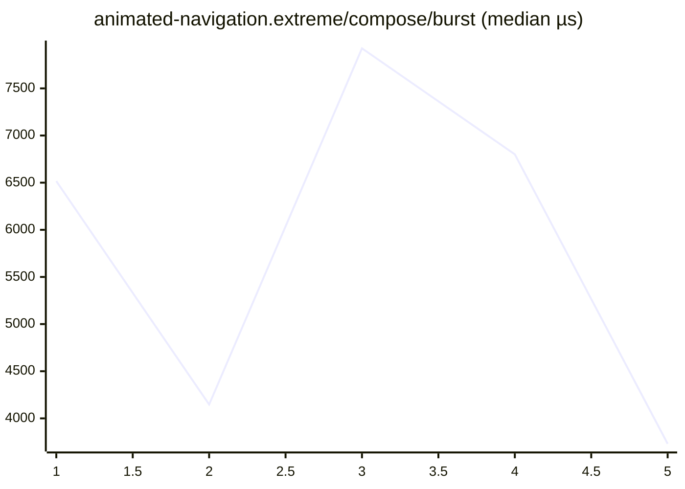

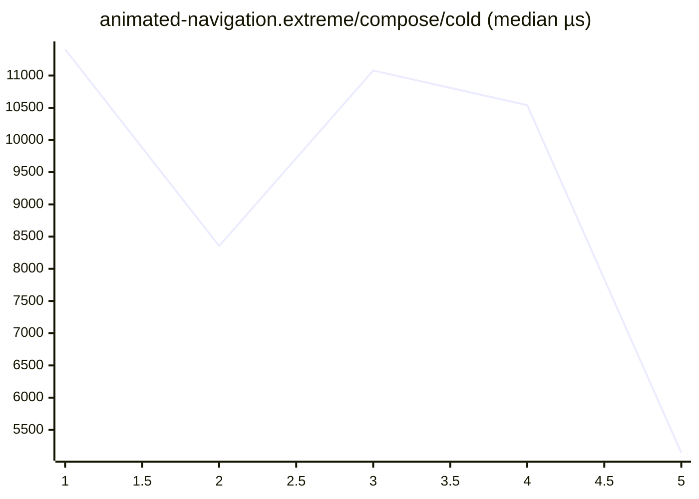


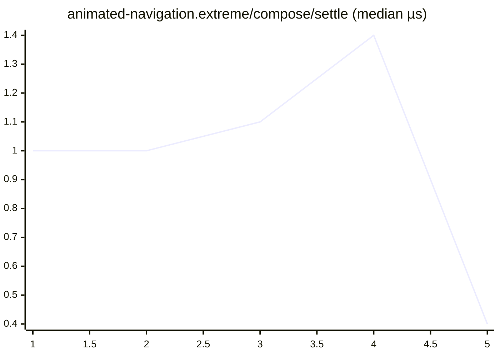


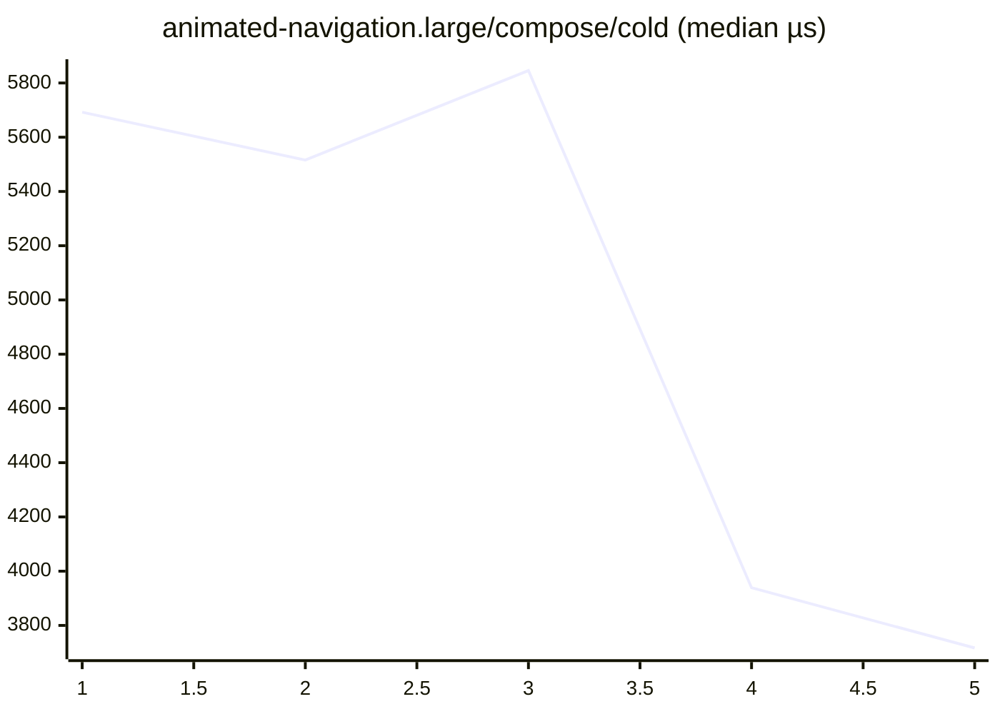

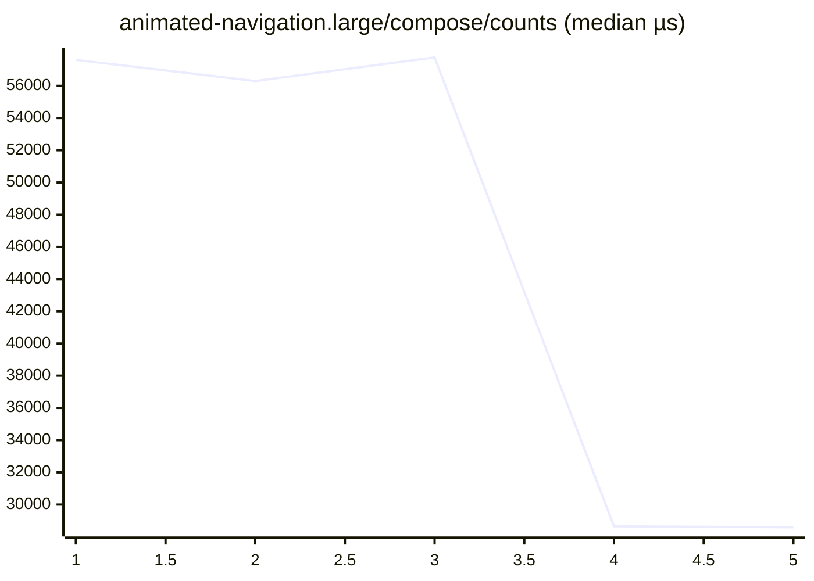

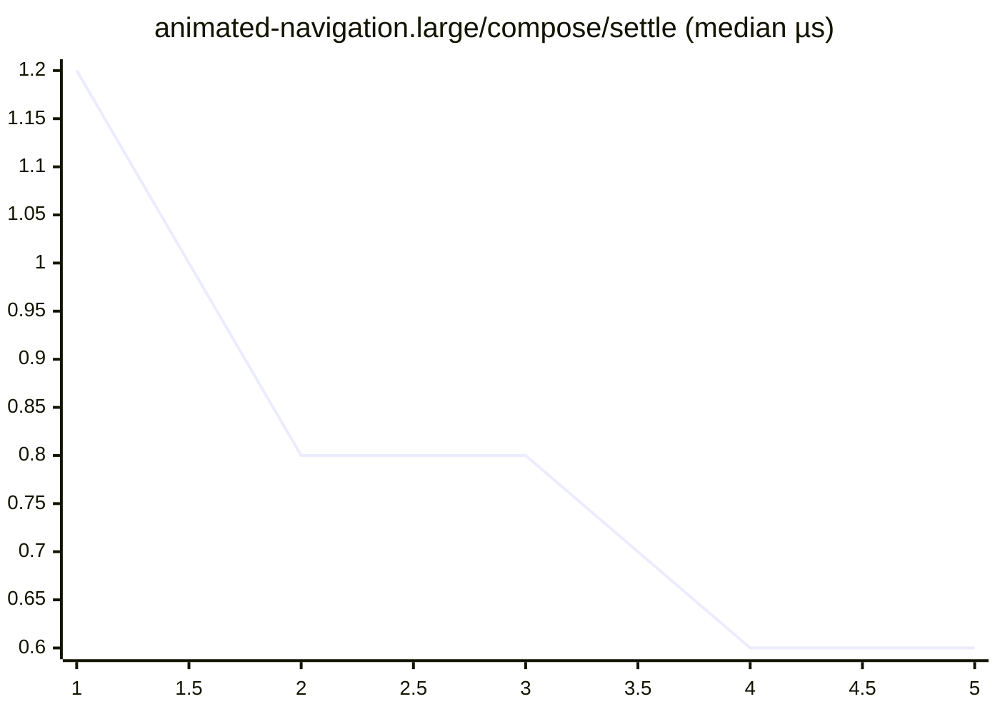

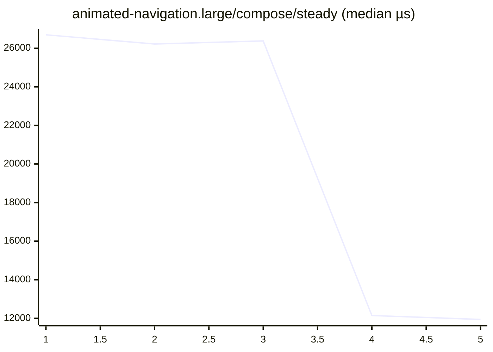

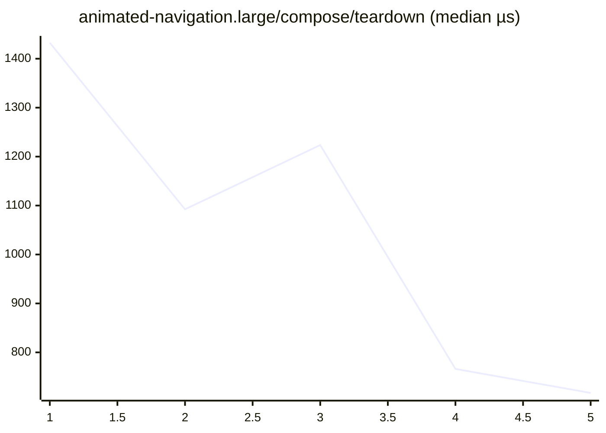

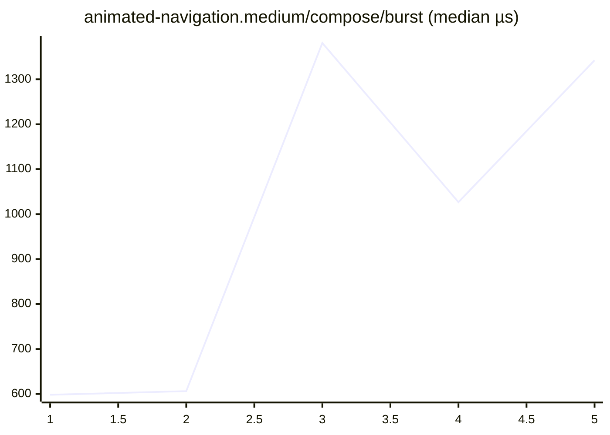

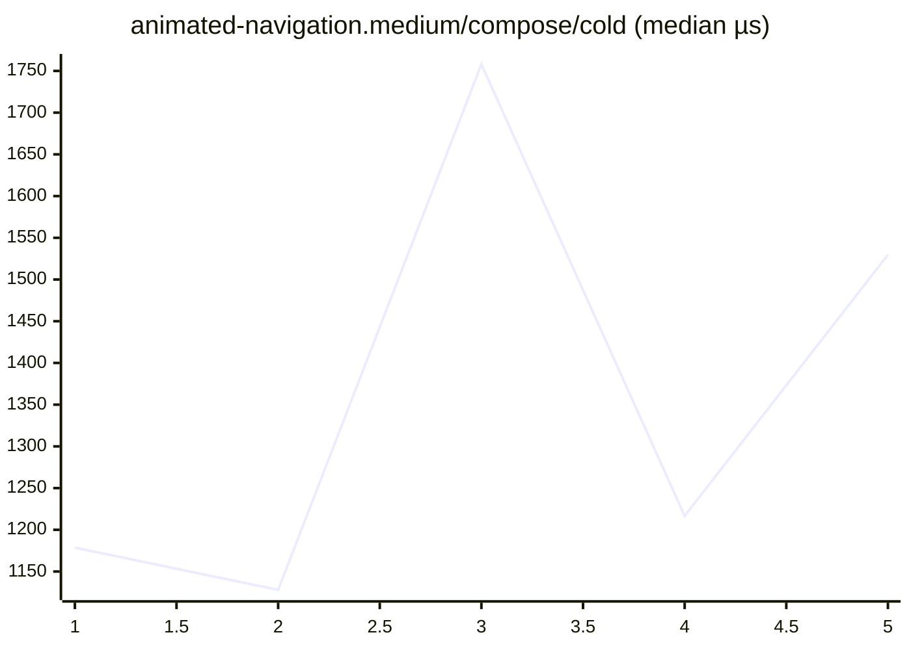


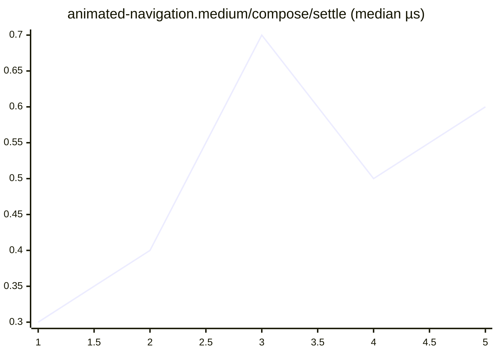

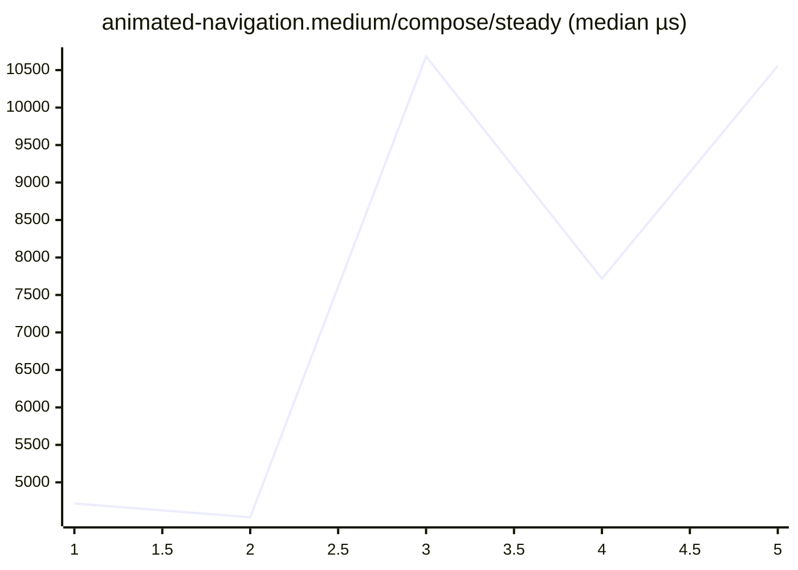

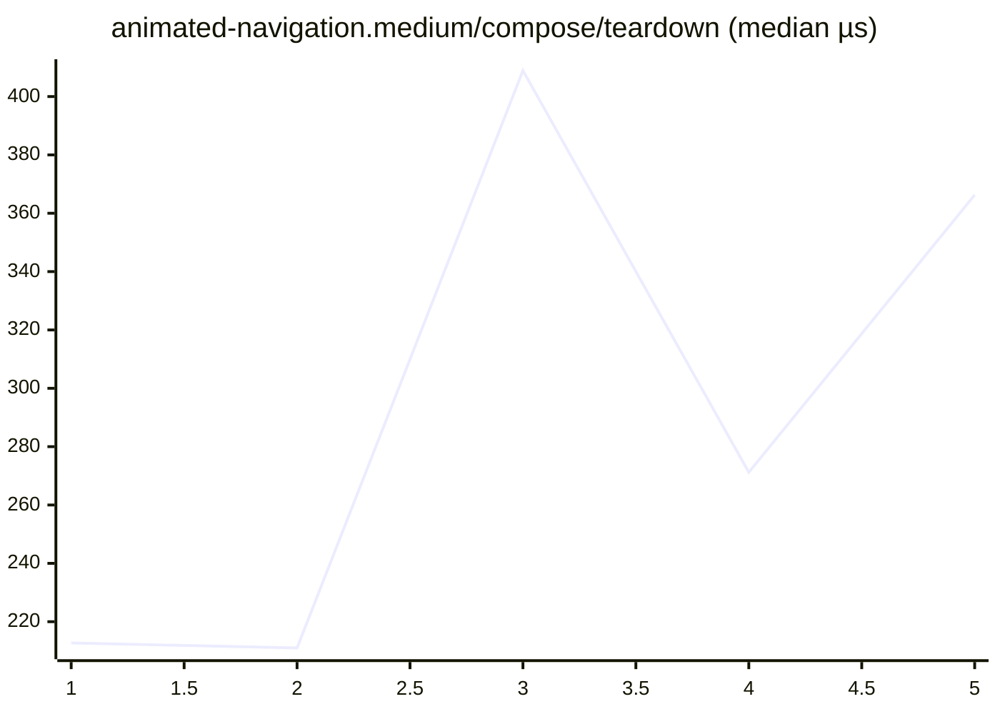

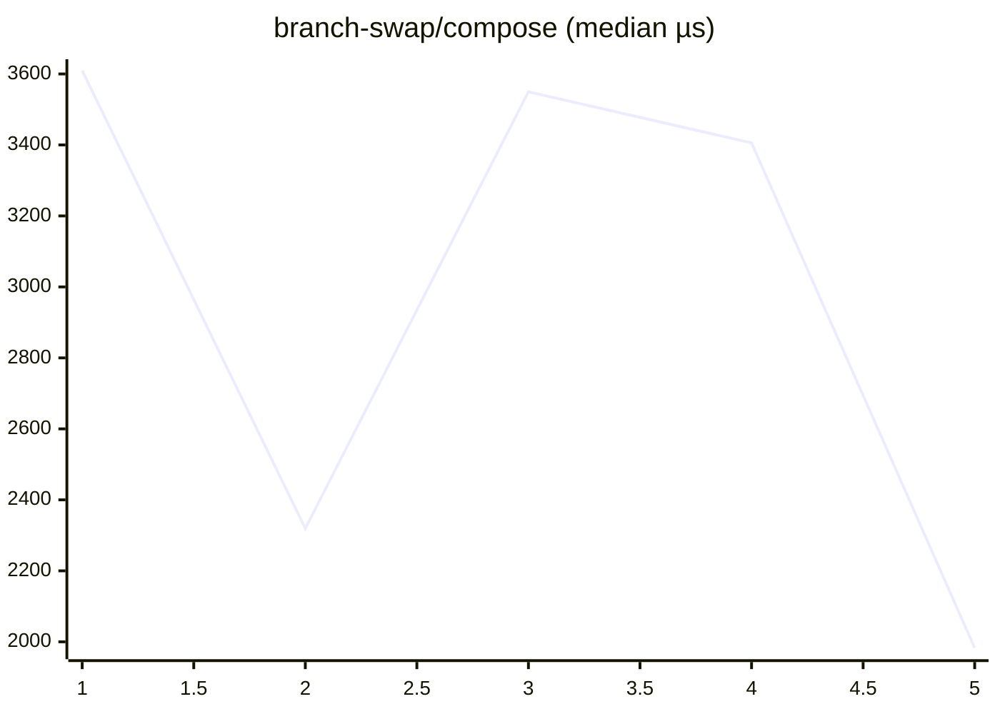

```mermaid
xychart-beta
    title "cold-mount-100/compose (median µs)"
    x-axis 1 --> 5
    line [592.6, 519.9, 885.4, 445.1, 390.3]
```

```mermaid
xychart-beta
    title "cold-mount-1000/compose (median µs)"
    x-axis 1 --> 5
    line [8085.8, 5389.9, 8549.6, 6933.2, 5008.1]
```

```mermaid
xychart-beta
    title "cold-mount-10000/compose (median µs)"
    x-axis 1 --> 5
    line [73945.7, 98256.1, 94238.7, 59096.4, 91513.5]
```

```mermaid
xychart-beta
    title "data-grid.extreme/compose/burst (median µs)"
    x-axis 1 --> 5
    line [572777.3, 535083.2, 832744.6, 637093.8, 901025.5]
```

```mermaid
xychart-beta
    title "data-grid.extreme/compose/cold (median µs)"
    x-axis 1 --> 5
    line [350893.5, 328646.9, 515839.7, 377498.6, 538166.5]
```

```mermaid
xychart-beta
    title "data-grid.extreme/compose/counts (median µs)"
    x-axis 1 --> 5
    line [961903.0, 895177.9, 1510853.2, 1085251.1, 1502399.1]
```

```mermaid
xychart-beta
    title "data-grid.extreme/compose/settle (median µs)"
    x-axis 1 --> 5
    line [2.8, 2.4, 2.2, 2.6, 2.1]
```

```mermaid
xychart-beta
    title "data-grid.extreme/compose/steady (median µs)"
    x-axis 1 --> 5
    line [12594.0, 11681.8, 22844.9, 17958.7, 23673.8]
```

```mermaid
xychart-beta
    title "data-grid.extreme/compose/teardown (median µs)"
    x-axis 1 --> 5
    line [1086.6, 1137.9, 1208.9, 1019.3, 1268.8]
```

```mermaid
xychart-beta
    title "data-grid.large/compose/burst (median µs)"
    x-axis 1 --> 5
    line [140083.3, 135962.2, 137048.1, 79047.3, 75260.8]
```

```mermaid
xychart-beta
    title "data-grid.large/compose/cold (median µs)"
    x-axis 1 --> 5
    line [80791.9, 79866.7, 78358.1, 46545.2, 43756.7]
```

```mermaid
xychart-beta
    title "data-grid.large/compose/counts (median µs)"
    x-axis 1 --> 5
    line [269572.2, 259528.8, 247425.1, 134287.8, 131710.6]
```

```mermaid
xychart-beta
    title "data-grid.large/compose/settle (median µs)"
    x-axis 1 --> 5
    line [2.0, 2.0, 1.8, 1.2, 2.0]
```

```mermaid
xychart-beta
    title "data-grid.large/compose/steady (median µs)"
    x-axis 1 --> 5
    line [17382.0, 15842.8, 15303.1, 9007.1, 8005.9]
```

```mermaid
xychart-beta
    title "data-grid.large/compose/teardown (median µs)"
    x-axis 1 --> 5
    line [517.4, 507.1, 530.1, 308.6, 332.9]
```

```mermaid
xychart-beta
    title "data-grid.medium/compose/burst (median µs)"
    x-axis 1 --> 5
    line [49689.5, 40264.0, 63124.3, 54341.9, 32137.1]
```

```mermaid
xychart-beta
    title "data-grid.medium/compose/cold (median µs)"
    x-axis 1 --> 5
    line [28216.2, 22726.8, 35966.3, 30152.5, 18330.7]
```

```mermaid
xychart-beta
    title "data-grid.medium/compose/counts (median µs)"
    x-axis 1 --> 5
    line [101676.4, 85010.8, 128707.0, 106187.2, 62031.4]
```

```mermaid
xychart-beta
    title "data-grid.medium/compose/settle (median µs)"
    x-axis 1 --> 5
    line [2.2, 2.3, 1.8, 2.4, 0.6]
```

```mermaid
xychart-beta
    title "data-grid.medium/compose/steady (median µs)"
    x-axis 1 --> 5
    line [12139.2, 8725.2, 12812.2, 11984.4, 6457.6]
```

```mermaid
xychart-beta
    title "data-grid.medium/compose/teardown (median µs)"
    x-axis 1 --> 5
    line [242.3, 222.0, 291.3, 267.8, 145.7]
```

```mermaid
xychart-beta
    title "dense-dashboard.extreme/compose/burst (median µs)"
    x-axis 1 --> 5
    line [8748.3, 13808.9, 14242.7, 14836.6, 15612.8]
```

```mermaid
xychart-beta
    title "dense-dashboard.extreme/compose/cold (median µs)"
    x-axis 1 --> 5
    line [306.9, 503.4, 495.3, 587.1, 524.3]
```

```mermaid
xychart-beta
    title "dense-dashboard.extreme/compose/counts (median µs)"
    x-axis 1 --> 5
    line [12107.6, 25337.6, 22769.2, 21520.0, 21897.1]
```

```mermaid
xychart-beta
    title "dense-dashboard.extreme/compose/settle (median µs)"
    x-axis 1 --> 5
    line [0.6, 1.1, 1.0, 0.8, 0.9]
```

```mermaid
xychart-beta
    title "dense-dashboard.extreme/compose/steady (median µs)"
    x-axis 1 --> 5
    line [461.4, 853.9, 896.4, 863.9, 868.1]
```

```mermaid
xychart-beta
    title "dense-dashboard.extreme/compose/teardown (median µs)"
    x-axis 1 --> 5
    line [300.0, 528.8, 524.0, 500.2, 563.4]
```

```mermaid
xychart-beta
    title "dense-dashboard.large/compose/burst (median µs)"
    x-axis 1 --> 5
    line [7315.2, 6455.4, 7861.5, 5932.0, 3664.7]
```

```mermaid
xychart-beta
    title "dense-dashboard.large/compose/cold (median µs)"
    x-axis 1 --> 5
    line [321.9, 311.0, 312.5, 196.1, 172.6]
```

```mermaid
xychart-beta
    title "dense-dashboard.large/compose/counts (median µs)"
    x-axis 1 --> 5
    line [15457.3, 15616.4, 15030.0, 9619.3, 9006.3]
```

```mermaid
xychart-beta
    title "dense-dashboard.large/compose/settle (median µs)"
    x-axis 1 --> 5
    line [0.9, 0.8, 0.8, 0.7, 0.5]
```

```mermaid
xychart-beta
    title "dense-dashboard.large/compose/steady (median µs)"
    x-axis 1 --> 5
    line [871.8, 849.7, 860.9, 434.1, 430.1]
```

```mermaid
xychart-beta
    title "dense-dashboard.large/compose/teardown (median µs)"
    x-axis 1 --> 5
    line [255.7, 242.4, 250.0, 139.2, 128.8]
```

```mermaid
xychart-beta
    title "dense-dashboard.medium/compose/burst (median µs)"
    x-axis 1 --> 5
    line [1884.9, 1716.2, 3396.7, 2022.7, 3071.6]
```

```mermaid
xychart-beta
    title "dense-dashboard.medium/compose/cold (median µs)"
    x-axis 1 --> 5
    line [150.8, 125.0, 199.3, 164.2, 201.4]
```

```mermaid
xychart-beta
    title "dense-dashboard.medium/compose/counts (median µs)"
    x-axis 1 --> 5
    line [4488.4, 3035.8, 6218.8, 3927.1, 6262.4]
```

```mermaid
xychart-beta
    title "dense-dashboard.medium/compose/settle (median µs)"
    x-axis 1 --> 5
    line [0.6, 0.4, 0.7, 0.5, 0.7]
```

```mermaid
xychart-beta
    title "dense-dashboard.medium/compose/steady (median µs)"
    x-axis 1 --> 5
    line [451.5, 440.8, 842.9, 675.3, 830.4]
```

```mermaid
xychart-beta
    title "dense-dashboard.medium/compose/teardown (median µs)"
    x-axis 1 --> 5
    line [71.1, 68.2, 109.1, 88.9, 111.5]
```

```mermaid
xychart-beta
    title "entities-identity-churn-10.extreme/compose/burst (median µs)"
    x-axis 1 --> 5
    line [36450.3, 44418.2, 46637.6, 27103.8, 44981.1]
```

```mermaid
xychart-beta
    title "entities-identity-churn-10.extreme/compose/cold (median µs)"
    x-axis 1 --> 5
    line [22317.0, 30608.9, 30755.4, 23786.9, 40570.4]
```

```mermaid
xychart-beta
    title "entities-identity-churn-10.extreme/compose/counts (median µs)"
    x-axis 1 --> 5
    line [157183.8, 226408.0, 207640.3, 143081.0, 226763.2]
```

```mermaid
xychart-beta
    title "entities-identity-churn-10.extreme/compose/settle (median µs)"
    x-axis 1 --> 5
    line [1.5, 2.2, 2.0, 1.5, 2.5]
```

```mermaid
xychart-beta
    title "entities-identity-churn-10.extreme/compose/steady (median µs)"
    x-axis 1 --> 5
    line [38679.7, 58936.7, 52064.1, 26669.0, 61811.9]
```

```mermaid
xychart-beta
    title "entities-identity-churn-10.extreme/compose/teardown (median µs)"
    x-axis 1 --> 5
    line [870.1, 1178.4, 1115.4, 774.0, 1244.2]
```

```mermaid
xychart-beta
    title "entities-identity-churn-10.large/compose/burst (median µs)"
    x-axis 1 --> 5
    line [13822.3, 12671.8, 13643.0, 12953.8, 6143.0]
```

```mermaid
xychart-beta
    title "entities-identity-churn-10.large/compose/cold (median µs)"
    x-axis 1 --> 5
    line [8768.9, 8903.6, 12727.0, 12419.1, 6935.5]
```

```mermaid
xychart-beta
    title "entities-identity-churn-10.large/compose/counts (median µs)"
    x-axis 1 --> 5
    line [56991.3, 49197.8, 64112.9, 60677.1, 28433.4]
```

```mermaid
xychart-beta
    title "entities-identity-churn-10.large/compose/settle (median µs)"
    x-axis 1 --> 5
    line [2.0, 2.2, 1.6, 1.9, 0.7]
```

```mermaid
xychart-beta
    title "entities-identity-churn-10.large/compose/steady (median µs)"
    x-axis 1 --> 5
    line [16083.5, 12191.6, 17784.2, 14312.6, 8120.2]
```

```mermaid
xychart-beta
    title "entities-identity-churn-10.large/compose/teardown (median µs)"
    x-axis 1 --> 5
    line [346.1, 297.1, 375.4, 338.9, 182.0]
```

```mermaid
xychart-beta
    title "entities-identity-churn-10.medium/compose/burst (median µs)"
    x-axis 1 --> 5
    line [4810.6, 5385.1, 7593.1, 5112.8, 6878.8]
```

```mermaid
xychart-beta
    title "entities-identity-churn-10.medium/compose/cold (median µs)"
    x-axis 1 --> 5
    line [3510.0, 3688.3, 5372.0, 3383.4, 4891.2]
```

```mermaid
xychart-beta
    title "entities-identity-churn-10.medium/compose/counts (median µs)"
    x-axis 1 --> 5
    line [22176.2, 21779.2, 33203.4, 22936.2, 34013.7]
```

```mermaid
xychart-beta
    title "entities-identity-churn-10.medium/compose/settle (median µs)"
    x-axis 1 --> 5
    line [0.9, 1.3, 1.1, 0.9, 1.2]
```

```mermaid
xychart-beta
    title "entities-identity-churn-10.medium/compose/steady (median µs)"
    x-axis 1 --> 5
    line [5091.1, 4800.2, 8300.0, 5909.2, 8141.7]
```

```mermaid
xychart-beta
    title "entities-identity-churn-10.medium/compose/teardown (median µs)"
    x-axis 1 --> 5
    line [138.2, 141.4, 189.4, 143.6, 208.6]
```

```mermaid
xychart-beta
    title "entities-identity-churn-50.extreme/compose/burst (median µs)"
    x-axis 1 --> 5
    line [37375.3, 42100.8, 41076.4, 43172.5, 28018.8]
```

```mermaid
xychart-beta
    title "entities-identity-churn-50.extreme/compose/cold (median µs)"
    x-axis 1 --> 5
    line [28909.8, 26506.8, 29632.4, 23700.6, 16677.6]
```

```mermaid
xychart-beta
    title "entities-identity-churn-50.extreme/compose/counts (median µs)"
    x-axis 1 --> 5
    line [312089.2, 264728.7, 287119.4, 313931.9, 170730.7]
```

```mermaid
xychart-beta
    title "entities-identity-churn-50.extreme/compose/settle (median µs)"
    x-axis 1 --> 5
    line [2.6, 2.4, 1.9, 2.3, 2.1]
```

```mermaid
xychart-beta
    title "entities-identity-churn-50.extreme/compose/steady (median µs)"
    x-axis 1 --> 5
    line [144362.2, 138910.8, 151388.1, 146004.0, 82765.7]
```

```mermaid
xychart-beta
    title "entities-identity-churn-50.extreme/compose/teardown (median µs)"
    x-axis 1 --> 5
    line [1011.3, 1046.8, 1153.3, 1158.5, 635.9]
```

```mermaid
xychart-beta
    title "entities-identity-churn-50.large/compose/burst (median µs)"
    x-axis 1 --> 5
    line [11392.1, 16006.5, 14237.9, 8830.8, 17379.2]
```

```mermaid
xychart-beta
    title "entities-identity-churn-50.large/compose/cold (median µs)"
    x-axis 1 --> 5
    line [10645.8, 12312.2, 10388.0, 8077.7, 10611.2]
```

```mermaid
xychart-beta
    title "entities-identity-churn-50.large/compose/counts (median µs)"
    x-axis 1 --> 5
    line [86389.6, 118638.8, 108507.3, 60853.6, 129304.7]
```

```mermaid
xychart-beta
    title "entities-identity-churn-50.large/compose/settle (median µs)"
    x-axis 1 --> 5
    line [1.5, 2.3, 1.6, 1.2, 1.9]
```

```mermaid
xychart-beta
    title "entities-identity-churn-50.large/compose/steady (median µs)"
    x-axis 1 --> 5
    line [40309.4, 56606.6, 50910.5, 29130.8, 63002.5]
```

```mermaid
xychart-beta
    title "entities-identity-churn-50.large/compose/teardown (median µs)"
    x-axis 1 --> 5
    line [312.8, 448.9, 398.2, 225.9, 469.2]
```

```mermaid
xychart-beta
    title "entities-identity-churn-50.medium/compose/burst (median µs)"
    x-axis 1 --> 5
    line [8485.7, 8733.8, 7811.5, 5053.3, 3913.2]
```

```mermaid
xychart-beta
    title "entities-identity-churn-50.medium/compose/cold (median µs)"
    x-axis 1 --> 5
    line [5123.1, 5090.8, 6479.6, 3545.3, 2939.0]
```

```mermaid
xychart-beta
    title "entities-identity-churn-50.medium/compose/counts (median µs)"
    x-axis 1 --> 5
    line [60621.5, 66177.5, 62123.7, 40694.0, 32773.8]
```

```mermaid
xychart-beta
    title "entities-identity-churn-50.medium/compose/settle (median µs)"
    x-axis 1 --> 5
    line [1.3, 1.6, 1.6, 1.3, 0.7]
```

```mermaid
xychart-beta
    title "entities-identity-churn-50.medium/compose/steady (median µs)"
    x-axis 1 --> 5
    line [22448.9, 25049.9, 23583.9, 14477.3, 11837.6]
```

```mermaid
xychart-beta
    title "entities-identity-churn-50.medium/compose/teardown (median µs)"
    x-axis 1 --> 5
    line [239.6, 252.1, 242.6, 155.2, 117.2]
```

```mermaid
xychart-beta
    title "entities-identity-churn.extreme/compose/burst (median µs)"
    x-axis 1 --> 5
    line [51119.4, 42743.7, 45181.7, 38370.3, 33338.8]
```

```mermaid
xychart-beta
    title "entities-identity-churn.extreme/compose/cold (median µs)"
    x-axis 1 --> 5
    line [31173.0, 29216.5, 29632.0, 19346.5, 15753.8]
```

```mermaid
xychart-beta
    title "entities-identity-churn.extreme/compose/counts (median µs)"
    x-axis 1 --> 5
    line [276895.4, 231546.3, 239558.4, 151482.1, 126042.6]
```

```mermaid
xychart-beta
    title "entities-identity-churn.extreme/compose/settle (median µs)"
    x-axis 1 --> 5
    line [2.3, 2.0, 2.1, 2.3, 1.7]
```

```mermaid
xychart-beta
    title "entities-identity-churn.extreme/compose/steady (median µs)"
    x-axis 1 --> 5
    line [103496.4, 98719.9, 87903.0, 60700.8, 49561.0]
```

```mermaid
xychart-beta
    title "entities-identity-churn.extreme/compose/teardown (median µs)"
    x-axis 1 --> 5
    line [1459.8, 1163.1, 1253.7, 814.1, 700.5]
```

```mermaid
xychart-beta
    title "entities-identity-churn.large/compose/burst (median µs)"
    x-axis 1 --> 5
    line [9662.4, 8486.1, 12526.7, 11002.8, 13446.7]
```

```mermaid
xychart-beta
    title "entities-identity-churn.large/compose/cold (median µs)"
    x-axis 1 --> 5
    line [7331.9, 8413.6, 11406.1, 12037.1, 13160.2]
```

```mermaid
xychart-beta
    title "entities-identity-churn.large/compose/counts (median µs)"
    x-axis 1 --> 5
    line [62489.1, 65083.5, 93016.9, 76013.1, 98085.9]
```

```mermaid
xychart-beta
    title "entities-identity-churn.large/compose/settle (median µs)"
    x-axis 1 --> 5
    line [1.6, 1.6, 1.7, 1.3, 2.0]
```

```mermaid
xychart-beta
    title "entities-identity-churn.large/compose/steady (median µs)"
    x-axis 1 --> 5
    line [17762.3, 18587.4, 28783.0, 23340.3, 29455.6]
```

```mermaid
xychart-beta
    title "entities-identity-churn.large/compose/teardown (median µs)"
    x-axis 1 --> 5
    line [221.0, 244.4, 350.0, 314.6, 386.7]
```

```mermaid
xychart-beta
    title "entities-identity-churn.medium/compose/burst (median µs)"
    x-axis 1 --> 5
    line [5597.4, 5043.1, 7507.7, 7112.6, 3457.9]
```

```mermaid
xychart-beta
    title "entities-identity-churn.medium/compose/cold (median µs)"
    x-axis 1 --> 5
    line [4098.3, 3677.5, 4917.8, 4309.4, 3034.9]
```

```mermaid
xychart-beta
    title "entities-identity-churn.medium/compose/counts (median µs)"
    x-axis 1 --> 5
    line [31911.5, 26270.5, 38265.0, 35758.5, 17029.0]
```

```mermaid
xychart-beta
    title "entities-identity-churn.medium/compose/settle (median µs)"
    x-axis 1 --> 5
    line [1.0, 1.7, 1.0, 1.9, 0.6]
```

```mermaid
xychart-beta
    title "entities-identity-churn.medium/compose/steady (median µs)"
    x-axis 1 --> 5
    line [10781.6, 9751.3, 14145.6, 11476.1, 7059.7]
```

```mermaid
xychart-beta
    title "entities-identity-churn.medium/compose/teardown (median µs)"
    x-axis 1 --> 5
    line [163.7, 158.3, 209.3, 186.8, 106.1]
```

```mermaid
xychart-beta
    title "entities-integrated.extreme/compose/burst (median µs)"
    x-axis 1 --> 5
    line [18098.0, 16855.7, 18205.9, 16320.2, 17509.3]
```

```mermaid
xychart-beta
    title "entities-integrated.extreme/compose/cold (median µs)"
    x-axis 1 --> 5
    line [102015.1, 100238.6, 110792.2, 98791.5, 86043.8]
```

```mermaid
xychart-beta
    title "entities-integrated.extreme/compose/counts (median µs)"
    x-axis 1 --> 5
    line [358907.4, 324615.1, 382570.8, 305419.8, 287951.5]
```

```mermaid
xychart-beta
    title "entities-integrated.extreme/compose/settle (median µs)"
    x-axis 1 --> 5
    line [1.8, 1.9, 2.1, 1.7, 1.7]
```

```mermaid
xychart-beta
    title "entities-integrated.extreme/compose/steady (median µs)"
    x-axis 1 --> 5
    line [90630.1, 81412.5, 95946.8, 80410.1, 73987.2]
```

```mermaid
xychart-beta
    title "entities-integrated.extreme/compose/teardown (median µs)"
    x-axis 1 --> 5
    line [52871.1, 45496.4, 55490.6, 46463.3, 40502.6]
```

```mermaid
xychart-beta
    title "entities-integrated.large/compose/burst (median µs)"
    x-axis 1 --> 5
    line [9879.6, 9266.1, 9580.3, 5350.4, 5000.3]
```

```mermaid
xychart-beta
    title "entities-integrated.large/compose/cold (median µs)"
    x-axis 1 --> 5
    line [42924.1, 40697.9, 38453.5, 27622.0, 23282.1]
```

```mermaid
xychart-beta
    title "entities-integrated.large/compose/counts (median µs)"
    x-axis 1 --> 5
    line [159260.0, 136585.0, 136418.7, 92540.6, 75726.6]
```

```mermaid
xychart-beta
    title "entities-integrated.large/compose/settle (median µs)"
    x-axis 1 --> 5
    line [2.1, 1.5, 1.6, 1.6, 1.2]
```

```mermaid
xychart-beta
    title "entities-integrated.large/compose/steady (median µs)"
    x-axis 1 --> 5
    line [56879.3, 47700.5, 50360.1, 29499.8, 25632.1]
```

```mermaid
xychart-beta
    title "entities-integrated.large/compose/teardown (median µs)"
    x-axis 1 --> 5
    line [16802.1, 13908.2, 14198.2, 10974.4, 8656.6]
```

```mermaid
xychart-beta
    title "entities-integrated.medium/compose/burst (median µs)"
    x-axis 1 --> 5
    line [4273.0, 4064.7, 6941.6, 5470.1, 7091.9]
```

```mermaid
xychart-beta
    title "entities-integrated.medium/compose/cold (median µs)"
    x-axis 1 --> 5
    line [14214.0, 12986.0, 18998.1, 20759.9, 20252.4]
```

```mermaid
xychart-beta
    title "entities-integrated.medium/compose/counts (median µs)"
    x-axis 1 --> 5
    line [60159.0, 56773.8, 91261.8, 68607.4, 94840.7]
```

```mermaid
xychart-beta
    title "entities-integrated.medium/compose/settle (median µs)"
    x-axis 1 --> 5
    line [1.9, 1.7, 1.6, 1.2, 1.4]
```

```mermaid
xychart-beta
    title "entities-integrated.medium/compose/steady (median µs)"
    x-axis 1 --> 5
    line [20781.1, 19484.3, 34314.8, 25155.4, 35931.8]
```

```mermaid
xychart-beta
    title "entities-integrated.medium/compose/teardown (median µs)"
    x-axis 1 --> 5
    line [5912.5, 5137.9, 6370.7, 5086.2, 6899.6]
```

```mermaid
xychart-beta
    title "entities-relevance-saturated.extreme/compose/burst (median µs)"
    x-axis 1 --> 5
    line [82088.2, 67803.4, 81772.9, 78539.9, 42827.9]
```

```mermaid
xychart-beta
    title "entities-relevance-saturated.extreme/compose/cold (median µs)"
    x-axis 1 --> 5
    line [23851.0, 19385.3, 27237.7, 29579.2, 16205.6]
```

```mermaid
xychart-beta
    title "entities-relevance-saturated.extreme/compose/counts (median µs)"
    x-axis 1 --> 5
    line [215972.6, 170155.4, 218067.6, 205395.8, 129067.0]
```

```mermaid
xychart-beta
    title "entities-relevance-saturated.extreme/compose/settle (median µs)"
    x-axis 1 --> 5
    line [2.5, 2.9, 2.1, 2.6, 1.9]
```

```mermaid
xychart-beta
    title "entities-relevance-saturated.extreme/compose/steady (median µs)"
    x-axis 1 --> 5
    line [46499.2, 63403.0, 50693.5, 50493.5, 26077.2]
```

```mermaid
xychart-beta
    title "entities-relevance-saturated.extreme/compose/teardown (median µs)"
    x-axis 1 --> 5
    line [13254.3, 13259.6, 13403.6, 14674.6, 8911.1]
```

```mermaid
xychart-beta
    title "entities-relevance-saturated.large/compose/burst (median µs)"
    x-axis 1 --> 5
    line [23829.2, 21410.5, 26910.9, 27013.4, 14236.6]
```

```mermaid
xychart-beta
    title "entities-relevance-saturated.large/compose/cold (median µs)"
    x-axis 1 --> 5
    line [9046.6, 8698.0, 11112.7, 11237.4, 6143.2]
```

```mermaid
xychart-beta
    title "entities-relevance-saturated.large/compose/counts (median µs)"
    x-axis 1 --> 5
    line [66263.4, 60081.6, 78201.5, 74218.9, 39404.5]
```

```mermaid
xychart-beta
    title "entities-relevance-saturated.large/compose/settle (median µs)"
    x-axis 1 --> 5
    line [2.2, 2.3, 1.7, 2.3, 1.1]
```

```mermaid
xychart-beta
    title "entities-relevance-saturated.large/compose/steady (median µs)"
    x-axis 1 --> 5
    line [15970.8, 12947.8, 17610.3, 17826.6, 11242.1]
```

```mermaid
xychart-beta
    title "entities-relevance-saturated.large/compose/teardown (median µs)"
    x-axis 1 --> 5
    line [3313.5, 2966.7, 2967.8, 3445.2, 1914.9]
```

```mermaid
xychart-beta
    title "entities-relevance-saturated.medium/compose/burst (median µs)"
    x-axis 1 --> 5
    line [10053.5, 13258.0, 10542.4, 6875.4, 13588.9]
```

```mermaid
xychart-beta
    title "entities-relevance-saturated.medium/compose/cold (median µs)"
    x-axis 1 --> 5
    line [4425.1, 5999.0, 4925.5, 3251.8, 5590.3]
```

```mermaid
xychart-beta
    title "entities-relevance-saturated.medium/compose/counts (median µs)"
    x-axis 1 --> 5
    line [26589.7, 40004.4, 35054.4, 23518.5, 43107.2]
```

```mermaid
xychart-beta
    title "entities-relevance-saturated.medium/compose/settle (median µs)"
    x-axis 1 --> 5
    line [1.0, 1.5, 1.0, 0.9, 2.0]
```

```mermaid
xychart-beta
    title "entities-relevance-saturated.medium/compose/steady (median µs)"
    x-axis 1 --> 5
    line [6593.9, 10265.5, 7799.1, 4375.5, 8267.5]
```

```mermaid
xychart-beta
    title "entities-relevance-saturated.medium/compose/teardown (median µs)"
    x-axis 1 --> 5
    line [909.1, 1375.7, 1014.9, 866.7, 1424.9]
```

```mermaid
xychart-beta
    title "entities-relevance-sweep.extreme/compose/burst (median µs)"
    x-axis 1 --> 5
    line [83025.5, 131890.1, 139155.5, 102900.1, 157933.2]
```

```mermaid
xychart-beta
    title "entities-relevance-sweep.extreme/compose/cold (median µs)"
    x-axis 1 --> 5
    line [27112.7, 32898.9, 35114.3, 19901.5, 33750.6]
```

```mermaid
xychart-beta
    title "entities-relevance-sweep.extreme/compose/counts (median µs)"
    x-axis 1 --> 5
    line [297306.3, 392730.6, 375325.7, 279449.1, 480733.4]
```

```mermaid
xychart-beta
    title "entities-relevance-sweep.extreme/compose/settle (median µs)"
    x-axis 1 --> 5
    line [1.9, 2.5, 2.5, 2.5, 2.8]
```

```mermaid
xychart-beta
    title "entities-relevance-sweep.extreme/compose/steady (median µs)"
    x-axis 1 --> 5
    line [104435.7, 129482.8, 118556.7, 87490.4, 162273.4]
```

```mermaid
xychart-beta
    title "entities-relevance-sweep.extreme/compose/teardown (median µs)"
    x-axis 1 --> 5
    line [11409.1, 14374.0, 14539.1, 12187.9, 16437.6]
```

```mermaid
xychart-beta
    title "entities-relevance-sweep.large/compose/burst (median µs)"
    x-axis 1 --> 5
    line [37687.9, 36619.3, 41760.4, 43897.0, 20442.0]
```

```mermaid
xychart-beta
    title "entities-relevance-sweep.large/compose/cold (median µs)"
    x-axis 1 --> 5
    line [9427.2, 7416.6, 10731.1, 9936.2, 7900.6]
```

```mermaid
xychart-beta
    title "entities-relevance-sweep.large/compose/counts (median µs)"
    x-axis 1 --> 5
    line [118464.0, 105642.9, 132017.4, 113098.8, 71443.8]
```

```mermaid
xychart-beta
    title "entities-relevance-sweep.large/compose/settle (median µs)"
    x-axis 1 --> 5
    line [2.0, 2.4, 1.7, 2.1, 1.2]
```

```mermaid
xychart-beta
    title "entities-relevance-sweep.large/compose/steady (median µs)"
    x-axis 1 --> 5
    line [36383.7, 29649.6, 42899.0, 36038.5, 24323.9]
```

```mermaid
xychart-beta
    title "entities-relevance-sweep.large/compose/teardown (median µs)"
    x-axis 1 --> 5
    line [3319.5, 3173.8, 3204.1, 3765.1, 2211.6]
```

```mermaid
xychart-beta
    title "entities-relevance-sweep.medium/compose/burst (median µs)"
    x-axis 1 --> 5
    line [21304.8, 17609.9, 19632.8, 19428.5, 17153.1]
```

```mermaid
xychart-beta
    title "entities-relevance-sweep.medium/compose/cold (median µs)"
    x-axis 1 --> 5
    line [5522.9, 4875.0, 6616.8, 5391.1, 4632.0]
```

```mermaid
xychart-beta
    title "entities-relevance-sweep.medium/compose/counts (median µs)"
    x-axis 1 --> 5
    line [73432.0, 63426.8, 72731.7, 66518.2, 62374.3]
```

```mermaid
xychart-beta
    title "entities-relevance-sweep.medium/compose/settle (median µs)"
    x-axis 1 --> 5
    line [1.9, 1.0, 1.3, 1.3, 1.6]
```

```mermaid
xychart-beta
    title "entities-relevance-sweep.medium/compose/steady (median µs)"
    x-axis 1 --> 5
    line [21627.0, 18049.0, 19673.0, 19997.6, 17951.3]
```

```mermaid
xychart-beta
    title "entities-relevance-sweep.medium/compose/teardown (median µs)"
    x-axis 1 --> 5
    line [1421.5, 998.7, 1251.6, 1111.8, 1133.0]
```

```mermaid
xychart-beta
    title "entity-labels-sparse.extreme/compose/burst (median µs)"
    x-axis 1 --> 5
    line [28431.3, 29661.9, 27082.8, 16711.4, 16256.2]
```

```mermaid
xychart-beta
    title "entity-labels-sparse.extreme/compose/cold (median µs)"
    x-axis 1 --> 5
    line [25491.4, 23933.9, 25087.3, 17441.6, 14649.4]
```

```mermaid
xychart-beta
    title "entity-labels-sparse.extreme/compose/counts (median µs)"
    x-axis 1 --> 5
    line [103374.1, 95880.0, 93198.2, 60028.1, 47563.7]
```

```mermaid
xychart-beta
    title "entity-labels-sparse.extreme/compose/settle (median µs)"
    x-axis 1 --> 5
    line [1.8, 1.9, 1.6, 1.8, 1.2]
```

```mermaid
xychart-beta
    title "entity-labels-sparse.extreme/compose/steady (median µs)"
    x-axis 1 --> 5
    line [4152.6, 3939.8, 3787.2, 2841.3, 2146.5]
```

```mermaid
xychart-beta
    title "entity-labels-sparse.extreme/compose/teardown (median µs)"
    x-axis 1 --> 5
    line [12752.1, 12268.9, 12210.0, 9099.8, 7657.4]
```

```mermaid
xychart-beta
    title "entity-labels-sparse.large/compose/burst (median µs)"
    x-axis 1 --> 5
    line [12559.3, 12285.7, 12193.2, 7053.5, 7719.0]
```

```mermaid
xychart-beta
    title "entity-labels-sparse.large/compose/cold (median µs)"
    x-axis 1 --> 5
    line [10065.7, 12236.3, 12145.6, 7446.2, 7340.1]
```

```mermaid
xychart-beta
    title "entity-labels-sparse.large/compose/counts (median µs)"
    x-axis 1 --> 5
    line [47228.6, 41552.7, 49545.9, 25620.0, 20398.0]
```

```mermaid
xychart-beta
    title "entity-labels-sparse.large/compose/settle (median µs)"
    x-axis 1 --> 5
    line [1.2, 1.3, 1.2, 1.2, 1.0]
```

```mermaid
xychart-beta
    title "entity-labels-sparse.large/compose/steady (median µs)"
    x-axis 1 --> 5
    line [1880.4, 1925.6, 1869.1, 1138.5, 1131.8]
```

```mermaid
xychart-beta
    title "entity-labels-sparse.large/compose/teardown (median µs)"
    x-axis 1 --> 5
    line [3848.1, 4042.8, 3927.2, 2747.9, 2759.1]
```

```mermaid
xychart-beta
    title "entity-labels-sparse.medium/compose/burst (median µs)"
    x-axis 1 --> 5
    line [2692.8, 4883.0, 4638.9, 4912.8, 5026.0]
```

```mermaid
xychart-beta
    title "entity-labels-sparse.medium/compose/cold (median µs)"
    x-axis 1 --> 5
    line [3511.6, 5344.2, 4334.1, 5274.7, 5181.4]
```

```mermaid
xychart-beta
    title "entity-labels-sparse.medium/compose/counts (median µs)"
    x-axis 1 --> 5
    line [11899.6, 20010.0, 21389.0, 22972.4, 20570.5]
```

```mermaid
xychart-beta
    title "entity-labels-sparse.medium/compose/settle (median µs)"
    x-axis 1 --> 5
    line [0.8, 0.8, 0.9, 0.8, 0.9]
```

```mermaid
xychart-beta
    title "entity-labels-sparse.medium/compose/steady (median µs)"
    x-axis 1 --> 5
    line [546.9, 864.1, 884.8, 935.5, 884.1]
```

```mermaid
xychart-beta
    title "entity-labels-sparse.medium/compose/teardown (median µs)"
    x-axis 1 --> 5
    line [793.8, 1245.8, 1305.4, 1265.7, 1223.0]
```

```mermaid
xychart-beta
    title "entity-labels.extreme/compose/burst (median µs)"
    x-axis 1 --> 5
    line [38306.7, 27292.5, 30271.6, 28243.8, 29005.1]
```

```mermaid
xychart-beta
    title "entity-labels.extreme/compose/cold (median µs)"
    x-axis 1 --> 5
    line [26392.1, 25728.0, 24789.0, 25091.7, 22204.5]
```

```mermaid
xychart-beta
    title "entity-labels.extreme/compose/counts (median µs)"
    x-axis 1 --> 5
    line [146562.2, 118482.8, 130233.0, 121188.5, 115298.7]
```

```mermaid
xychart-beta
    title "entity-labels.extreme/compose/settle (median µs)"
    x-axis 1 --> 5
    line [2.1, 1.2, 1.5, 1.9, 1.9]
```

```mermaid
xychart-beta
    title "entity-labels.extreme/compose/steady (median µs)"
    x-axis 1 --> 5
    line [35077.9, 31134.3, 31374.2, 30446.4, 26594.6]
```

```mermaid
xychart-beta
    title "entity-labels.extreme/compose/teardown (median µs)"
    x-axis 1 --> 5
    line [14166.4, 14892.9, 12081.1, 11856.0, 11411.3]
```

```mermaid
xychart-beta
    title "entity-labels.large/compose/burst (median µs)"
    x-axis 1 --> 5
    line [16371.6, 13675.4, 14796.5, 8143.5, 6921.8]
```

```mermaid
xychart-beta
    title "entity-labels.large/compose/cold (median µs)"
    x-axis 1 --> 5
    line [13125.5, 12164.0, 12241.7, 8754.9, 8206.7]
```

```mermaid
xychart-beta
    title "entity-labels.large/compose/counts (median µs)"
    x-axis 1 --> 5
    line [71347.2, 67401.3, 63961.0, 38511.1, 29591.2]
```

```mermaid
xychart-beta
    title "entity-labels.large/compose/settle (median µs)"
    x-axis 1 --> 5
    line [1.8, 1.6, 1.8, 1.2, 0.8]
```

```mermaid
xychart-beta
    title "entity-labels.large/compose/steady (median µs)"
    x-axis 1 --> 5
    line [17130.8, 15636.5, 15592.5, 6886.2, 5727.0]
```

```mermaid
xychart-beta
    title "entity-labels.large/compose/teardown (median µs)"
    x-axis 1 --> 5
    line [4985.7, 4474.5, 4408.6, 3132.6, 2490.9]
```

```mermaid
xychart-beta
    title "entity-labels.medium/compose/burst (median µs)"
    x-axis 1 --> 5
    line [5454.2, 5016.4, 5182.8, 4977.7, 4705.2]
```

```mermaid
xychart-beta
    title "entity-labels.medium/compose/cold (median µs)"
    x-axis 1 --> 5
    line [6039.1, 4145.2, 5211.5, 4920.9, 4320.8]
```

```mermaid
xychart-beta
    title "entity-labels.medium/compose/counts (median µs)"
    x-axis 1 --> 5
    line [27680.1, 23447.7, 25731.3, 23381.3, 18913.6]
```

```mermaid
xychart-beta
    title "entity-labels.medium/compose/settle (median µs)"
    x-axis 1 --> 5
    line [1.2, 0.8, 1.1, 0.8, 1.0]
```

```mermaid
xychart-beta
    title "entity-labels.medium/compose/steady (median µs)"
    x-axis 1 --> 5
    line [6474.9, 6388.6, 6421.2, 6421.9, 4371.6]
```

```mermaid
xychart-beta
    title "entity-labels.medium/compose/teardown (median µs)"
    x-axis 1 --> 5
    line [1477.1, 1273.6, 1329.9, 1262.9, 1139.0]
```

```mermaid
xychart-beta
    title "events/compose (median µs)"
    x-axis 1 --> 5
    line [10464.1, 9121.0, 11019.8, 9922.2, 6474.8]
```

```mermaid
xychart-beta
    title "inspector.extreme/compose/burst (median µs)"
    x-axis 1 --> 5
    line [7448.2, 5545.2, 8042.0, 7887.1, 4081.4]
```

```mermaid
xychart-beta
    title "inspector.extreme/compose/cold (median µs)"
    x-axis 1 --> 5
    line [18874.4, 15878.8, 20409.9, 18550.5, 11659.9]
```

```mermaid
xychart-beta
    title "inspector.extreme/compose/counts (median µs)"
    x-axis 1 --> 5
    line [34335.8, 23488.3, 37816.7, 33632.2, 18349.1]
```

```mermaid
xychart-beta
    title "inspector.extreme/compose/settle (median µs)"
    x-axis 1 --> 5
    line [1.6, 1.4, 1.2, 2.0, 0.7]
```

```mermaid
xychart-beta
    title "inspector.extreme/compose/steady (median µs)"
    x-axis 1 --> 5
    line [245.7, 207.7, 236.8, 270.8, 131.2]
```

```mermaid
xychart-beta
    title "inspector.extreme/compose/teardown (median µs)"
    x-axis 1 --> 5
    line [2590.5, 2153.7, 2312.0, 3007.8, 1361.7]
```

```mermaid
xychart-beta
    title "inspector.large/compose/burst (median µs)"
    x-axis 1 --> 5
    line [3270.5, 4234.2, 4065.4, 2059.0, 4547.1]
```

```mermaid
xychart-beta
    title "inspector.large/compose/cold (median µs)"
    x-axis 1 --> 5
    line [6003.2, 9644.5, 6469.4, 5148.0, 8219.5]
```

```mermaid
xychart-beta
    title "inspector.large/compose/counts (median µs)"
    x-axis 1 --> 5
    line [15848.8, 18252.6, 18863.7, 13882.7, 21141.3]
```

```mermaid
xychart-beta
    title "inspector.large/compose/settle (median µs)"
    x-axis 1 --> 5
    line [0.8, 1.2, 0.8, 0.7, 1.8]
```

```mermaid
xychart-beta
    title "inspector.large/compose/steady (median µs)"
    x-axis 1 --> 5
    line [184.9, 255.0, 227.5, 142.8, 294.1]
```

```mermaid
xychart-beta
    title "inspector.large/compose/teardown (median µs)"
    x-axis 1 --> 5
    line [939.1, 1289.4, 1054.6, 747.2, 1560.4]
```

```mermaid
xychart-beta
    title "inspector.medium/compose/burst (median µs)"
    x-axis 1 --> 5
    line [652.7, 1463.0, 1421.7, 1608.0, 1429.8]
```

```mermaid
xychart-beta
    title "inspector.medium/compose/cold (median µs)"
    x-axis 1 --> 5
    line [1084.4, 2117.8, 1731.0, 2819.9, 1695.4]
```

```mermaid
xychart-beta
    title "inspector.medium/compose/counts (median µs)"
    x-axis 1 --> 5
    line [2345.3, 5474.4, 4793.9, 6353.6, 4594.8]
```

```mermaid
xychart-beta
    title "inspector.medium/compose/settle (median µs)"
    x-axis 1 --> 5
    line [0.4, 0.6, 0.6, 0.7, 0.6]
```

```mermaid
xychart-beta
    title "inspector.medium/compose/steady (median µs)"
    x-axis 1 --> 5
    line [101.1, 207.3, 210.4, 235.5, 200.8]
```

```mermaid
xychart-beta
    title "inspector.medium/compose/teardown (median µs)"
    x-axis 1 --> 5
    line [183.0, 391.0, 377.6, 430.5, 364.3]
```

```mermaid
xychart-beta
    title "keyed-append/compose (median µs)"
    x-axis 1 --> 5
    line [1217.7, 1121.3, 1123.5, 616.2, 544.3]
```

```mermaid
xychart-beta
    title "keyed-insert/compose (median µs)"
    x-axis 1 --> 5
    line [1418.3, 1388.8, 2985.6, 1957.4, 2688.9]
```

```mermaid
xychart-beta
    title "keyed-prepend/compose (median µs)"
    x-axis 1 --> 5
    line [3339.2, 2323.0, 4385.8, 3245.3, 1938.3]
```

```mermaid
xychart-beta
    title "keyed-remove/compose (median µs)"
    x-axis 1 --> 5
    line [1834.7, 2550.5, 2731.1, 1302.2, 2681.1]
```

```mermaid
xychart-beta
    title "keyed-replace/compose (median µs)"
    x-axis 1 --> 5
    line [56638.2, 52082.4, 51437.5, 31895.5, 28628.9]
```

```mermaid
xychart-beta
    title "keyed-reverse/compose (median µs)"
    x-axis 1 --> 5
    line [1366.2, 1329.2, 2904.2, 2262.2, 3010.7]
```

```mermaid
xychart-beta
    title "keyed-rotate/compose (median µs)"
    x-axis 1 --> 5
    line [2837.0, 2918.3, 3001.8, 1448.0, 1299.3]
```

```mermaid
xychart-beta
    title "keyed-shuffle/compose (median µs)"
    x-axis 1 --> 5
    line [1337.6, 3134.0, 3010.8, 3078.2, 3095.3]
```

```mermaid
xychart-beta
    title "mount-cycles/compose (median µs)"
    x-axis 1 --> 5
    line [24941.5, 23043.1, 23398.1, 16185.9, 17338.0]
```

```mermaid
xychart-beta
    title "mount-dispose/compose (median µs)"
    x-axis 1 --> 5
    line [7076.9, 9579.0, 7445.0, 4609.4, 10316.6]
```

```mermaid
xychart-beta
    title "ordered-window-scroll/compose (median µs)"
    x-axis 1 --> 5
    line [412.1, 498.2, 504.6, 260.5, 499.9]
```

```mermaid
xychart-beta
    title "projection-keyed-append-500/compose (median µs)"
    x-axis 1 --> 5
    line [5754.2, 14069.9, 10109.7, 13717.9, 13328.0]
```

```mermaid
xychart-beta
    title "projection-observe-100/compose (median µs)"
    x-axis 1 --> 5
    line [1160.9, 1688.5, 1375.7, 934.9, 1415.9]
```

```mermaid
xychart-beta
    title "projection-selection-500/compose (median µs)"
    x-axis 1 --> 5
    line [1347.5, 1257.8, 1305.3, 1261.8, 1068.3]
```

```mermaid
xychart-beta
    title "scene-2d.extreme/compose/burst (median µs)"
    x-axis 1 --> 5
    line [31592.1, 26430.2, 30086.2, 22463.2, 21523.7]
```

```mermaid
xychart-beta
    title "scene-2d.extreme/compose/cold (median µs)"
    x-axis 1 --> 5
    line [11079.4, 9876.1, 11841.3, 12194.2, 9875.0]
```

```mermaid
xychart-beta
    title "scene-2d.extreme/compose/counts (median µs)"
    x-axis 1 --> 5
    line [216069.1, 186166.0, 209496.7, 210635.3, 184504.6]
```

```mermaid
xychart-beta
    title "scene-2d.extreme/compose/settle (median µs)"
    x-axis 1 --> 5
    line [2.2, 1.2, 1.5, 1.2, 1.8]
```

```mermaid
xychart-beta
    title "scene-2d.extreme/compose/steady (median µs)"
    x-axis 1 --> 5
    line [90044.4, 84419.8, 84931.4, 87195.8, 80201.7]
```

```mermaid
xychart-beta
    title "scene-2d.extreme/compose/teardown (median µs)"
    x-axis 1 --> 5
    line [1242.8, 991.8, 1179.9, 1042.6, 955.6]
```

```mermaid
xychart-beta
    title "scene-2d.large/compose/burst (median µs)"
    x-axis 1 --> 5
    line [23109.8, 30942.5, 25739.8, 16117.3, 28514.7]
```

```mermaid
xychart-beta
    title "scene-2d.large/compose/cold (median µs)"
    x-axis 1 --> 5
    line [4352.7, 6212.1, 6516.0, 3797.0, 6126.6]
```

```mermaid
xychart-beta
    title "scene-2d.large/compose/counts (median µs)"
    x-axis 1 --> 5
    line [150813.2, 189240.1, 180380.0, 102688.1, 198929.2]
```

```mermaid
xychart-beta
    title "scene-2d.large/compose/settle (median µs)"
    x-axis 1 --> 5
    line [1.3, 1.9, 1.8, 1.0, 2.6]
```

```mermaid
xychart-beta
    title "scene-2d.large/compose/steady (median µs)"
    x-axis 1 --> 5
    line [67819.6, 92259.3, 88664.7, 47707.5, 91878.3]
```

```mermaid
xychart-beta
    title "scene-2d.large/compose/teardown (median µs)"
    x-axis 1 --> 5
    line [835.3, 1495.8, 1118.6, 692.5, 1280.0]
```

```mermaid
xychart-beta
    title "scene-2d.medium/compose/burst (median µs)"
    x-axis 1 --> 5
    line [20349.9, 15428.8, 24654.7, 18400.6, 17606.8]
```

```mermaid
xychart-beta
    title "scene-2d.medium/compose/cold (median µs)"
    x-axis 1 --> 5
    line [4709.8, 4295.8, 3803.5, 4326.4, 3189.5]
```

```mermaid
xychart-beta
    title "scene-2d.medium/compose/counts (median µs)"
    x-axis 1 --> 5
    line [147623.1, 136904.9, 148677.3, 143451.4, 123739.5]
```

```mermaid
xychart-beta
    title "scene-2d.medium/compose/settle (median µs)"
    x-axis 1 --> 5
    line [2.2, 0.8, 1.4, 1.1, 1.2]
```

```mermaid
xychart-beta
    title "scene-2d.medium/compose/steady (median µs)"
    x-axis 1 --> 5
    line [69181.6, 65753.4, 65422.7, 66617.4, 56988.1]
```

```mermaid
xychart-beta
    title "scene-2d.medium/compose/teardown (median µs)"
    x-axis 1 --> 5
    line [1053.9, 734.4, 1016.7, 799.9, 697.2]
```

```mermaid
xychart-beta
    title "scene-3d/compose (median µs)"
    x-axis 1 --> 5
    line [10050.2, 7649.9, 9011.1, 8309.7, 6569.6]
```

```mermaid
xychart-beta
    title "session-cycle.extreme/compose/burst (median µs)"
    x-axis 1 --> 5
    line [111388.5, 145081.3, 133361.3, 117151.1, 134745.1]
```

```mermaid
xychart-beta
    title "session-cycle.extreme/compose/cold (median µs)"
    x-axis 1 --> 5
    line [4.4, 4.2, 4.6, 3.8, 4.3]
```

```mermaid
xychart-beta
    title "session-cycle.extreme/compose/counts (median µs)"
    x-axis 1 --> 5
    line [347844.7, 331552.2, 361578.0, 315896.8, 329766.9]
```

```mermaid
xychart-beta
    title "session-cycle.extreme/compose/settle (median µs)"
    x-axis 1 --> 5
    line [2.2, 2.2, 2.4, 2.0, 2.0]
```

```mermaid
xychart-beta
    title "session-cycle.extreme/compose/steady (median µs)"
    x-axis 1 --> 5
    line [189371.2, 170051.3, 208681.3, 177283.5, 150659.9]
```

```mermaid
xychart-beta
    title "session-cycle.extreme/compose/teardown (median µs)"
    x-axis 1 --> 5
    line [2.3, 1.9, 2.4, 2.0, 1.9]
```

```mermaid
xychart-beta
    title "session-cycle.large/compose/burst (median µs)"
    x-axis 1 --> 5
    line [55471.8, 41682.9, 47858.1, 38268.2, 43969.3]
```

```mermaid
xychart-beta
    title "session-cycle.large/compose/cold (median µs)"
    x-axis 1 --> 5
    line [4.1, 3.4, 4.0, 3.9, 3.5]
```

```mermaid
xychart-beta
    title "session-cycle.large/compose/counts (median µs)"
    x-axis 1 --> 5
    line [152922.2, 127280.8, 125332.5, 126145.5, 114593.6]
```

```mermaid
xychart-beta
    title "session-cycle.large/compose/settle (median µs)"
    x-axis 1 --> 5
    line [1.9, 1.9, 2.0, 1.9, 1.6]
```

```mermaid
xychart-beta
    title "session-cycle.large/compose/steady (median µs)"
    x-axis 1 --> 5
    line [70217.2, 67586.5, 71040.2, 71631.7, 65993.8]
```

```mermaid
xychart-beta
    title "session-cycle.large/compose/teardown (median µs)"
    x-axis 1 --> 5
    line [1.9, 1.7, 2.1, 1.7, 1.5]
```

```mermaid
xychart-beta
    title "session-cycle.medium/compose/burst (median µs)"
    x-axis 1 --> 5
    line [9419.6, 16119.8, 14877.2, 8687.9, 14987.9]
```

```mermaid
xychart-beta
    title "session-cycle.medium/compose/cold (median µs)"
    x-axis 1 --> 5
    line [2.9, 4.7, 3.3, 3.8, 4.1]
```

```mermaid
xychart-beta
    title "session-cycle.medium/compose/counts (median µs)"
    x-axis 1 --> 5
    line [32366.0, 44739.0, 39841.4, 32409.8, 45078.7]
```

```mermaid
xychart-beta
    title "session-cycle.medium/compose/settle (median µs)"
    x-axis 1 --> 5
    line [1.2, 1.5, 1.5, 1.5, 1.7]
```

```mermaid
xychart-beta
    title "session-cycle.medium/compose/steady (median µs)"
    x-axis 1 --> 5
    line [16834.7, 22422.0, 19376.8, 14924.2, 24496.6]
```

```mermaid
xychart-beta
    title "session-cycle.medium/compose/teardown (median µs)"
    x-axis 1 --> 5
    line [1.2, 1.7, 1.6, 1.9, 2.0]
```

```mermaid
xychart-beta
    title "spatial-scene.extreme/compose/burst (median µs)"
    x-axis 1 --> 5
    line [131626.4, 122408.9, 135923.1, 79047.5, 80922.8]
```

```mermaid
xychart-beta
    title "spatial-scene.extreme/compose/cold (median µs)"
    x-axis 1 --> 5
    line [11274.4, 10752.6, 11344.1, 6370.1, 6350.3]
```

```mermaid
xychart-beta
    title "spatial-scene.extreme/compose/counts (median µs)"
    x-axis 1 --> 5
    line [280294.2, 255499.9, 266526.7, 181289.9, 146193.2]
```

```mermaid
xychart-beta
    title "spatial-scene.extreme/compose/settle (median µs)"
    x-axis 1 --> 5
    line [1.7, 1.7, 2.0, 1.9, 2.2]
```

```mermaid
xychart-beta
    title "spatial-scene.extreme/compose/steady (median µs)"
    x-axis 1 --> 5
    line [54938.1, 53195.1, 53842.8, 26463.3, 28588.3]
```

```mermaid
xychart-beta
    title "spatial-scene.extreme/compose/teardown (median µs)"
    x-axis 1 --> 5
    line [4193.8, 3229.5, 4161.6, 1998.5, 2138.0]
```

```mermaid
xychart-beta
    title "spatial-scene.large/compose/burst (median µs)"
    x-axis 1 --> 5
    line [24854.0, 36908.9, 37836.4, 24036.9, 44486.3]
```

```mermaid
xychart-beta
    title "spatial-scene.large/compose/cold (median µs)"
    x-axis 1 --> 5
    line [3382.2, 4654.1, 3405.2, 2395.1, 3754.2]
```

```mermaid
xychart-beta
    title "spatial-scene.large/compose/counts (median µs)"
    x-axis 1 --> 5
    line [50109.8, 74015.2, 77275.2, 40372.0, 80626.4]
```

```mermaid
xychart-beta
    title "spatial-scene.large/compose/settle (median µs)"
    x-axis 1 --> 5
    line [1.2, 1.9, 1.6, 1.6, 2.3]
```

```mermaid
xychart-beta
    title "spatial-scene.large/compose/steady (median µs)"
    x-axis 1 --> 5
    line [12804.6, 19446.0, 19168.6, 10456.3, 19958.5]
```

```mermaid
xychart-beta
    title "spatial-scene.large/compose/teardown (median µs)"
    x-axis 1 --> 5
    line [635.6, 862.7, 813.6, 579.0, 1398.1]
```

```mermaid
xychart-beta
    title "spatial-scene.medium/compose/burst (median µs)"
    x-axis 1 --> 5
    line [7485.6, 7465.0, 13238.7, 8798.9, 12763.6]
```

```mermaid
xychart-beta
    title "spatial-scene.medium/compose/cold (median µs)"
    x-axis 1 --> 5
    line [732.5, 682.2, 1256.5, 880.4, 1341.3]
```

```mermaid
xychart-beta
    title "spatial-scene.medium/compose/counts (median µs)"
    x-axis 1 --> 5
    line [16776.7, 16094.7, 35495.1, 20724.3, 34643.5]
```

```mermaid
xychart-beta
    title "spatial-scene.medium/compose/settle (median µs)"
    x-axis 1 --> 5
    line [0.9, 0.7, 1.0, 0.8, 1.1]
```

```mermaid
xychart-beta
    title "spatial-scene.medium/compose/steady (median µs)"
    x-axis 1 --> 5
    line [4566.2, 4426.4, 9311.4, 6005.6, 9340.5]
```

```mermaid
xychart-beta
    title "spatial-scene.medium/compose/teardown (median µs)"
    x-axis 1 --> 5
    line [160.7, 145.7, 287.7, 205.3, 299.3]
```

```mermaid
xychart-beta
    title "status-panel/compose (median µs)"
    x-axis 1 --> 5
    line [594.8, 546.6, 567.0, 319.8, 265.0]
```

```mermaid
xychart-beta
    title "unwind/compose (median µs)"
    x-axis 1 --> 5
    line [4404.4, 3896.7, 3558.7, 3983.7, 4089.5]
```

```mermaid
xychart-beta
    title "update-batched/compose (median µs)"
    x-axis 1 --> 5
    line [3025.0, 2927.0, 2916.4, 3054.1, 2189.1]
```

```mermaid
xychart-beta
    title "update-fanout/compose (median µs)"
    x-axis 1 --> 5
    line [777.2, 1629.0, 1423.8, 1627.8, 1621.0]
```

```mermaid
xychart-beta
    title "update-leaf/compose (median µs)"
    x-axis 1 --> 5
    line [33.7, 23.3, 40.6, 34.7, 19.6]
```

```mermaid
xychart-beta
    title "update-repeated/compose (median µs)"
    x-axis 1 --> 5
    line [291.8, 288.2, 351.9, 292.5, 264.7]
```

```mermaid
xychart-beta
    title "virtual-filtered-list.extreme/compose/burst (median µs)"
    x-axis 1 --> 5
    line [468218.5, 855118.6, 780270.5, 834379.1, 822280.8]
```

```mermaid
xychart-beta
    title "virtual-filtered-list.extreme/compose/cold (median µs)"
    x-axis 1 --> 5
    line [303705.7, 494927.2, 485557.0, 513263.7, 523189.8]
```

```mermaid
xychart-beta
    title "virtual-filtered-list.extreme/compose/counts (median µs)"
    x-axis 1 --> 5
    line [758775.9, 1513830.2, 1273975.2, 1375818.0, 1299789.2]
```

```mermaid
xychart-beta
    title "virtual-filtered-list.extreme/compose/settle (median µs)"
    x-axis 1 --> 5
    line [2.5, 2.4, 2.6, 2.4, 2.2]
```

```mermaid
xychart-beta
    title "virtual-filtered-list.extreme/compose/steady (median µs)"
    x-axis 1 --> 5
    line [8156.9, 15826.4, 14142.7, 17395.9, 15076.2]
```

```mermaid
xychart-beta
    title "virtual-filtered-list.extreme/compose/teardown (median µs)"
    x-axis 1 --> 5
    line [337.4, 510.6, 522.8, 521.1, 540.1]
```

```mermaid
xychart-beta
    title "virtual-filtered-list.large/compose/burst (median µs)"
    x-axis 1 --> 5
    line [103439.2, 85508.3, 125691.5, 107855.0, 65857.2]
```

```mermaid
xychart-beta
    title "virtual-filtered-list.large/compose/cold (median µs)"
    x-axis 1 --> 5
    line [59355.8, 50136.7, 78271.4, 62224.0, 40375.8]
```

```mermaid
xychart-beta
    title "virtual-filtered-list.large/compose/counts (median µs)"
    x-axis 1 --> 5
    line [189934.0, 152506.8, 237753.9, 190827.8, 118574.4]
```

```mermaid
xychart-beta
    title "virtual-filtered-list.large/compose/settle (median µs)"
    x-axis 1 --> 5
    line [2.3, 2.6, 2.0, 2.3, 0.8]
```

```mermaid
xychart-beta
    title "virtual-filtered-list.large/compose/steady (median µs)"
    x-axis 1 --> 5
    line [12089.3, 9916.3, 14136.9, 10607.7, 5998.1]
```

```mermaid
xychart-beta
    title "virtual-filtered-list.large/compose/teardown (median µs)"
    x-axis 1 --> 5
    line [262.7, 240.8, 290.6, 268.4, 155.5]
```

```mermaid
xychart-beta
    title "virtual-filtered-list.medium/compose/burst (median µs)"
    x-axis 1 --> 5
    line [17844.8, 25511.5, 24629.5, 12779.6, 25017.7]
```

```mermaid
xychart-beta
    title "virtual-filtered-list.medium/compose/cold (median µs)"
    x-axis 1 --> 5
    line [9422.5, 13481.1, 12703.5, 6786.8, 13017.4]
```

```mermaid
xychart-beta
    title "virtual-filtered-list.medium/compose/counts (median µs)"
    x-axis 1 --> 5
    line [44077.6, 61203.3, 59533.4, 31373.7, 63554.6]
```

```mermaid
xychart-beta
    title "virtual-filtered-list.medium/compose/settle (median µs)"
    x-axis 1 --> 5
    line [1.0, 1.7, 1.3, 0.8, 2.0]
```

```mermaid
xychart-beta
    title "virtual-filtered-list.medium/compose/steady (median µs)"
    x-axis 1 --> 5
    line [9077.3, 12332.6, 11738.6, 6268.6, 14641.4]
```

```mermaid
xychart-beta
    title "virtual-filtered-list.medium/compose/teardown (median µs)"
    x-axis 1 --> 5
    line [139.6, 199.8, 194.4, 101.4, 199.4]
```
